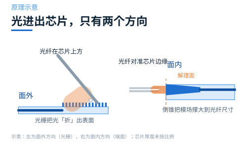
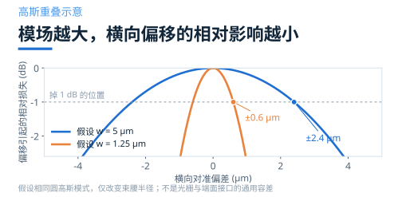
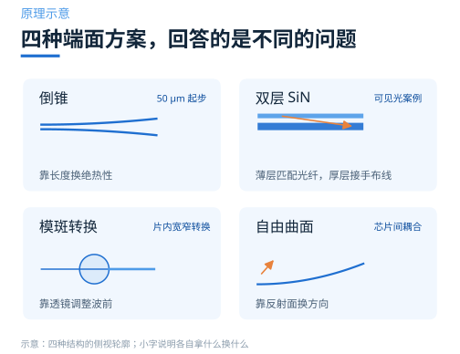
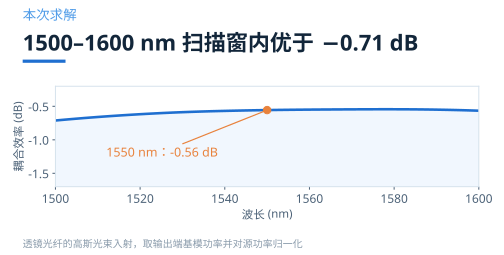
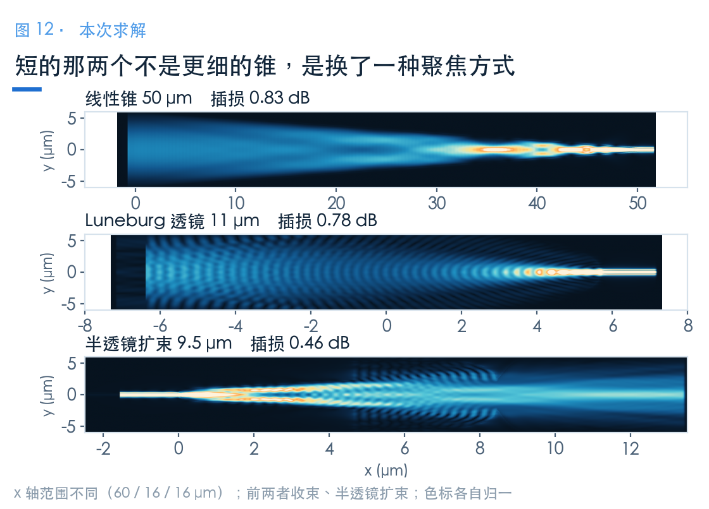

# 光怎么从芯片边缘进出？先把两种接口分清

> **待审稿**：本文处于独立 PR 审核阶段，尚未收录为正式内容。定量结论、素材来源与授权仍需指定业内审核者核查。

上一组文章讲的是光怎么在片内拐弯、交叉。但光总得有个进出芯片的地方。

这件事只有两个方向：从芯片**表面**进出，或者从芯片**边缘**进出。前者是光栅耦合器，后者是端面耦合器。两种都叫「耦合」，做的事却完全不同——一个把光「折」出表面，一个把模场「撑」到光纤尺寸。

这一篇不急着讲案例，先把地图铺开：端面这条路换来了什么，代价又是什么，以及后面四篇各自回答哪个问题。

## 01　面外与面内，差的不只是方向

光栅耦合器坐在芯片表面，靠周期结构把波导里的导模衍射到上方。它的好处很实在：光可以从芯片任何位置进出，不用解理、不用抛光，晶圆级测试可以直接在划片前做。

代价也在带宽上。衍射角随波长变化，耦合效率的峰很窄。上一组文章里三个光栅案例的 1 dB 带宽分别是 39、42、62 nm——够用，但只够用一个波段。

端面耦合器换了个思路：把光从芯片侧面直接送进波导。没有衍射，就没有那种由周期结构决定的窄带限制。

代价是机械上的。芯片通常需要光学质量的端面，光纤要对准到这个端面上。普通通信单模光纤的模场直径约 10 μm，而典型硅波导的几何宽度约 0.5 μm；几何宽度与模场直径是不同的量。

端面模式转换器要做的，是**让光纤模与片内导模相匹配**，具体扩展量需由模场计算确定。

## 02　换来的是余量，付出的是对准

一个常被忽略的差别是对准容差。

横向容差取决于接口处的模场大小、形状与失配。端面倒锥也能把端面模场扩展，因此不能只凭「光栅」或「端面」名称给出统一的微米级容差。

端面处理、对准和固定都要计入封装成本；光栅能支持晶圆级测试，也会影响整体成本。具体取舍需要结合测试与封装流程。

带宽要求宽时，端面是值得考虑的路线。可见光和 SiN 平台同样可以使用光栅；偏振依赖、模场与工艺能力都需要逐案核查。

## 03　四个案例，回答四个不同的问题

端面这一族里，学习中心有四个可用案例。它们不是四个可以互相替代的选项，而是四个不同前提下的答案。

**倒锥**是最经典的做法。把波导尖端做到 0.19 μm，让模场慢慢扩开，直到和光纤匹配。它的全部设计难点就是「慢」——锥越长越绝热，但芯片面积不答应。

**双层 SiN** 将端面匹配与片内约束分开：薄上层扩展端面模场，随后经 75 μm 重叠锥形区转移到厚下层波导。100 nm 是本例层间距，不是上下衍射相消的证据。

**模斑转换**关注片内宽窄波导之间的转换。Notebook 给出 50 μm 线性锥、11 μm Luneburg 以及 9.5 μm 半透镜，但其截面和激励方向不同，不能把全部读数作为同条件排名。

**自由曲面**使用两个介质抛物反射面进行芯片间耦合；本例的 25 μm 是焦点 y 坐标差，不能直接当成芯片间空气间隙。

## 04　这一组文章的读数，长什么样

先给一个样本，让你知道端面能做到什么程度。

倒锥用二次轮廓、50 μm 锥长，在 1550 nm 处耦合效率是 **−0.56 dB**，1500–1600 nm 扫描窗口最差约 −0.71 dB。常用 C 波段约为 1530–1565 nm。

本组还包含紧凑片内转换器：半透镜六段总长 9.5 μm。它与 50 μm 光纤倒锥的端口、截面和激励不同，长度与损耗必须连同条件阅读。

上一组三个光栅案例的峰值是 −4.20、−2.08、−2.00 dB。1.5–3.5 dB 的功率差对应约 1.41–2.24 倍；这些跨案例读数不代表端面器件普遍具有这样的收益。

它们的波段、材料、激励和端口定义不同，直接排名没有意义。后面几篇会写清每条曲线各自的边界。

底反射光栅、层间模式转移和片内透镜使用了不同的结构自由度。半透镜的 −0.46 dB 是总通量传输，仅取 TE0 为 −1.45 dB；两者都不能直接替代光纤接口效率。

## 05　读这一组，先记住三件事

**第一，看波段。** 这一组的四个案例分别在 1550 nm（SOI）、400–640 nm（SiN）、1500–1600 nm（低对比度）和 650–1050 nm 工作。跨波段比数字，等于比不同物理起点。

**第二，看激励。** 有的案例用高斯光束模拟透镜光纤，有的显式建模光纤模，有的直接从波导端激励。三种口径下的「耦合效率」不是同一个量。

**第三，看维度与网格。** 双层 SiN 的模型有 13.5 亿个网格点，倒锥只有 3000 万。分辨率不同，能分辨的最小损耗也不同。

记住这三条，后面每篇的读数才不会被误读成排名。

### 配套案例

- [Inverse taper edge coupler](https://www.lingcompute.com/photon/learning-center/examples/notebooks/EdgeCoupler)
- [Bi-layer SiN edge coupler](https://www.lingcompute.com/photon/learning-center/examples/notebooks/BilayerSiNEdgeCoupler)
- [Waveguide mode size converters](https://www.lingcompute.com/photon/learning-center/examples/notebooks/WaveguideSizeConverter)
- [Free-form chip-to-chip coupler](https://www.lingcompute.com/photon/learning-center/examples/notebooks/FreeFormCoupler)

更多案例见[灵算光子学习中心](https://www.lingcompute.com/photon/learning-center/example-library)，国内产品入口为 [Tidy3D 平台](https://tidy3d.fangzhen.cloud/)。本次未验证国内注册、Notebook 导入与浏览器执行流程，请以平台当前指引为准。

本文数值来自本地实际求解。各案例的波段、材料、激励与监视器口径不同，不构成同条件下的性能排名。
