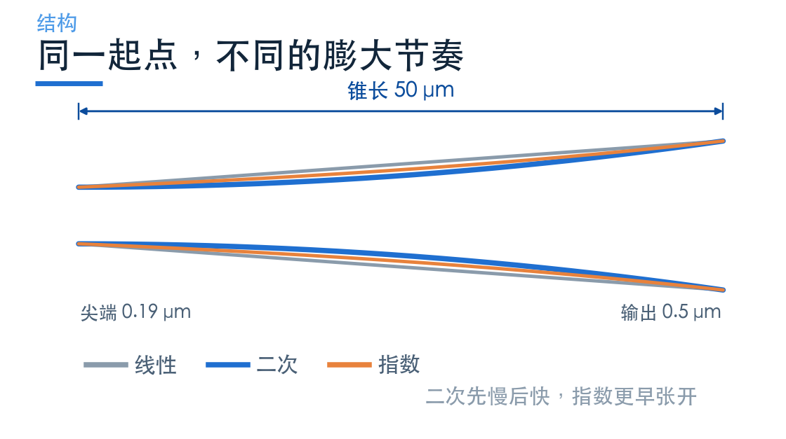
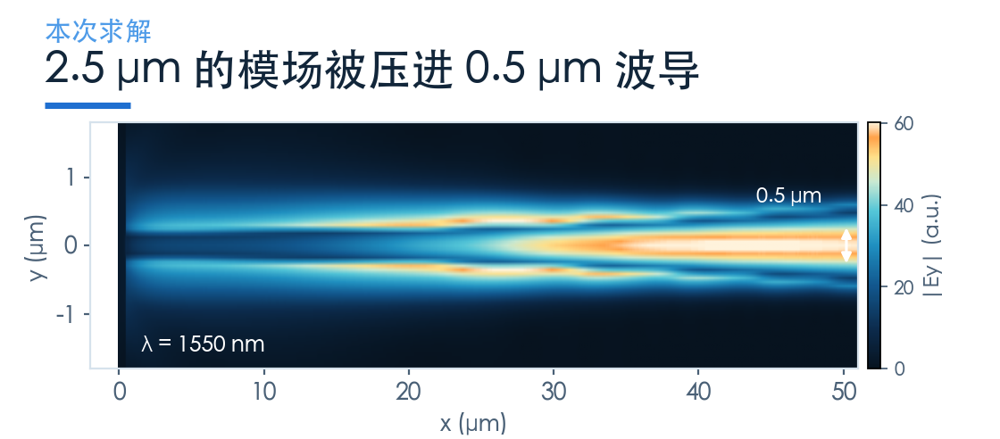
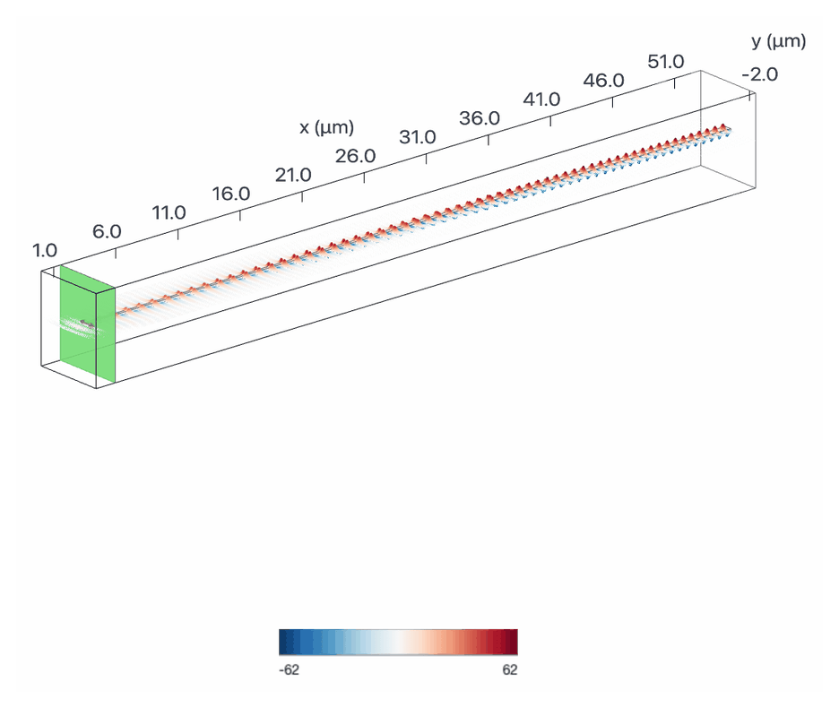
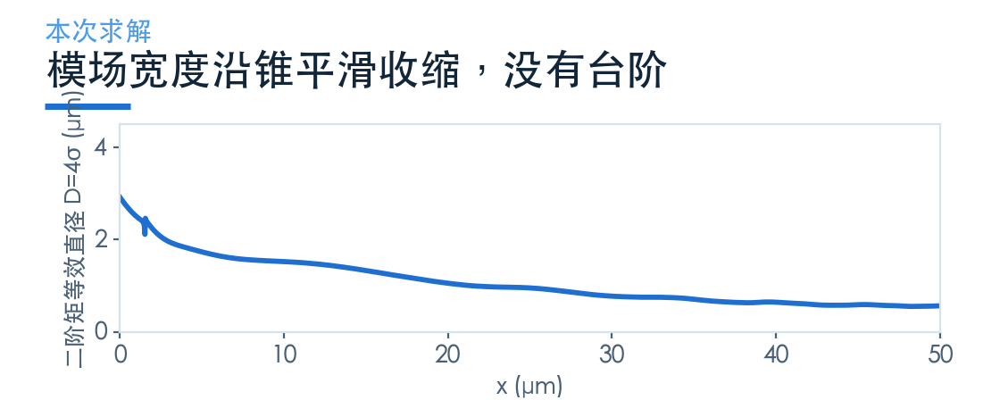
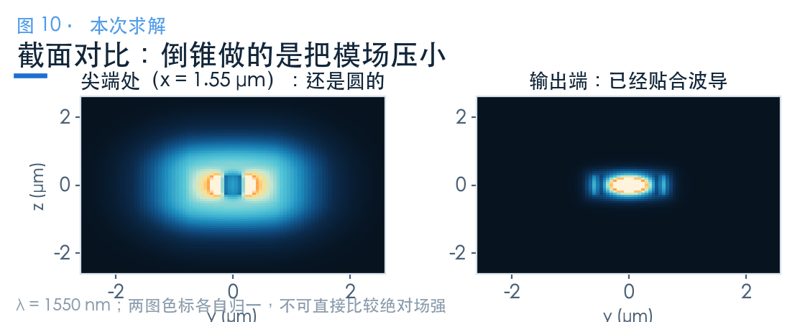
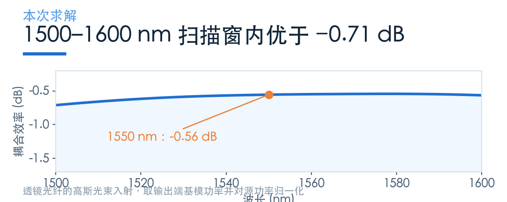

# 同样 50 μm，为什么二次轮廓更划算？

> **待审稿**：本文处于独立 PR 审核阶段，尚未收录为正式内容。定量结论、素材来源与授权仍需指定业内审核者核查。

普通通信光纤的模场直径约 10 μm，典型硅波导的几何宽度约 0.5 μm。两个量定义不同，但提示接口需要模场转换；本案例实际用的是直径 2.5 μm 的高斯入射光斑。

倒锥（inverse taper）就是最常见的那段翻译：把波导尖端磨到零点几微米，让模场不得不扩展开，慢慢膨胀到光纤尺寸。

听起来简单，做起来全在细节里。同样是 50 μm 长、同样的尖端宽度，换一条轮廓曲线，损耗就能差出可观的量级——原 Notebook 的扫描里，二次轮廓是三种写法里最低的那条。这一篇拆开看：差在哪，以及这一点差别值不值得为它多花面积。

## 01　倒锥做的事，是「不让模式突变」

光在波导里传播时，横向模场形状由波导的截面决定。截面突然变化，模式就要重新分布——这个过程会激发高阶模、向包层辐射，形成损耗。

倒锥的思路是反的：让截面**连续**变化，而且变化得足够慢，慢到模式在每一步都能「跟上」。这个条件叫绝热。

绝热性取决于局部截面变化率与相关模式传播常数差；不能只用一个固定拍长判定。需要检查目标模式传输及辐射、反射和高阶模激发。

所以倒锥的第一个设计变量是长度，第二个才是轮廓。而这次要说的是：**轮廓其实比长度更划算**。

## 02　三种轮廓，差在「哪一段慢」

同样从 0.19 μm 的尖端出发，到 0.5 μm 结束，中间那段宽度怎么涨，有三种常见的写法。

线性是均匀涨；二次是开始慢、后面快；指数是更早张开。

差别看着很小，但对绝热条件影响很大。模场在尖端附近最需要「慢」——那里的模式最不束缚，稍微一急就辐射出去。二次和指数都把「慢」放在了前半段，所以在同样长度下损耗更低。

官方 Notebook 做了 3 种轮廓 × 3 种长度（25、50、100 μm）的扫描，结论是二次轮廓在 50 μm 就达到 0.6 dB 以内，而线性要长得多才能追上。这个扫描是原文已经给出的结论，本次没有重跑。

本次只复现原文选定的那一个点：**二次轮廓、50 μm**。

## 03　光是怎么被「挤」进去的

场图最能说明问题。

左端模场是圆的，直径约 2.5 μm。往右走，模场被逐渐收窄，到输出端已经基本贴合波导的截面。整个过程没有明显的辐射条纹——这就是绝热做对了的样子。

再看两个截面。

把场图沿传播方向逐列积分，可以直接量出模场宽度的变化。

曲线显示模场沿锥收缩，但单个设计的宽度变化不能独立证明哪种轮廓损耗最低。轮廓优劣仍需相同源、端口及收敛条件下的传输比较。

尖端处的模场几乎是圆的，说明它还没「意识到」波导的存在；输出端则已经被压成与 0.5 μm 波导匹配的形状。倒锥做的就是把左图变成右图。

## 04　这一次的读数

同一套源、网格与监视器口径下，二次轮廓 50 μm 的结果是：

- 1550 nm 处 **−0.56 dB**
- 峰值 **−0.54 dB @ 1579 nm**
- 1500–1600 nm 全band 最差 **−0.71 dB**

本次峰值在 1579 nm。峰位由模场匹配与器件传输共同决定；要移到其他波长，需要扫描尖端宽度、轮廓等参数，不能由这一条谱给出固定的修改量。

## 05　那 0.19 μm 的尖端，工艺上意味着什么

这是这一族器件最现实的问题。

0.19 μm 是 190 nm。能否稳定制造，要核查产线的最小线宽、刻蚀偏差、侧壁粗糙度和端面工艺，不能只凭光刻类型判断。

而且倒锥是**尖端朝外**的结构：最细的那一头正好在解理面上。解理、抛光、镀增透膜，每一步都可能把尖端弄钝。钝一点，模场就多散射一点。

尖端尺寸需要在模场匹配与加工能力之间取舍。具体保留多少线宽余量，要通过尺寸扫描和制造统计确定。

氧化层厚度可能改变弱约束尖端模与衬底之间的耦合，侧壁粗糙度也可能引入散射。本次理想侧壁模型没有扫描这两类误差，不能据此给出敏感度排序。

−0.56 dB 是本次理想模型的读数；成品损耗和工艺余量需要实测或容差分析，本文不指定固定的 dB 余量。

## 06　什么时候选它

选倒锥的场合很明确：

- 波段在通信窗口，SOI 平台，工艺线有 DUV
- 能接受 50 μm 以上的长度（相比后面的透镜方案，这个长度不小）
- 目标偏振的模场匹配经过验证；偏振无关需求须分别检查 TE/TM

面积紧张或使用其他波段时，可以评估后面的结构；本次没有给出跨平台的最优性结论。

### 配套案例

[Inverse taper edge coupler](https://www.lingcompute.com/photon/learning-center/examples/notebooks/EdgeCoupler)

更多案例见[灵算光子学习中心](https://www.lingcompute.com/photon/learning-center/example-library)，国内产品入口为 [Tidy3D 平台](https://tidy3d.fangzhen.cloud/)。本次未验证国内注册、Notebook 导入与浏览器执行流程，请以平台当前指引为准。

本次只复现二次轮廓、50 μm 一个点；三种轮廓 × 三种长度的对比是原 Notebook 已给出的结论，未在本次重跑。数值为本地求解结果，工艺可行性需按实际产线核查。
