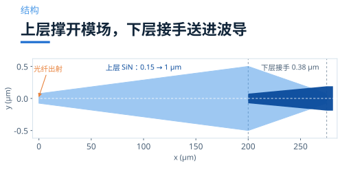
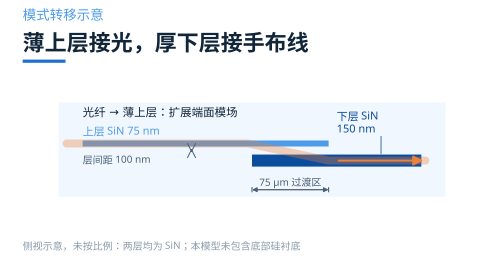
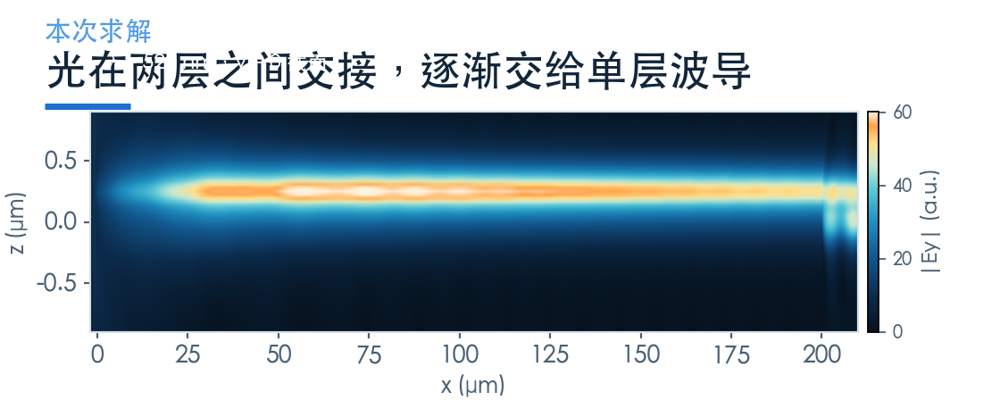
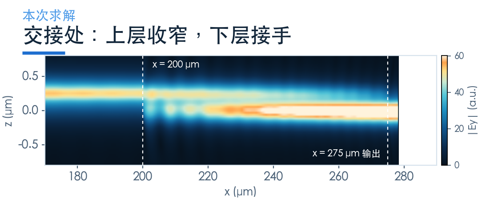
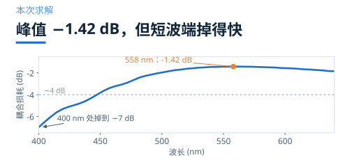

# 双层 SiN 端面耦合：薄层接光，厚层布线

> **待审稿**：本文处于独立 PR 审核阶段，尚未收录为正式内容。定量结论、素材来源与授权仍需指定业内审核者核查。

前面两篇关注 1550 nm 的硅光接口。这一篇转向 400–640 nm 的 SiN：怎样同时满足端面的大模场匹配与片内布线的强约束？

换到可见光，规则全变了。

本例将薄上层与厚下层分工：薄层用于端面模场扩展，厚层用于片内约束。材料折射率、截面与目标光纤模共同决定设计，不能由折射率差直接判定所有单层方案不可用。

官方案例给的解法是：**叠两层，中间隔 100 nm**。

## 01　低对比度带来的两难

先理解困难在哪。

端面需要较大的模场以匹配光纤，片内布线则希望约束较强，以控制弯曲和串扰。材料和截面共同决定模式束缚。

这对端面耦合意味着两件事。

一是**端面匹配**。薄上层配合窄尖端，使模式延伸到包层，接近光纤模场。

二是**后续布线**。较厚的下层提供更强约束，通过重叠锥形区接手输入模式。

这是一种把两项需求分开实现的路线，不是双层结构唯一可行的证明。

## 02　两层的分工：一层接光，一层接手布线

这个双层结构的几何是这样的：

- 上层 SiN 厚 0.075 μm，从 0.15 μm 的尖端张开到 1 μm，负责把光纤的模场接住并撑大
- 下层 SiN 厚 0.15 μm，在 x = 200 μm 处接手，再收窄到 0.38 μm 的波导
- 两层间隔 0.1 μm
- 锥长 200 μm，之后接一段 75 μm 的过渡区

上层较薄，有利于端面模场扩展；下层较厚，用于把模式带入约束更强的片内波导。

两层靠近时，局部模式随截面变化重新分布；在 75 μm 过渡区，上层逐步退出、下层逐步接手。100 nm 间距影响层间模式耦合，本例没有用上下衍射相消来工作。

这与上一组的 SiN/Si 底反射光栅机制不同。本模型没有底部硅衬底，也没有可支持「衬底泄漏降到某百分比」的测量。

## 03　代价：两层都要对准

这个方案最现实的代价是工艺。

两层 SiN 需要层间对准与间隔控制。误差可能改变局部模式及转移效率，但本次没有扫描制造偏差，不能给出允许误差或泄漏比例。

换句话说：**它把光学上的宽容，换成了工艺上的严格**。

本例增加一层来分配光学功能，同时增加制造步骤；与倒锥的性能差别不能跨波段直接比较。

## 04　这一次的读数

本次复现 Notebook 给定的那一个设计：200 μm 锥长、75 μm 过渡、层间距 100 nm，波段 400–640 nm，51 个频点。

激励方式与倒锥不同：这里显式建模了光纤（芯半径 1.5 μm、NA 0.12），从光纤端面直接注入模式，而不是用高斯光束近似。这个差别会影响绝对读数——显式光纤模更接近真实封装，但也把光纤本身的失配算了进来。

模型规模是本期最大的：**13.5 亿个网格点**，仿真时长 3 ps。

本次已有任务仅记录了 y = 0 的 XZ 场截面，没有 XY 场监视器，因此这一篇保留静态场图，不提供 XY 动画。

结果是：

- 峰值 **−1.42 dB @ 558 nm**
- 520 nm：−1.62 dB
- 600 nm：−1.57 dB
- 640 nm：−1.85 dB
- 450 nm：−3.95 dB
- 400 nm：**−6.99 dB**

把 x = 170–290 μm 这一段放大，能看到两层是怎么交接的。

交接区间约 75 μm。这个长度不是随便定的：太短，模场来不及从「1 μm 宽的上层」过渡到「0.38 μm 宽的下层」，中间会有一段模场失配；太长，器件面积继续涨。原文选 75 μm，是这两者之间的折中。

这里必须说清一件事：原文的表述是 400–640 nm 内耦合损耗不超过 4 dB，而本次在 400 nm 处得到 −7 dB，只有 450 nm 之后才进入 −4 dB 以内。

差异原因尚未分离。网格、材料与模式求解设置等都需要核查；`min_steps_per_wvl=12` 和参考波长 520 nm 本身不足以证明差异由网格造成，实际网格还受自动加密和几何约束影响。

**所以本次只能声称「450–640 nm 内不超过 4 dB」**，不能替原文背书 400 nm 那个端点。要确认这一点，需要把参考波长改到 400 nm 重算一次——那是一次新的求解，本次没有做。

## 05　什么时候值得上双层

判断顺序很直接：

**第一，是否需要同时优化端面匹配与片内约束。** 本例针对可见光 SiN，两层分工值得评估；单层或其他接口是否足够，需要单独设计验证。

**第二，工艺线能不能支持两层。** 如果不能，应重新评估单层、其他模式转换或光栅路线。本次没有复现单层与双层的配对比较。

**第三，能不能接受偏振依赖。** 双层结构对 TE/TM 的响应不同，如果系统要求偏振无关，需要分别设计或者加偏振管理。本次只算 TE。

这三项用于筛选候选路线；成本、性能与容差仍需按具体工艺验证。

### 配套案例

[Bi-layer SiN edge coupler](https://www.lingcompute.com/photon/learning-center/examples/notebooks/BilayerSiNEdgeCoupler)

更多案例见[灵算光子学习中心](https://www.lingcompute.com/photon/learning-center/example-library)，国内产品入口为 [Tidy3D 平台](https://tidy3d.fangzhen.cloud/)。本次未验证国内注册、Notebook 导入与浏览器执行流程，请以平台当前指引为准。

本次只跑 TE 偏振，TM 与参数扫描未复现；400 nm 端点差异的原因尚未通过收敛研究确认，正文已限定可声称的波段范围。该案例不作跨平台排名。
