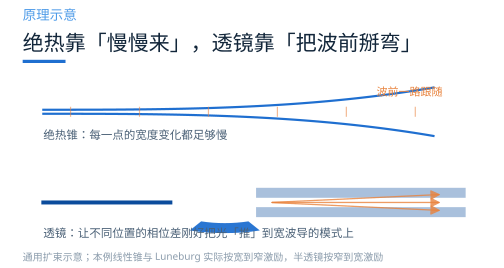
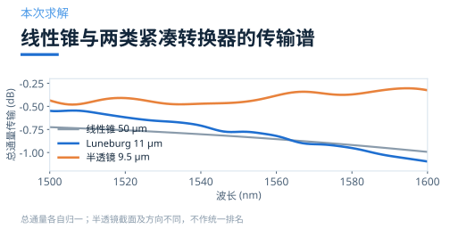
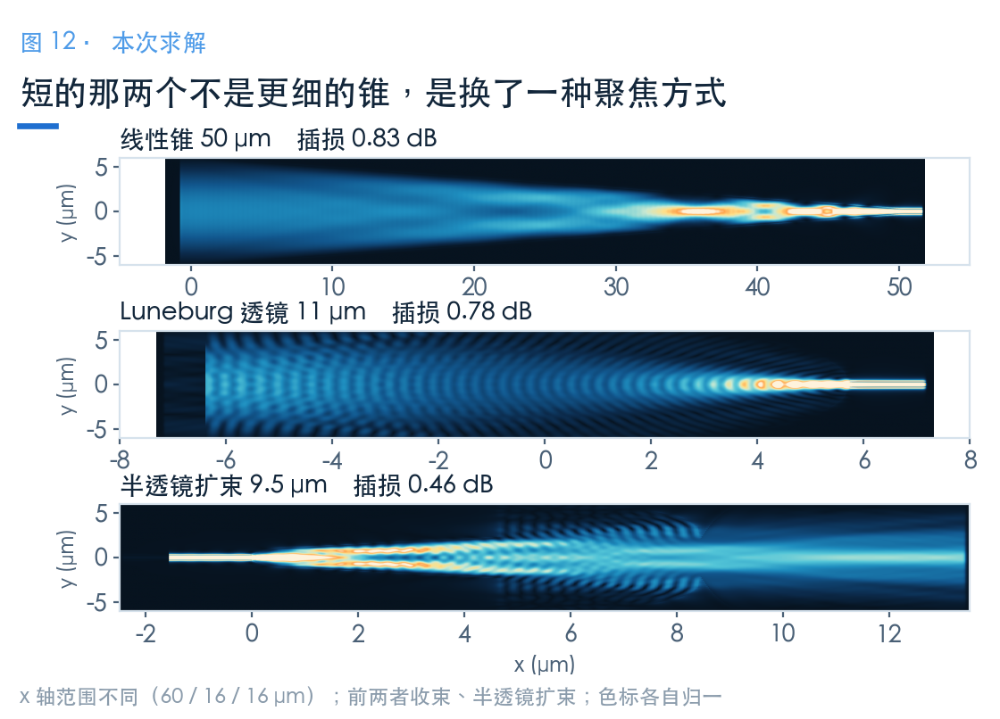
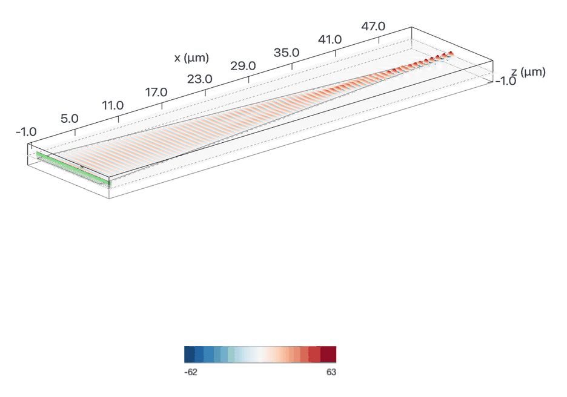
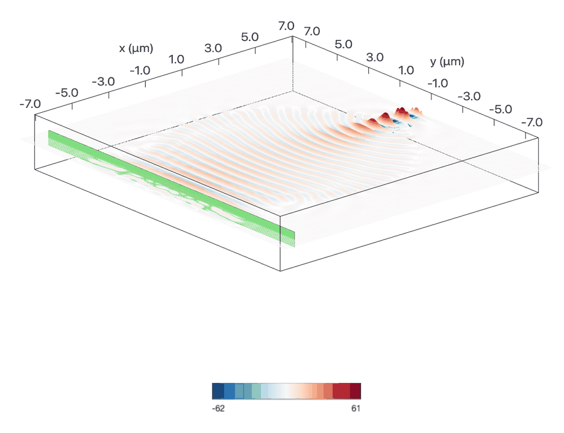
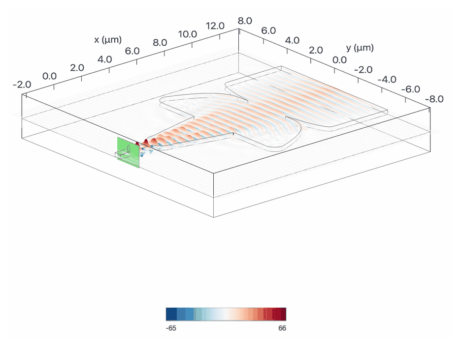
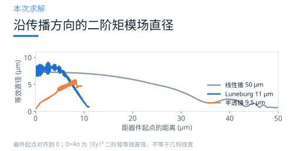
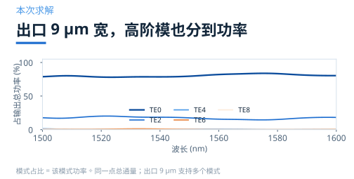

# 片内模斑怎么转换：线性锥、Luneburg 与半透镜

> **待审稿**：本文处于独立 PR 审核阶段，尚未收录为正式内容。定量结论、素材来源与授权仍需指定业内审核者核查。

倒锥的思路是「慢慢来」：让截面变化足够慢，模式就能一路跟上。

但慢意味着长。50 μm 的锥长，对单器件不算什么，对需要几十个接口的阵列就很占地方。

这一篇讲**波前整形**。同一个 Notebook 给出 50 μm 线性锥、11 μm Luneburg 与 9.5 μm 半透镜。前两者与半透镜的截面和激励方向不同，读数要连同端口条件理解。

## 01　绝热是充分条件，不是必要条件

倒锥之所以要那么长，是因为它只用了「让截面连续变化」这一个自由度。模式跟不上，是因为变化太快。

但如果在中途主动给波前加一个相位修正呢？

这就从「绝热」跳到了「成像」：不去追求每一步都跟得上，而是在末端一次性把场型纠正过来。需要的长度，从「拍长的许多倍」变成了「一个透镜的尺寸」。

实现方式并不相同：Luneburg 通过厚度分布调有效折射率，半透镜通过多段平面轮廓整形；后者并不要求同样的厚度渐变工艺。

## 02　三种做法，长度差 4 倍以上

同一个 Notebook 给了三个设计点：

- **线性锥**：长度 50 μm，作为基准
- **Luneburg 透镜**：直径 11 μm，通过渐变厚度让局部有效折射率按 Luneburg 分布
- **半透镜扩束**：六段长度 1、3.61、0.05、0.7、3.11、1.03 μm，总长 **9.5 μm**

线性锥与 Luneburg 的波导厚 110 nm，按宽 10 μm 输入、0.5 μm 输出激励；半透镜厚 260 nm，按宽 0.45 μm 输入、9 μm 输出激励。这里的宽度均为几何宽度。前两者收束、后者扩束，源模场和输出监视器尺寸不同。

1500–1600 nm 内，三者的表现是：

| 方案 | 长度 | 1550 nm 插损 | 全band 最差 |
| --- | ---: | ---: | ---: |
| 线性锥 | 50 μm | −0.83 dB | −0.99 dB |
| Luneburg 透镜 | 11 μm | −0.78 dB | −1.10 dB |
| 半透镜扩束 | 9.5 μm | **−0.46 dB** | −0.48 dB |

表中半透镜的总通量曲线较平，但它输出到宽多模波导。1550 nm 仅取 TE0 的传输为 **−1.45 dB**，不能用总通量数字证明它优于单模收束器。

## 03　场图上能看出两种机制

三张图的差别很直观。

线性锥的场随结构收束；Luneburg 通过渐变有效折射率组织波前；半透镜通过多段轮廓扩束。Luneburg 使用 TE0 模式源，不能仅凭场条纹就认定输入端同时激励了多个导模；反射、干涉与局部模式转换需要端口分解来区分。

顺带说一句：Luneburg 的谱线在三者里起伏最大（−0.55 到 −1.10 dB）。它对波长更敏感，因为厚度渐变带来的相位是按设计波长算的。

## 04　出口 9 μm 宽，光其实分成好几个模式

这里有个容易被忽略的口径问题。

半透镜的输出波导宽 9 μm。这么宽的波导支持多个模式，所以「插损」只是总功率比，还需要看功率落在哪个模式上。

这些曲线显示每个设计内部的模场变化。互易性适用于对应端口模式之间的传输系数，不能把正向总通量自动等同于反向高斯光纤的耦合效率。

1550 nm 处，TE0 占总通量约 **79.57%**。其余功率包含所记录的高阶模及未完成分解的部分。总通量 −0.46 dB 与 TE0 传输 −1.45 dB 是两个指标；后续连接单模波导会如何转换，还取决于过渡设计。

如果下游只接收某一模式，应检查该模式的功率与连接段传输，不能只看总通量。

这也解释了为什么「透镜型方案能到 −0.46 dB」这种数字要谨慎对待：如果只统计 TE0，插损会明显更高。本期的 −0.46 dB 是总通量口径，与倒锥那篇的基模口径**不是同一个量**——倒锥的输出是 0.5 μm 单模波导，两者在这件事上没有可比性。

## 05　什么时候值得用

透镜型方案的适用条件其实很窄：

- 面积紧张（阵列、多通道并行）
- 能接受更复杂的设计流程（厚度渐变、多段曲线、需要 GDS）
- 波段相对固定（谱线比线性锥更敏感）

Luneburg 的厚度渐变需要相应加工能力；半透镜使用不同的平面轮廓，工艺要求应分别核查。线性锥的设计与制造流程相对直接。

本次仅演示三个设计点，没有统计产业采用率或制造成本。

阵列面积要同时考虑传播长度、横向节距与布线。32 个并排通道不会把传播长度乘以 32；只有明确相同端口、节距和排布后，才能估算紧凑转换器节省的总面积。

### 配套案例

[Waveguide mode size converters](https://www.lingcompute.com/photon/learning-center/examples/notebooks/WaveguideSizeConverter)

更多案例见[灵算光子学习中心](https://www.lingcompute.com/photon/learning-center/example-library)，国内产品入口为 [Tidy3D 平台](https://tidy3d.fangzhen.cloud/)。本次未验证国内注册、Notebook 导入与浏览器执行流程，请以平台当前指引为准。

本次跑的是三个最终设计，其他长度与优化过程未重跑。线性锥与 Luneburg 共享名义输入/输出截面，半透镜的厚度、宽度及激励方向不同；倒锥另用高斯光束激励。所有读数均需按各自条件解读。

数据重载时，Luneburg 模型首个半径为 0 的圆柱触发退化几何警告；本次未改变已有求解，也未验证该项的数值影响。精确引用前还需核查几何和网格收敛。
