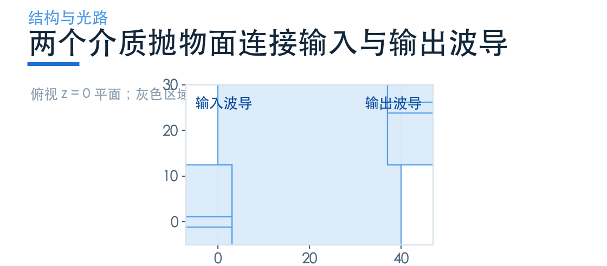
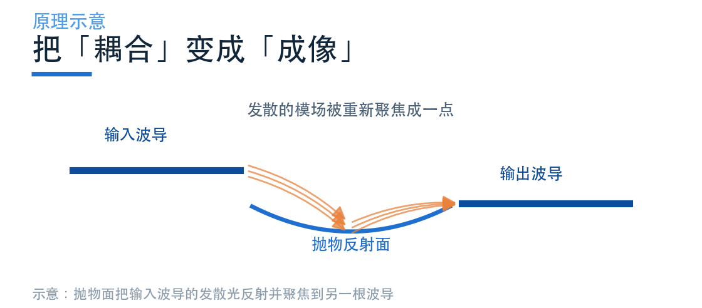
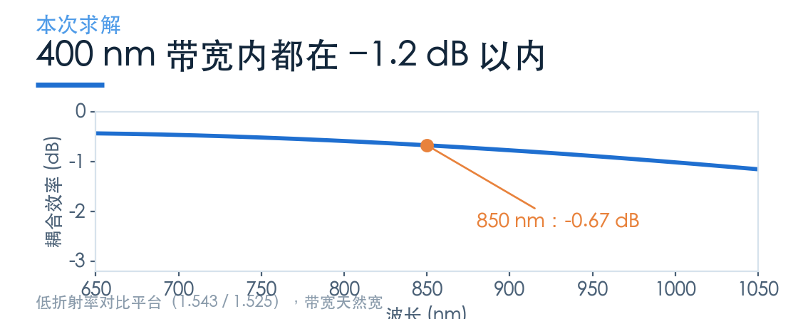
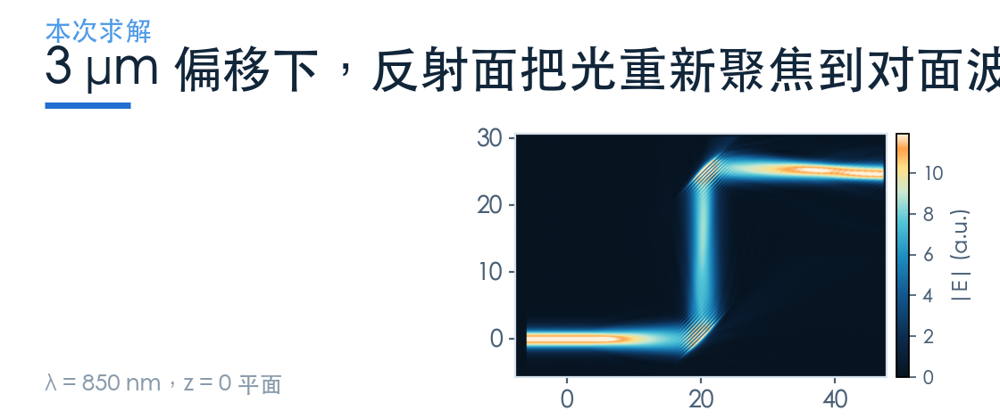
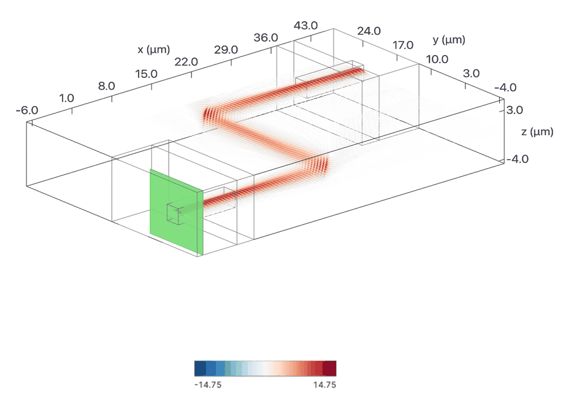
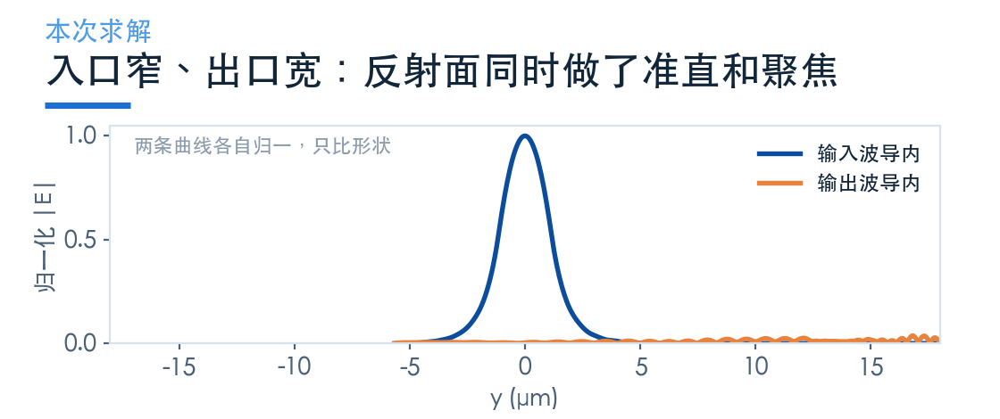

# 两个介质抛物面，怎样连接两根波导

> **待审稿**：本文处于独立 PR 审核阶段，尚未收录为正式内容。定量结论、素材来源与授权仍需指定业内审核者核查。

前面几篇讲的都是「光纤—芯片」接口。但还有一类接口完全不用光纤：两块芯片面对面放着，让光直接从一片进另一片。

本例以两个抛物反射面组织光路，两个焦点的 y 坐标差为 25 μm。这个参数不是两芯片之间空气传播长度的直接测量。

输入端先准直，输出端再聚焦。模型使用 STL 导入的介质实体及其与空气的边界，没有铝或其他金属反射面。

## 01　这不是光纤接口，是芯片间接口

先说清楚定位，否则后面的数字会被套错场景。

这个案例的平台是低折射率对比波导（芯 1.543、包层 1.525），芯层 2.3 μm 见方——不是硅光，更像是聚合物或玻璃波导。波段 650–1050 nm，也不是通信窗口。

它的应用场景是：两块光子芯片需要光互连，但中间不能有光纤（比如共封装、堆叠封装、或者在片测试）。

这里使用外部 CAD 曲面并以 STL 导入。实际芯片边缘处理与装配方式需按封装设计确定，不能由这一模型排除这些工序。

## 02　为什么是抛物面

抛物面有一个几何性质：从焦点发出的光，经抛物面反射后平行射出；反过来，平行光入射会汇聚到焦点。

射线近似把输入波导出口视为点源，经第一抛物面准直，再由第二抛物面聚焦到输出。实际波导模具有有限尺寸，光在介质结构及其边界中传播、反射，需由波动仿真检验，不能把两焦点坐标差解释为全程在空气中传播。

本例使用外部 CAD/STL 表达曲面；也可以采用其他几何表示，但需验证离散误差。

代价是：**它不好做**。硅光的平面工艺做不出这种三维曲面，需要灰度曝光、3D 打印、或者特殊的刻蚀工艺。所以这类结构在硅光里很少见，更多出现在聚合物光子学或封装级的互连件上。

## 03　这一次的读数

3 μm 偏移（原文给出的最佳点）下：

- 850 nm 处 **−0.67 dB**
- 峰值 **−0.44 dB @ 650 nm**
- 650–1050 nm 全band 最差 **−1.16 dB**

这个扫描窗口宽 400 nm。本模型芯层与包层使用常数折射率，没有验证真实材料色散；0.018 的折射率差不能推出色散小。

倒锥与光栅的扫描窗口和阈值不同。这里只能报告本设计在 650–1050 nm 的结果，不能据此认定低对比度平台普遍更宽带。

## 04　场图上，聚焦点在哪

场图显示能量从输入波导经曲面区域传到输出波导。传播介质和反射位置应结合 STL 几何理解；仅看色图不能把中间区域都认定为空气。

原文扫了 −1 到 4 μm 的六个偏移量，结论是 3–4 μm 时耦合效率约 0.5 dB。这个扫描本次没有重跑，只复现了 3 μm 这一个点。

把入口与出口的横向场剖面对比，能看出反射面做了两件事。

入口处模场宽度约等于 2.3 μm 的波导芯；出口处场分布更宽、更平，说明反射面确实把光重新分配到了对面波导的模式上。两条曲线各自归一，只能比形状，不能比绝对场强。

## 05　偏移为什么能「调」耦合

这里有个反直觉的地方：偏移 3 μm 反而比 0 偏移好。

官方案例将这一优化归因于有限尺寸波导模与点光源射线近似的差异：波动光学的最佳位置与初始几何焦点不同。本模型没有模拟制造、CAD 误定位或装配偏差。

**3 μm 是相对于射线初始设计的位置优化量。** 原文的 3–4 μm 两个良好扫描点不能代替围绕最佳设计的独立装配容差研究。

## 06　什么时候会用到它

可以评估这类结构的条件包括：

- 两块芯片之间必须无光纤互连
- 平台是低折射率对比（聚合物、玻璃、部分 SiN）
- 波段宽（可见到近红外）
- 能接受非平面工艺

还应与其他芯片间互连方式一起评估；本次没有穷尽替代路线。

两个反射面的制造与定位都要纳入封装方案。能否连接异质平台需另行设计模式过渡，本例未验证这种连接，也不能证明它原则上不可行。

从成本角度看，这类器件的价值不在器件本身，而在**省掉的那套光纤耦合与封装**。如果两块芯片本来就靠得很近（比如共封装光学里的交换芯片与光引擎），用一片抛物面换掉一整组光纤阵列，省下的是封装工序和体积，不是几个 dB。

### 配套案例

[Free-form chip-to-chip coupler](https://www.lingcompute.com/photon/learning-center/examples/notebooks/FreeFormCoupler)

更多案例见[灵算光子学习中心](https://www.lingcompute.com/photon/learning-center/example-library)，国内产品入口为 [Tidy3D 平台](https://tidy3d.fangzhen.cloud/)。本次未验证国内注册、Notebook 导入与浏览器执行流程，请以平台当前指引为准。

本次只跑 3 μm 偏移一个点；−1 至 4 μm 的偏移扫描是原 Notebook 的结论，未重跑。该案例的几何依赖外部 STL 文件，取自 Tidy3D 官方 notebooks 仓库的 `misc/chip_to_chip_coupler.stl`，与学习中心下载包内的 Notebook 配套。波段与平台均与其余案例不同，不作跨案例排名。
