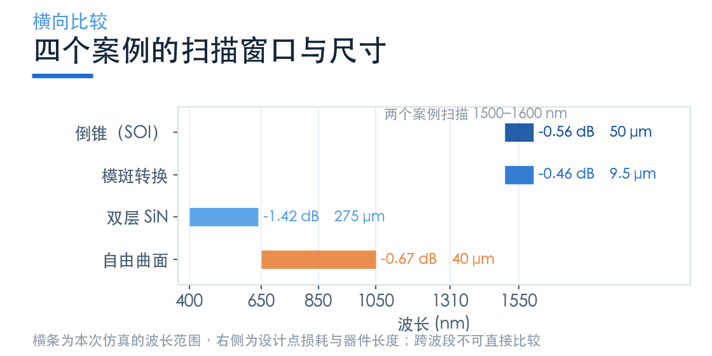
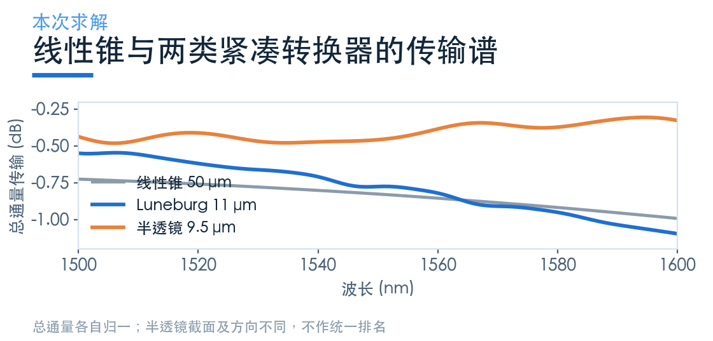
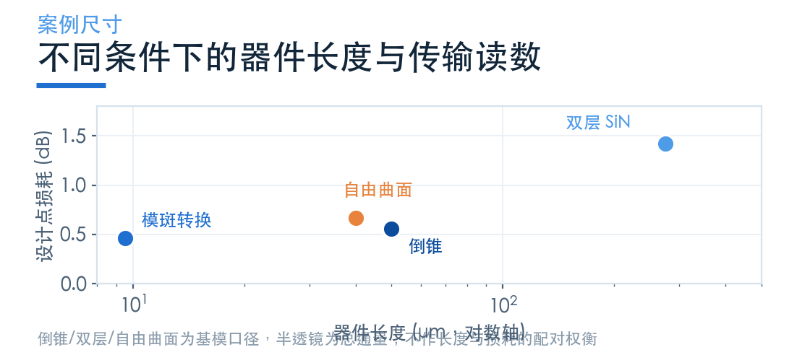
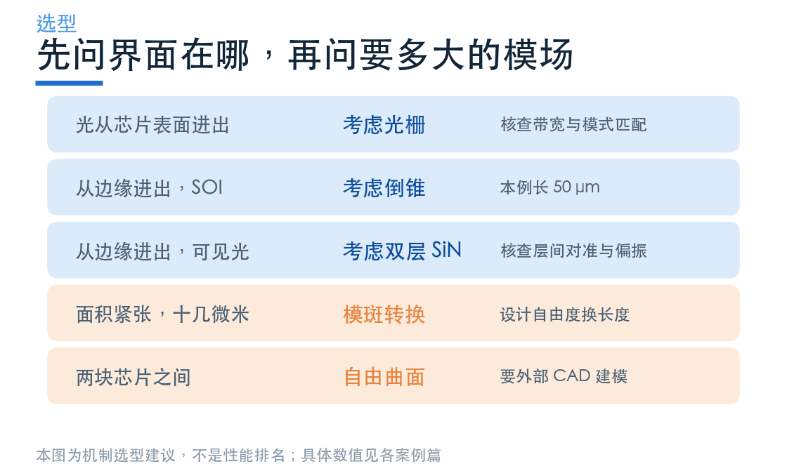
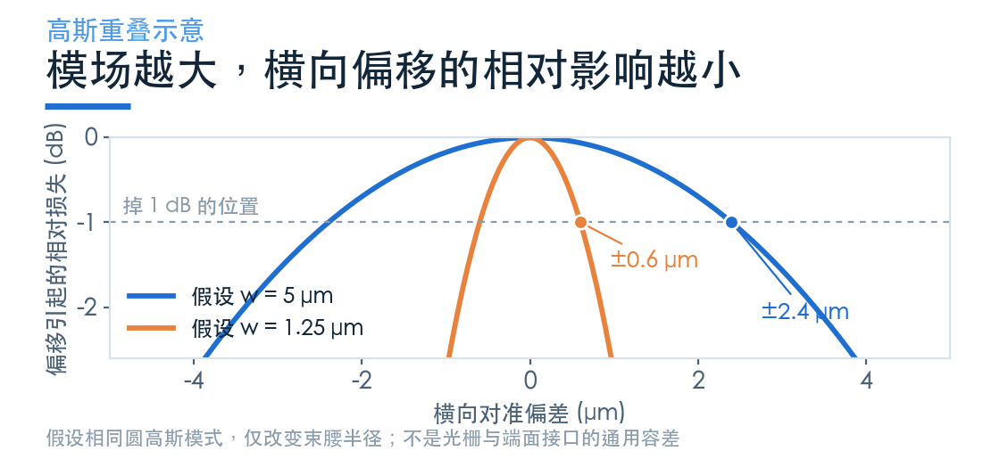

# 端面接口怎么选：先定波段，再定面积，最后才比 dB

> **待审稿**：本文处于独立 PR 审核阶段，尚未收录为正式内容。定量结论、素材来源与授权仍需指定业内审核者核查。

四个案例讲完，最后这一篇不重复原理，只回答一个问题：手上这个项目，该选哪种？

先把一件事说清：这四个案例的读数**不能放一起排名**。它们工作在四个不同波段、三种不同材料平台，激励方式也不一样。硬排名会得出「半透镜比倒锥好」这类没有意义的结论。

能比较的只有「同一个设计问题下，哪种机制更合适」。

## 01　四条路线各自的关键数字

先把本次实测的结果摆出来，都注明口径。

| 案例 | 平台 / 波段 | 器件长度 | 设计点损耗 | 全band 最差 |
| --- | --- | ---: | ---: | ---: |
| 倒锥（二次轮廓） | SOI / 1550 nm | 50 μm | −0.56 dB | −0.71 dB |
| 双层 SiN | SiN / 400–640 nm | 275 μm | −1.42 dB @558 nm | −6.99 dB @400 nm |
| 模斑转换（半透镜） | SOI / 1550 nm | 9.5 μm | −0.46 dB（总通量） | −0.48 dB |
| 自由曲面 | 低对比度 / 650–1050 nm | 40 μm | −0.67 dB @850 nm | −1.16 dB |

读这张表要注意三件事。

第一，双层 SiN 的「全band 最差」是 400 nm 端，与原文差异的原因尚未确认；本次只能报告 450–640 nm 内 ≤4 dB。

第二，半透镜的 −0.46 dB 为总通量；1550 nm 的 TE0 占总通量约 79.57%，TE0 传输为 −1.45 dB。

第三，倒锥由高斯光束激励，半透镜由波导模式激励，输入/输出截面也不同。不能把二者的读数差当作相同光纤接口的性能提升。

把长度和损耗放在一张图上，会看到一件反直觉的事。

这四点的平台、源与端口定义不同，长度不是配对扫描中的唯一自变量。图中只展示案例尺寸，不支持「缩短就能减小损耗」的因果判断。

## 02　选型顺序：三个问题，一条路径

**第一步：界面在芯片表面，还是边缘？**

如果是表面，没有别的选择，只能上光栅耦合器——那不是本期内容，上一组讲过。如果一定要端面，往下走。

**第二步：波段在哪？**

1550 nm 的 SOI 可评估倒锥；片内宽窄转换可评估透镜型结构；可见光 SiN 可评估双层；芯片间互连可评估自由曲面。它们都只是候选，不排除单层或光栅等其他路线。

这一步就把四个案例分到三个互不重叠的格子里了。

**第三步：面积紧不紧张？**

先固定相同端口与目标模式，再比较可制造的器件长度和总面积。本例的 50 μm 倒锥、11 μm Luneburg、9.5 μm 半透镜不能直接互换。

**第四步：能不能接受严格的工艺？**

双层的两层对准、自由曲面的三维曲面，都不是标准平面工艺能做的。如果产线做不了，光学设计再漂亮也没用。

## 03　四个维度的真实取舍

把「损耗」之外的三个维度摆出来，取舍会清楚很多。

**对准容差。** 取决于接口模场和装配误差类型，本次没有独立容差扫描。自由曲面的 3 μm 是相对射线初始设计的优化量，不能当作装配容差。

**带宽。** 自由曲面、双层 SiN、倒锥与模斑转换的扫描窗口分别宽 400、240、100、100 nm；这些不是统一损耗阈值下的可用带宽。材料色散和带边仍需验证。

**工艺复杂度。** 倒锥最简单（一条轮廓、一次刻蚀），模斑转换次之（多段曲线或灰度），双层需要两次对准，自由曲面需要三维成型。

**偏振。** 几何模式转换也可能有明显偏振依赖。本期没有各结构的完整 TE/TM 对照，不能据此排序。

## 04　几条容易踩的坑

**坑一：把「耦合效率」当成一个统一指标。** 本期的四个案例，有的是「光纤模到波导模」的功率比，有的是「高斯光束到波导模」，有的是「波导到波导」。这三种数的绝对值不能互换。

**坑二：忽略归一化。** 倒锥的源是高斯光束，用 `normalize_index` 归一到源功率；双层是显式光纤模激励，光纤本身的失配已经算进去了。两者都叫「耦合损耗」，但一个是「器件损耗」，一个是「器件 + 光纤失配」。

**坑三：拿全band 最差去比峰值。** 表里两列要分开看。峰值说明设计点做得多好，全band 最差说明能用多宽。混着比会得出相反结论。

**坑四：忽略收敛。** 本次六项任务都达到了自动终止阈值，但达到终止阈值不等于完成网格收敛研究。要在论文级精度上引用，需要自己做网格与时间步的收敛测试。

## 05　回到模式匹配

端面接口要匹配光纤与导模；片内转换和芯片间接口则要匹配各自端口。几何宽度不能直接替代模场直径。

四篇下来，四种补法：

- 用长度补（倒锥）
- 用薄层匹配、厚层约束及层间模式转移（双层 SiN）
- 用相位补（模斑转换）
- 用反射面补方向（自由曲面）

这些案例展示不同约束下的设计方法，没有证明各自是该场景的最优解。

选型的本质不是比 dB，是**先认清自己的约束是哪一个**。

### 配套案例

- [Inverse taper edge coupler](https://www.lingcompute.com/photon/learning-center/examples/notebooks/EdgeCoupler)
- [Bi-layer SiN edge coupler](https://www.lingcompute.com/photon/learning-center/examples/notebooks/BilayerSiNEdgeCoupler)
- [Waveguide mode size converters](https://www.lingcompute.com/photon/learning-center/examples/notebooks/WaveguideSizeConverter)
- [Free-form chip-to-chip coupler](https://www.lingcompute.com/photon/learning-center/examples/notebooks/FreeFormCoupler)

更多案例见[灵算光子学习中心](https://www.lingcompute.com/photon/learning-center/example-library)，国内产品入口为 [Tidy3D 平台](https://tidy3d.fangzhen.cloud/)。本次未验证国内注册、Notebook 导入与浏览器执行流程，请以平台当前指引为准。

本篇为选型建议，不是性能排名。各案例的波段、平台、激励或端口不同，倒锥与半透镜也不构成同条件对照。所有数值取自已有本地求解结果，工艺可行性需按实际产线核查。
