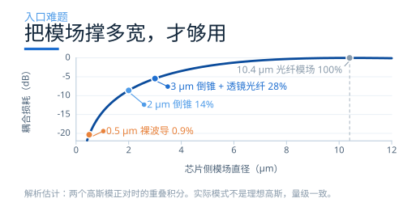
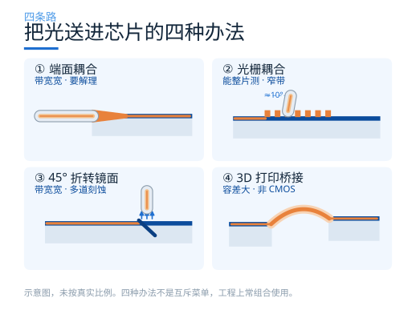
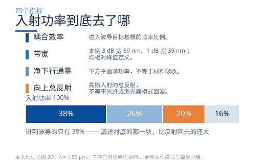

# 光怎么进芯片？看懂三类光栅耦合器

光子芯片上，光在波导里跑得很顺。真正的麻烦在门口。

一根通信单模光纤的模场直径约 10.4 μm，典型硅波导的截面约 0.5 × 0.22 μm。把这两根"管子"直接怼在一起，能进到波导里的功率不到 1%，其余全在接口上反射、散射、辐射掉。

这不是对准没做好，是尺寸差了一个数量级。两个高斯模正对时，重叠效率是

η = [ 2 d1 d2 / ( d12 + d22 ) ]2

代入 d1 = 10.4 μm、d2 = 0.5 μm，η ≈ 0.9%，也就是 −20.4 dB。这已经是"正对、无反射、无对准误差"的理想上限。

## 门口这件事，本质只有一句话

所有把光送进芯片的办法，都在做同一件事：**把两端的模场改成一样大、一样形状，然后按住不动**。

差别只在"从哪里改"。图 1 把这件事画成一条曲线：横轴是芯片侧的模场直径，纵轴是耦合损耗。裸波导那一点在 −20.4 dB；倒锥撑到 2 μm 涨到 −8.6 dB，配透镜光纤撑到 3 μm 是 −5.5 dB；只有撑到 10.4 μm 才归零。

曲线有两个读法。左边陡：从 0.5 μm 撑到 2 μm 能赚 11.8 dB，所以"扩口"这件事一定要做。右边平：从 6 μm 撑到 10.4 μm 只赚 1.3 dB，所以撑到 2–3 μm 就够用，再往上堆尺寸，不如去解决反射和方向性。

## 四条路：从侧面塞到现场缝

按光从哪个面进出，工程上有四种办法。它们的差别不在先进程度，而在于把代价花在哪里。

**① 端面耦合：把针管口扩成喇叭。** 波导走到芯片边缘时收成一个几十纳米宽的尖端，模场被"挤"出芯层、扩进包层，横向撑到 2–3 μm；再配一根透镜光纤或高 NA 光纤（模场也是 2–3 μm），两头就对上了。这条路带宽很宽、偏振不挑，配上低折射率覆盖层后插损可以做到 1 dB 量级。代价在边缘：芯片必须解理或抛光出光学级端面（量产常用 Bosch 深刻蚀在片上直接刻），光纤只能停在芯片边上，晶圆上没法整片测，对准容差也比光栅小。

**② 光栅耦合：让光从管壁上漏出去。** 在波导表面刻一排周期齿，导模每过一道齿就被散射一次；散射波相位对齐后，在偏离法线 10° 上下的方向叠成一束（本系列案例用 14.5°），射进几乎垂直放置的光纤。光从表面进出，芯片不用解理，光栅可以放在片上任何位置，晶圆上整片扎探针就能测。代价是它靠相位匹配工作：单层均匀光栅的耦合效率在 33% 上下（约 −4.8 dB），1 dB 带宽只有 40 nm 量级，而且天生有一半的光往衬底漏；加一层底部反射镜能把效率提到 69%（约 −1.6 dB），但那要多几道工艺。

**③ 折转镜面：走廊尽头装一面斜镜。** 在波导末端做一个 45° 斜面，水平跑过来的导模在斜面上全反射，直接折成垂直向上。全反射不挑波长、不挑偏振，带宽和端面耦合一样宽；光又从表面出，能晶圆级测——等于把前两条路的优点拼在一起。代价是多一道斜刻蚀或各向异性湿法腐蚀：角度差几度、表面粗糙几十纳米，损耗就上去了。镜面前面通常还得再放一个模斑转换，否则仍然要面对 0.5 μm 对 10.4 μm 的老问题。

**④ 3D 打印桥接：不对严了，现场缝一根管子。** 不再要求光纤对准芯片，而是用双光子聚合在两者之间直接打印一根三维聚合物波导，两端仍靠倒锥过渡；同一类工艺也能打印微透镜，把自由空间的光直接聚焦到芯片上。首代光子引线键合（photonic wire bonding）在 C 波段的平均插损是 1.6 ± 0.4 dB，1 dB 带宽超过 300 nm；这根"弯管"还能吃掉十几微米的对准误差。代价是它不属于标准 CMOS 工序，聚合物的长期可靠性、温度与湿度稳定性要单独验证；它更像封装工序，而不是芯片设计的一部分。

四条路的取舍压成一张表：

| 方式 | 插损/带宽（nm） | 主要代价 |
| --- | --- | --- |
| 端面耦合 | ≈1 dB / >100 | 要解理端面 |
| 光栅耦合 | −4.8 dB / 40 | 窄带、漏一半 |
| 折转镜面 | 看镜面 / 宽 | 多道斜刻蚀 |
| 3D 桥接 | 1.6 dB / >300 | 非 CMOS |

表中数字来自不同平台、不同波长的文献报道，定义与测试条件并不统一，只用来判断量级，不能当作同条件排名。光栅一行的 −4.8 dB 是单层结构，加底部反射镜可到 −1.6 dB，代价是多几道工艺。
{: .note }

## 这一期为什么只讲光栅

四条路里，光栅耦合器的效率不是最高的，带宽也不是最宽的。但它用一步刻蚀就换到了另外两条面外路线的关键好处：**接口在芯片表面，位置随便放**。

研发阶段要在一片晶圆上测几百个器件，封装阶段要把光纤阵列贴到指定位置，这两件事都要求"光从上面来"。端面耦合做不到；折转镜面和 3D 打印桥接虽然也从表面进出，但一个要多一道斜刻蚀、一个要多一道打印，通常只在特定封装方案里出现。所以绝大多数硅光子的测试界面都是光栅——它的 −4 dB 也就成了大家天天面对的基线。

接下来把这条路拆开：它靠什么把光"漏"出来，漏出来的功率又去了哪里。

## 原理：让光在正确的位置"漏"出来

波导里的光是导模，被全反射关在芯层里，理论上跑不掉。要让它跑掉，就得破坏这个"关得住"的条件。

办法是周期性地扰动。每隔一个周期 Λ 刻一道槽，导模每经过一道槽就被散射一次。这些散射波如果相位对得上，就会在某个方向上**相干叠加**，形成一个往外的辐射光束。

相位条件写成一行就是光栅方程：

neff − nclad · sin θ = λ / Λ

左边是导模的等效折射率减去它在包层方向上的投影，右边是波长除以周期。三件事被这一行锁死了：给定波长和材料，周期只能有一个值；想要别的出射角 θ，就得换周期。

这也是光栅耦合器天生窄带的根源——它靠相位匹配工作，波长一变，匹配就散了。

但"能漏出去"和"漏得好"是两回事。这里要引入第二个量：**泄漏因子 α**，单位是每微米漏掉多少比例。

α 太小，光栅要刻很长才漏得完，器件占地方；α 太大，光在头几道齿就漏光了，后面的齿白刻，而且剩下的光会在波导里反射回来。均匀光栅的 α 是常数，漏出的功率沿传播方向指数衰减——这跟光纤的高斯模场形状对不上，所以效率上不去。

## 四个指标，一起看才有意义

评价一个光栅耦合器，光看"效率多少 dB"是不够的。至少要四个数：

**耦合效率**。有多少入射光变成了波导里的基模。本期实测的均匀光栅峰值 −4.2 dB，也就是只有 38% 进得去。切趾设计能把它推到 −2 dB 上下。

**带宽**。相对峰值下降 3 dB 的连续波长范围。本期均匀光栅的 3 dB 带宽为 69 nm，1 dB 带宽为 39 nm。相对带宽与峰高是不同指标；把整条功率谱乘一个常数，不会改变相对带宽。

**方向性**。漏出去的光有多少朝上（去光纤），多少朝下（钻进衬底）。SOI 的 BOX 只有 2 μm，下面还有硅衬底。本期均匀光栅有 26% 的入射功率直接漏进了衬底——比反射回去的 20% 还多。

**向上总反射**。本期高斯光束入射时，上方平面记录的向上反射总通量约占 20%。它不是返回入射光纤模式的重叠功率，也不是波导反向基模反射；不能用它直接判断激光反馈强弱。

## 三条路线：把设计自由度放在哪里

同样是刻一排齿，工程上有三种放法，差别不在"谁先进"，而在于你把自由度花在哪个指标上。

**均匀光栅。** 周期和占空比都是常数。设计变量只有两个：周期 Λ 和光纤位置。它简单、好制造、是理解一切的起点，但 α 恒定导致模式失配，效率被卡在 −4 dB 附近。

**切趾 + 聚焦。** 本例的 F 是硅填充比例，入口 F 较高、刻蚀槽较窄，先弱散射，再沿传播方向调节泄漏以形成目标包络。曲线齿把片内收集的光汇向窄波导入口，缩短宽锥过渡；它不是把光聚到芯片上方的三维透镜。具体缩短量与工艺要求需逐案验证。

**双层结构。** 换到氮化硅平台时，材料折射率对比低，光栅本身就漏得弱、方向性差。这时在下面加一层硅光栅当反射镜，把原本漏向衬底的光反射回上方，再用层间距调相位让两束上行光相干叠加。它把"方向性"这个指标单独拎出来优化，代价是多一层工艺、多一组设计变量。

## 本期怎么读

接下来四篇：三个案例各对应学习中心里的一个 Notebook，最后一篇把它们放在一起比。每个案例我们都下载下来、在本地跑通、把结果数据重新处理成图，再逐个讲清楚：

- **第二篇｜均匀光栅**：从光栅方程算出周期，用参数扫描找到工作点，看清 −4 dB 是怎么被分掉的。
- **第三篇｜聚焦切趾光栅**：切趾怎样整形辐射包络，聚焦如何缩短片内过渡，并区分总反射与模式回波。
- **第四篇｜双层 SiN/Si**：低折射率对比平台怎么靠一面底部光栅把方向性补回来。
- **第五篇｜横向比较**：三个案例放在一起，给一套能直接照着走的选型顺序。

需要提前说清楚的是：这三个 Notebook 的材料模型、网格精度、监视器位置并不完全一致，它们的效率数字**不能直接排名**。我们会把每个数字的来历标出来，比较时只谈机制和适用条件。

完整 Notebook 可从[灵算光子学习中心](https://www.lingcompute.com/photon/learning-center/example-library) 获取。国内产品入口为 [tidy3d.fangzhen.cloud](https://tidy3d.fangzhen.cloud/)；本次未验证注册、Notebook 导入与浏览器运行流程，请以平台当前指引为准。
