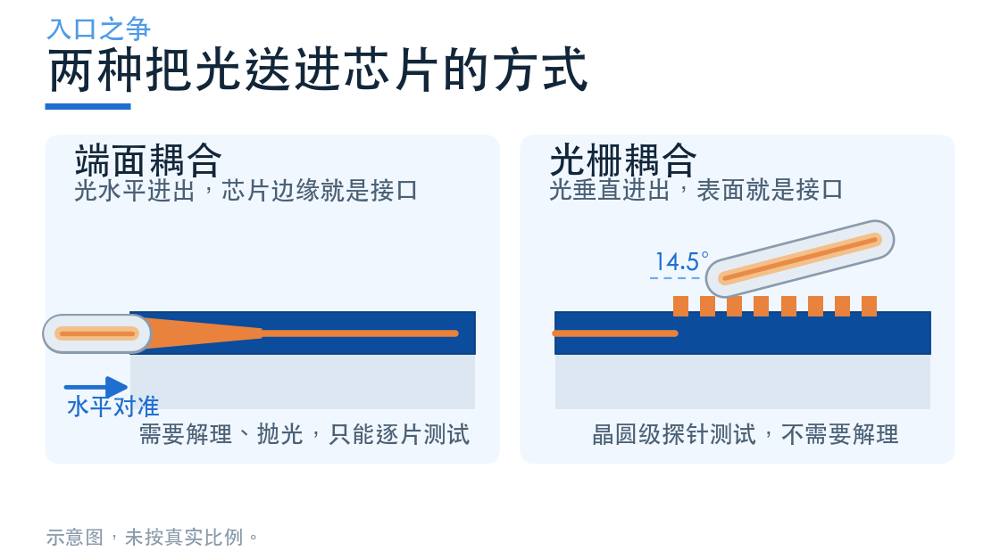
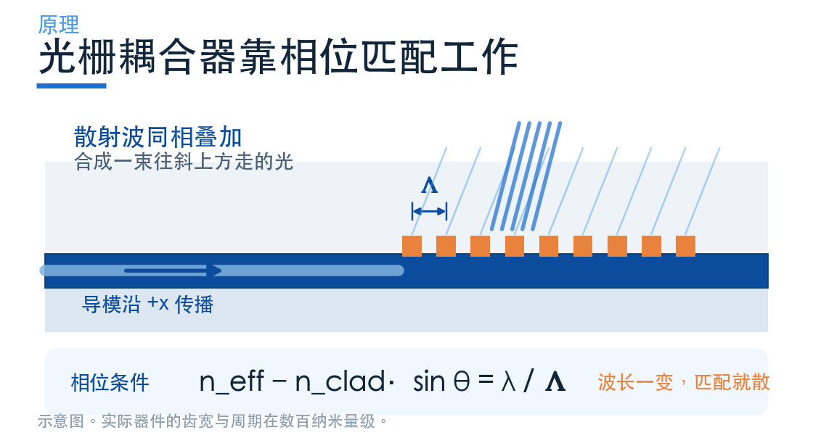
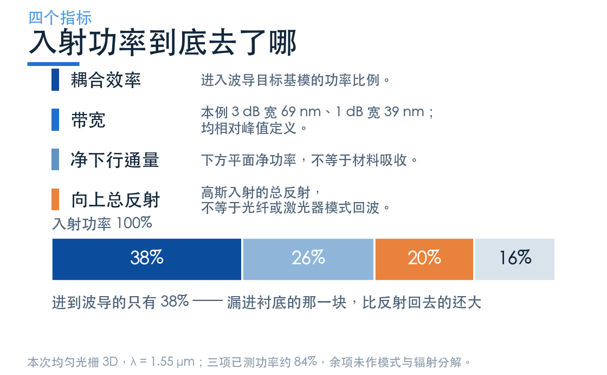
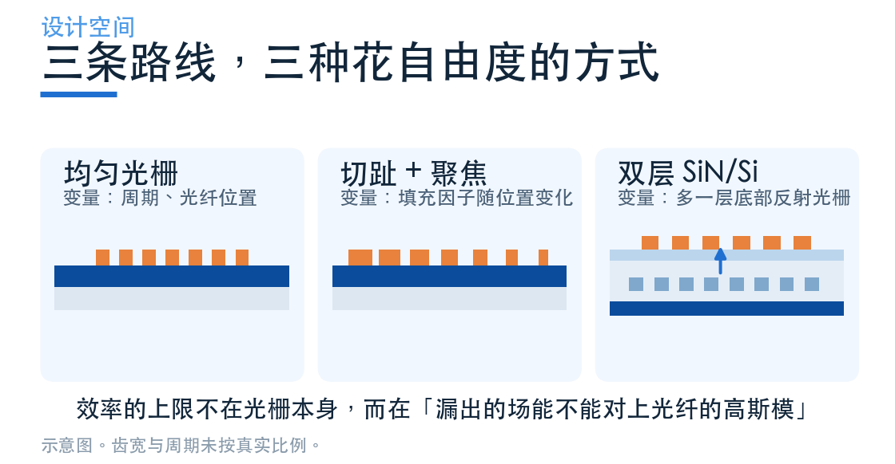

# 光怎么进芯片？看懂三类光栅耦合器

> **待审稿**：本文处于独立 PR 审核阶段，尚未收录为正式内容。定量结论、素材来源与授权仍需指定业内审核者核查。

光子芯片上，光在波导里跑得很顺。真正的麻烦在门口。

一根通信单模光纤的模场直径约 10.4 μm，而典型硅波导的几何截面约 0.5 × 0.22 μm。几何截面不等于模场面积，但两端模式差异提示接口需要专门匹配；直接对接的传输需由模式重叠与反射共同计算。

解决它有两条路。

一条是**端面耦合**：把波导端头做成倒锥，让模场慢慢撑大到 2–3 μm，再去和光纤对齐。光水平进出，带宽很宽，但芯片边缘必须抛光、解理，测试只能一片一片做。

另一条是**光栅耦合器**：在波导表面刻一排周期性的齿，让沿着波导跑的光"漏"出来，拐个弯射向斜上方的光纤。光垂直进出，芯片表面就是接口，晶圆上可以整片扎探针测试。

这一期讲光栅耦合器。它结构简单，但把"效率"这件事拆开看，里面全是权衡。

## 原理：让光在正确的位置"漏"出来

波导里的光是导模，被全反射关在芯层里，理论上跑不掉。要让它跑掉，就得破坏这个"关得住"的条件。

办法是周期性地扰动。每隔一个周期 Λ 刻一道槽，导模每经过一道槽就被散射一次。这些散射波如果相位对得上，就会在某个方向上**相干叠加**，形成一个往外的辐射光束。

相位条件写成一行就是光栅方程：

n_eff − n_clad · sin θ = λ / Λ

左边是导模的等效折射率减去它在包层方向上的投影，右边是波长除以周期。三件事被这一行锁死了：给定波长和材料，周期只能有一个值；想要别的出射角 θ，就得换周期。

这也是光栅耦合器天生窄带的根源——它靠相位匹配工作，波长一变，匹配就散了。

但"能漏出去"和"漏得好"是两回事。这里要引入第二个量：**泄漏因子 α**，单位是每微米漏掉多少比例。

α 太小，光栅要刻很长才漏得完，器件占地方；α 太大，光在头几道齿就漏光了，后面的齿白刻，而且剩下的光会在波导里反射回来。均匀光栅的 α 是常数，漏出的功率沿传播方向指数衰减——这跟光纤的高斯模场形状对不上，所以效率上不去。

## 四个指标，一起看才有意义

评价一个光栅耦合器，光看"效率多少 dB"是不够的。至少要四个数：

**耦合效率**。有多少入射光变成了波导里的基模。本次仿真得到的均匀光栅峰值 −4.2 dB，也就是只有 38% 进得去。切趾设计能把它推到 −2 dB 上下。

**带宽**。相对峰值下降 3 dB 的连续波长范围。本期均匀光栅的 3 dB 带宽为 69 nm，1 dB 带宽为 39 nm。相对带宽与峰高是不同指标；把整条功率谱乘一个常数，不会改变相对带宽。

**方向性**。漏出去的光有多少朝上（去光纤），多少朝下（钻进衬底）。SOI 的 BOX 只有 2 μm，下面还有硅衬底。本期均匀光栅有 26% 的入射功率直接漏进了衬底——比反射回去的 20% 还多。

**向上总反射**。本期高斯光束入射时，上方平面记录的向上反射总通量约占 20%。它不是返回入射光纤模式的重叠功率，也不是波导反向基模反射；不能用它直接判断激光反馈强弱。

## 三条路线：把设计自由度放在哪里

同样是刻一排齿，工程上有三种放法，差别不在"谁先进"，而在于你把自由度花在哪个指标上。

**均匀光栅。** 周期和占空比都是常数。设计变量只有两个：周期 Λ 和光纤位置。它简单、好制造、是理解一切的起点，但 α 恒定导致模式失配，效率被卡在 −4 dB 附近。

**切趾 + 聚焦。** 本例的 F 是硅填充比例，入口 F 较高、刻蚀槽较窄，先弱散射，再沿传播方向调节泄漏以形成目标包络。曲线齿把片内收集的光汇向窄波导入口，缩短宽锥过渡；它不是把光聚到芯片上方的三维透镜。具体缩短量与工艺要求需逐案验证。

**双层结构。** 换到氮化硅平台时，材料折射率对比低，光栅本身就漏得弱、方向性差。这时在下面加一层硅光栅当反射镜，把原本漏向衬底的光反射回上方，再用层间距调相位让两束上行光相干叠加。它把"方向性"这个指标单独拎出来优化，代价是多一层工艺、多一组设计变量。

## 本期怎么读

接下来三篇是三个案例，每个都对应学习中心里的一个 Notebook。我们把它下载下来、在本地跑通、把结果数据重新处理成图，再逐个讲清楚：

- **第二篇｜均匀光栅**：从光栅方程算出周期，用参数扫描找到工作点，看清 −4 dB 是怎么被分掉的。
- **第三篇｜聚焦切趾光栅**：切趾怎样整形辐射包络，聚焦如何缩短片内过渡，并区分总反射与模式回波。
- **第四篇｜双层 SiN/Si**：低折射率对比平台怎么靠一面底部光栅把方向性补回来。
- **第五篇｜横向比较**：三个案例放在一起，给一套能直接照着走的选型顺序。

需要提前说清楚的是：这三个 Notebook 的材料模型、网格精度、监视器位置并不完全一致，它们的效率数字**不能直接排名**。我们会把每个数字的来历标出来，比较时只谈机制和适用条件。

完整 Notebook 可从[灵算光子学习中心](https://www.lingcompute.com/photon/learning-center/example-library) 获取。国内产品入口为 [tidy3d.fangzhen.cloud](https://tidy3d.fangzhen.cloud/)；本次未验证注册、Notebook 导入与浏览器运行流程，请以平台当前指引为准。
