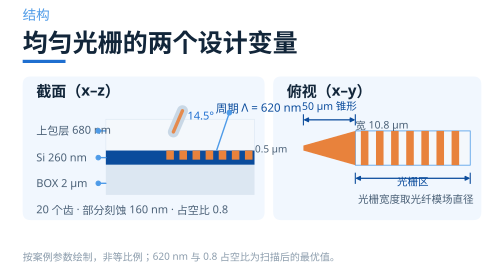
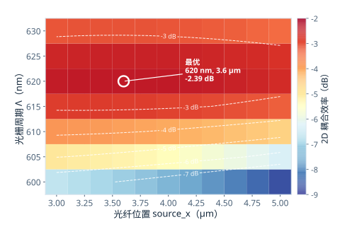
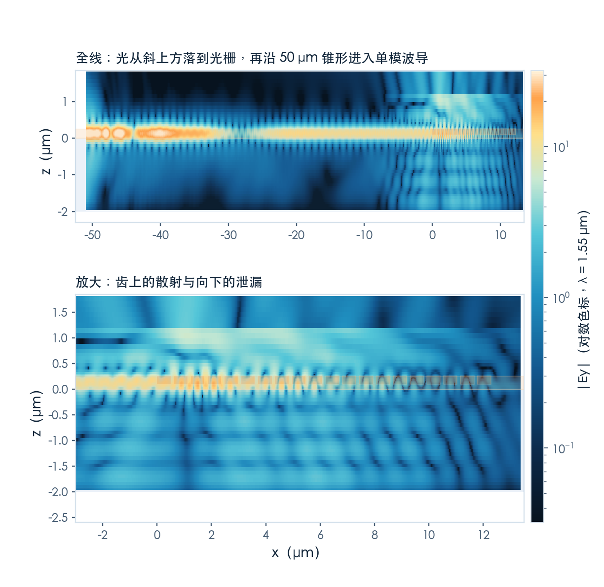
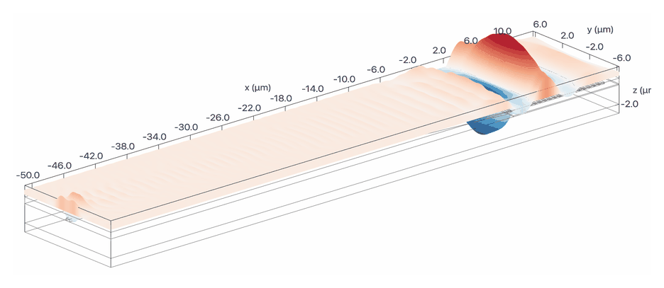
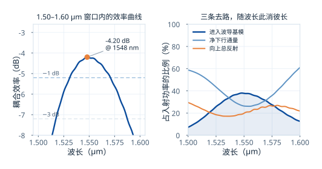

# 一排齿，怎么把光拐进波导？

> **待审稿**：本文处于独立 PR 审核阶段，尚未收录为正式内容。定量结论、素材来源与授权仍需指定业内审核者核查。

这是本系列的第二篇。上一篇把地图铺开了，这一篇从最简单的一种做起：**均匀线性光栅**。

它只有两个设计变量——周期和光纤位置。听起来简单，但正因为简单，你能把"光为什么进不去"这件事看得最清楚。

我们用的是学习中心里的 [Uniform linear grating coupler](https://www.lingcompute.com/photon/learning-center/examples/notebooks/GratingCoupler) 案例，SOI 平台，器件层 260 nm，部分刻蚀 160 nm，占空比 0.8，20 个齿。

## 先算周期，再谈别的

上一篇给过光栅方程。要对上 1550 nm、14.5° 入射，周期该取多少？

方程里缺一个量：波导的等效折射率。而光栅区有两个折射率——没刻蚀的平板一处、刻蚀后的薄板一处。案例的做法是先建一个 2D 仿真，然后在光栅区左右两侧各切一刀做模式求解：

- 未刻蚀平板：**n_eff = 2.9522**
- 刻蚀后平板：**n_eff = 2.1784**

按 0.8 的占空比加权，代回光栅方程，得到 **608 nm**。

这一步值得停一下。它说明周期不是"调"出来的，是**算**出来的——材料的折射率、刻蚀深度、入射角一旦定死，周期就只剩一个答案。后面所有优化，都是在已经确定的那个数附近找偏差。

## 扫描：两个变量，一张图

算出来的 608 nm 是近似值，因为占空比加权本身就是个线性近似。真实的最优点要从仿真里找。

案例的做法很直接：周期取 600–630 nm 七档，光纤位置取 3–5 μm 十一档，一共 77 个 2D 仿真，跑一个批处理。每个仿真只做一件事——在波导端放一个模式监视器，量出有多少光变成了基模。

结果有意思的地方不在最优点，而在**形状**。

最优点是 **620 nm、3.6 μm，耦合效率 −2.39 dB**。但你看那张图：沿周期方向，颜色变化极快——620 nm 上下偏 10 nm 就掉 1 dB 以上；沿光纤位置方向却几乎是一条条水平带，从 3 μm 挪到 5 μm，效率只变一点点。

这说明两件事的敏感度完全不对称：

- **周期是硬约束。** 它由相位匹配决定，工艺上周期偏 5 nm，效率就明显下降。这也解释了为什么光栅耦合器对光刻精度和温度都敏感。
- **光纤位置是软约束。** 它决定入射光斑落在光栅的哪一段，影响的是模式重叠，不是相位。位置偏 1 μm，效率只掉零点几 dB。

工程含义很直接：版图上的周期必须卡死，而封装时的对准公差可以放宽一些。

## 3D：多了 50 μm 的锥形

2D 仿真里光栅是整个宽度上无限延伸的，但真实器件有边界。案例把 2D 的结果搬到 3D，加了两个东西：

一是**宽度**。光栅宽度取光纤的模场直径 10.8 μm，而单模波导只有 0.5 μm 宽，中间靠一段 **50 μm 的线性锥形**过渡。

二是**损耗**。这段锥形不是免费的。光从 10.8 μm 宽的平板模收缩到 0.5 μm 宽的条波导，模式形状一路在变，理想绝热需要很长的距离，50 μm 显然不够。

3D 结果是 **−4.20 dB**，峰值在 1548 nm，比 2D 的 −2.39 dB 低约 1.8 dB。有限宽度、锥形过渡和三维模式匹配都可能参与；本次没有逐项分离，不能指定锥形占比。

## 功率去哪了：一次完整的收支

只看 −4.20 dB 这个数，你不知道该改哪里。所以我们在同一个 3D 任务里补了三个监视器，把入射功率的去向拆开。

在 1550 nm：

- 进入波导基模：**37.8%**（−4.23 dB）
- 下方监视器净下行通量：**26.3%**（不是吸收功率）
- 向上反射总通量：**19.8%**（不是返回光纤模式的功率）
- 三项之和之外约 16%，未做完整模式、辐射与闭合面分解

这张图说清了三件事。

**第一，净下行通量大于向上反射总通量。** 26% 对 20%。BOX/硅界面会产生 Fresnel 反射，往返相位影响方向性；下方通量不能被解释成材料吸收。本次没有 BOX 厚度扫描，不能认定 2 μm 是唯一原因或加厚必然改善。

**第二，波长一变，三条去路此消彼长。** 往短波走，衬底泄漏冲到 59%；往长波走，它又涨回 61%。中间那段低谷正好对着效率峰值——因为相位匹配最好的时候，往上的分量最强。

**第三，3 dB 带宽 69 nm，1 dB 带宽 39 nm。** 两者都相对峰值定义。实际可用窗口还需要满足系统允许的绝对插损，不能仅由峰高决定。

## 这一篇的结论

均匀光栅的价值不在性能，在于它把每个量的作用都摊开了：

- 周期由相位匹配唯一确定，是硬约束，工艺公差要卡在几个纳米。
- 光纤位置是软约束，决定模式重叠，容差可以放到微米量级。
- 本次 2D 与 3D 结果相差约 1.8 dB，损耗来源尚未独立分离。
- 本次净下行通量大于向上反射总通量；它们都不是吸收或激光反馈的直接测量。

下一篇处理的就是"模式和相位"这两件事：把填充因子做成位置的函数，让漏出的场对上光纤的高斯形状；再把直的齿弯成圆弧，让它们聚焦到同一点。

---

完整 Notebook 在[学习中心](https://www.lingcompute.com/photon/learning-center/examples/notebooks/GratingCoupler)。国内产品入口为 [tidy3d.fangzhen.cloud](https://tidy3d.fangzhen.cloud/)，注册与运行路径本次未验证，请以平台当前文档为准。
