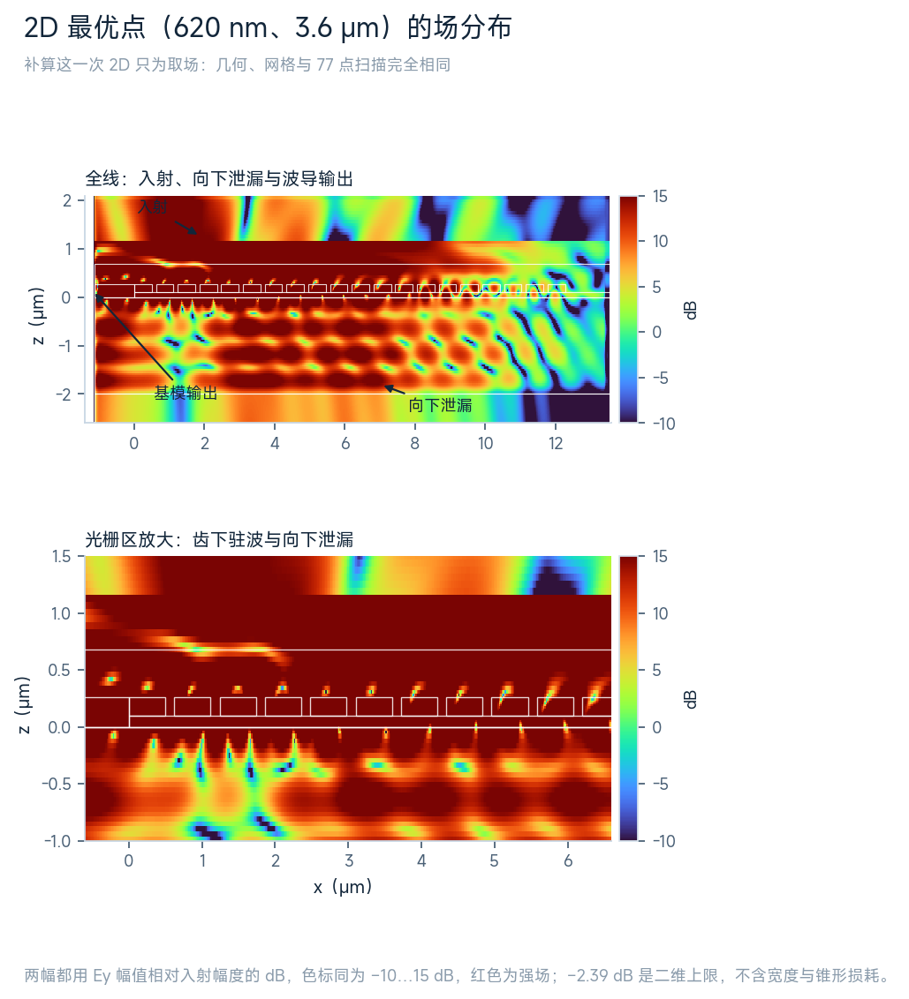
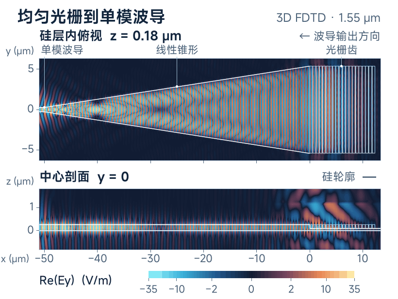
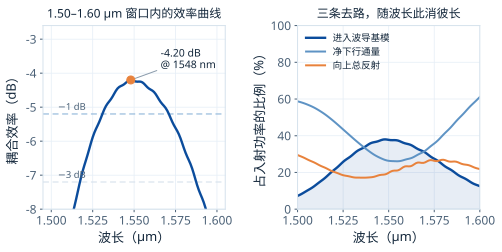

# 一排齿，怎么把光拐进波导？

这是本系列的第二篇。上一篇把地图铺开了，这一篇从最简单的一种做起：**均匀线性光栅**。

它只有两个设计变量：周期，和光束落在光栅上的位置。变量少，反而容易看清光为什么进不去。

我们用的是学习中心里的 [Uniform linear grating coupler](https://www.lingcompute.com/photon/learning-center/examples/notebooks/GratingCoupler) 案例。SOI 平台，硅 260 nm，部分刻蚀 160 nm，占空比 0.8，20 个齿，上面盖 680 nm SiO₂，下面 2 μm BOX。

## 先算周期

上一篇给过光栅方程。对上 1550 nm、14.5° 入射，周期该取多少？

方程里缺一个量：光栅区的等效折射率。刻蚀前后是两个不同的值，所以先建一个 2D 截面，在光栅区左右两侧各切一刀做模式求解，上包层与 BOX 都保留：

- 未刻蚀平板：**n_eff = 2.9522**
- 刻蚀后薄板：**n_eff = 2.1784**

按 0.8 的占空比线性加权，代回方程：

Λ = λ0 / ( neff − nc sin θc )，neff = 0.8 × 2.9522 + 0.2 × 2.1784 = 2.7974

Λ = 1550 nm / ( 2.7974 − 0.2504 ) ≈ 608 nm

θ 这一项容易算错。模型上方是 680 nm SiO₂，光纤在空气里斜 14.5°，进包层后按 Snell 折射到约 10°。相位匹配用到的是不变量 nc sin θc = sin 14.5° = 0.2504，所以式子里直接写 0.2504。拿 1.44 × sin 14.5° 去算会得到 636 nm，差出 28 nm。

材料、刻蚀深度、入射角定下来，周期就定下来了，剩下的只是精度问题。线性加权只准到十几纳米：扫描峰值在 620 nm，由它反推的 n_eff 约 2.750，比 2.797 低 1.7%，这 12 nm 就是近似带来的。真按 608 nm 加工，效率要掉 2 dB 以上。所以还是要扫。

## 为什么不直接做 3D 扫描

2D 只解一个截面：y 方向取周期边界，结构无限延伸，没有 10.8 μm 的宽度，也没有 50 μm 锥形。省下的时间很可观。单次 2D 约 0.025 credits，同一套网格精度的 3D 约 0.685，差 27 倍；77 个点摊开，2D 是 1.9 credits，3D 是 53。

分工因此很清楚：2D 定参数，3D 出结果。周期和光束位置该取多少，2D 的趋势够用；器件能到多少 dB，只有 3D 说了算，宽度、锥形、三维模式匹配都到 3D 才出现。把 2D 的数字当器件指标，会高估近 2 dB，图 3 和图 5 一对比就能看出来。

## 2D 扫的是哪两个量

扫 Λ 和 source_x：

- Λ 取 600–630 nm，七档，步长 5 nm。以算出的 608 nm 为中心，左右各留 20 nm 左右。
- source_x 取 3–5 μm，十一档，步长 0.2 μm。它是高斯光束中心到光栅起点 x = 0 的距离。2D 里没有真光纤，这个量标的是光斑落在光栅的哪一段，对应 3D 里光纤的横向位置。
- 每个点单频 1550 nm，波导端放模式监视器，读基模的 |a|²。

77 个点，就是图 1 右下那张网格。

最优点在 620 nm、3.6 μm，−2.39 dB。值得看的是形状。沿周期方向，620 nm 两侧偏 5 nm 分别掉 0.5 dB 和 0.1 dB，偏 10 nm 掉 1.6 dB 和 0.7 dB，短周期侧更陡。沿位置方向几乎是水平带，3–5 μm 整段只差 0.25 dB；3.6 μm 和次优点 3.4 μm 之间只差 0.01 dB，落在网格分辨之内。

两个方向的敏感度差了一个量级：

- **周期是硬约束。** 它由相位匹配定，偏 5 nm 约 0.5 dB，偏 10 nm 约 1.6 dB。10 nm 的偏差就能把 4.2 dB 的器件推到 5.8 dB。
- **位置是软约束。** 它决定光斑落在哪一段，影响模式重叠，不影响相位。3–5 μm 整段只差 0.25 dB，偏 1 μm 约 0.1 dB。

落到版图上：周期控在 5 nm 以内，代价约 0.5 dB；封装对准留 1 μm 余量，代价约 0.1 dB。

## 2D 最优点的场

57.7% 这个数看不出光去了哪儿。把最优点那组几何原样重跑一次，加一个场监视器，仍然是 2D。

光束在空气里 14.5°，进 SiO₂ 后明显变陡，约 10°，就是上一节 0.2504 的来处。每个齿下方都有局部热点，齿间场连续，说明它按一个漏波工作，不是一堆独立散射体。向下泄漏的条纹斜而连续，一直走到 BOX 以下，这部分在 3D 收支里占 26.3%。

## 3D：多了 50 μm 的锥形

2D 里光栅在整个宽度上无限延伸，也没有锥形。真实器件有边界，案例把 2D 结果搬到 3D，加了两样东西。

一是宽度。光栅宽取模场直径 10.8 μm，本案例光源腰斑 5.4 μm；上一篇的通用单模光纤是 10.4 μm，两个取值。中间要靠一段 **50 μm 的线性锥形**收进 0.5 μm 单模波导。

二是损耗。从 10.8 μm 收到 0.5 μm，理想绝热需要很长的距离，50 μm 不够。

3D 峰值 **−4.20 dB @1548 nm**，比 2D 在 1550 nm 的 −2.39 dB 低约 1.8 dB。口径不同：2D 没有有限宽度和锥形损耗，−2.39 dB 只是二维上限。这 1.8 dB 里有多少来自宽度、多少来自锥形、多少来自三维模式匹配，本次没有逐项分离，不能指定占比。

## 功率去哪了

只看 −4.20 dB，不知道该改哪里。同一个 3D 任务里补三个监视器，把入射功率的去向拆开。以下是 1550 nm 的读数，峰值在 1548 nm：

- 进入波导基模：**37.8%**（−4.23 dB）
- 下方监视器净下行通量：**26.3%**（不是吸收功率）
- 上方平面的向上总通量：**19.8%**（不是返回光纤模式的功率）
- 其余约 16%：未计入基模的高阶模与辐射，没做闭合面分解

净下行 26% 大于向上总通量 20%。BOX 与硅界面有 Fresnel 反射，往返相位影响方向性，所以下方通量不能解释成材料吸收。本次没做 BOX 厚度扫描，不能说 2 μm 是唯一原因，也不能说加厚一定改善。

波长一变，三条去路此消彼长。往短波走，衬底泄漏冲到 59%；往长波走，涨回 61%。中间的低谷对着效率峰值，相位匹配最好时往上的分量最强。

3 dB 带宽 69 nm，1 dB 带宽 39 nm，都相对峰值定义。实际可用窗口还要满足系统允许的绝对插损，光看峰高不够。

## 结论

均匀光栅性能不高，但每个量的作用都摆在明面上：

- 周期由相位匹配确定，短周期侧更陡：10 nm 约 1.6 dB，长周期侧约 0.7 dB。版图按 5 nm 内控，代价约 0.5 dB。
- 位置是软约束，3–5 μm 整段只差 0.25 dB，偏 1 μm 约 0.1 dB，封装余量可以给到微米。
- 2D 定参数、3D 出结果。2D 便宜 27 倍，但 −2.39 dB 只是二维上限，器件到 3D 才是 −4.20 dB。
- 净下行通量大于向上总通量，两者都不是吸收或激光反馈的直接测量。

下一篇处理模式和相位：把填充因子做成位置的函数，让漏出的场对上光纤的高斯形状；再把直的齿弯成圆弧，让它们聚焦到同一点。

---

完整 Notebook 在[学习中心](https://www.lingcompute.com/photon/learning-center/examples/notebooks/GratingCoupler)。国内产品入口为 [tidy3d.fangzhen.cloud](https://tidy3d.fangzhen.cloud/)，注册与运行路径本次未验证，请以平台当前文档为准。
