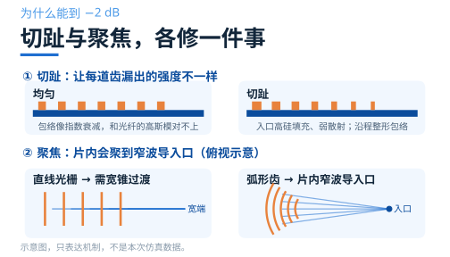
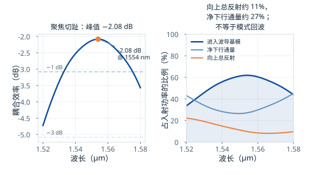
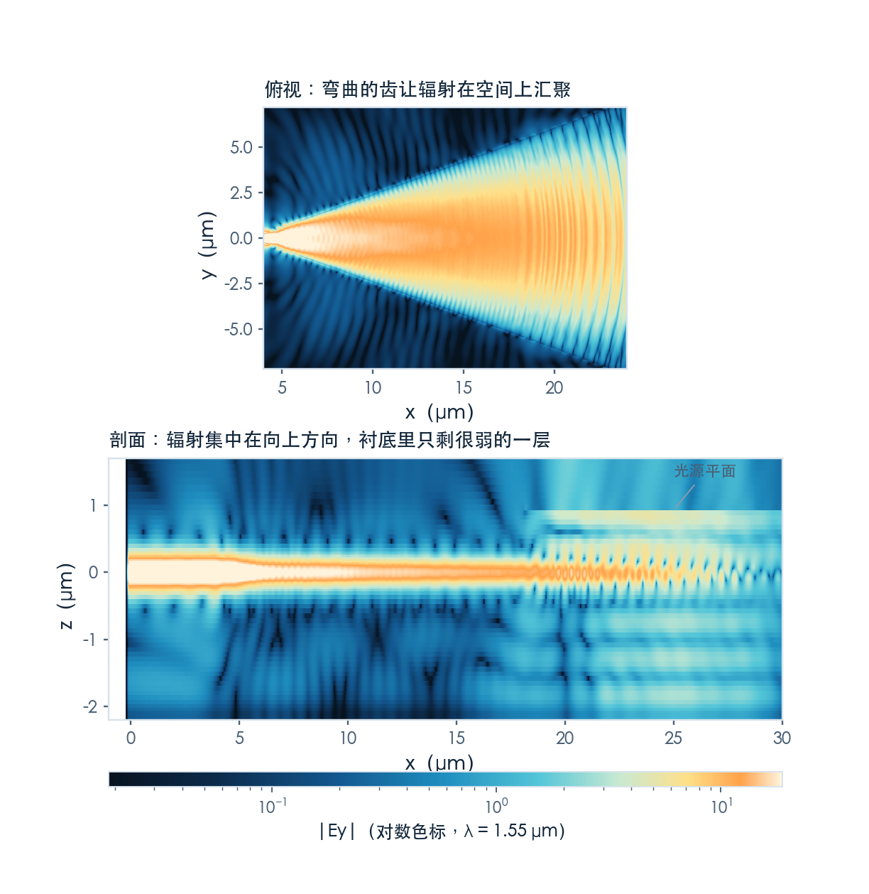
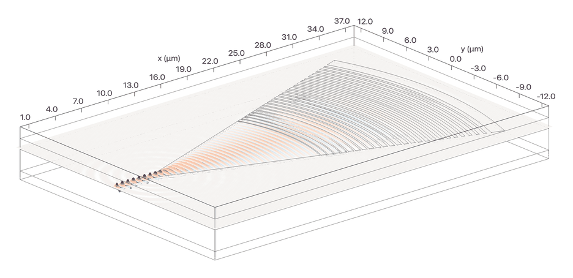

# 切趾与聚焦：把 −4 dB 推到 −2 dB

> **待审稿**：本文处于独立 PR 审核阶段，尚未收录为正式内容。定量结论、素材来源与授权仍需指定业内审核者核查。

上一篇的均匀光栅卡在 −4.2 dB。钱花在哪，账已经算清楚了：38% 进波导，26% 漏进衬底，20% 反射回去，剩下 16% 散掉。

这一篇关注**模式包络整形**与**片内聚焦**。均匀光栅辐射包络与光纤高斯模失配；反向导模散射也是设计关注点，但本期的向上总通量并不等于该反射模式。

案例是学习中心的 [Focusing apodized grating coupler](https://www.lingcompute.com/photon/learning-center/examples/notebooks/FocusedApodGC)，设计方法来自 Marchetti 等人 2017 年那篇 *High-efficiency grating-couplers: demonstration of a new design strategy*。

## 切趾：让填充因子变成位置的函数

均匀光栅的占空比是常数，所以每一道齿漏出的比例都一样。光往前走，剩下的功率越来越少，漏出的绝对量也就指数式衰减。而光纤的高斯模是中间强、两边弱、对称的钟形。两个形状对不上，重叠积分自然打折。

修法很直接：**让占空比沿传播方向线性下降**。

案例里的 F(x) = F₀ − R·x 指**硅填充比例**。入口 F 大、刻蚀槽窄，先让散射较弱；之后逐步调节填充比例及周期，使沿程辐射接近目标高斯包络。R 为填充比例下降的斜率，不能把硅填充比例与刻蚀槽比例混为一谈。

这一改有两个连带好处：

包络匹配有助于提高效率，入口渐变也可用于减小模式反射；后者需在相应激励下投影反向模式来验证，不能直接用上方平面总反射量替代。

还有一处细节：案例让每道齿的宽度 Δ 也跟着变，而不是只改占空比。原因是有效折射率随占空比变，布拉格条件 Λ = λ/(n_eff − n_clad·sinθ) 里的 n_eff 一变，周期就得跟着调，否则整段光栅只有中间一小截满足相位匹配。

## 聚焦：把直的齿弯成圆弧

切趾解决了"漏多少"，聚焦解决"往哪儿漏"。

直线光栅通常需要一段宽锥，把宽光栅区连接到窄波导。这里的聚焦主要作用在芯片平面内，不是把面外出射光聚到光纤位置。

曲线齿组织横向相位，使片内收集的光汇向窄波导入口，从而缩短宽窄过渡。具体能缩短多少，需要同条件版图与传输对照，本次没有验证统一的节省比例。

案例的做法是用同心圆近似椭圆（小角度下差别可忽略），锥形张开角 40°，锥长 16 μm，一共 25 个齿元。

## 结果：−2.08 dB，账怎么变

原案例在 2D 里扫了 8 个刻蚀深度 × 6 个切趾因子 × 5 个光源位置，共 240 次仿真，得到 etch_d = 0.09 μm、R = 0.031、光源在 5.0 μm，2D 效率 −1.9 dB。我们跳过了这 240 次扫描，直接用这组参数做 3D 验证——因为扫描的结论已经写在正文里，重跑一遍不会产生新的可讲内容。

3D 结果是 **−2.08 dB，峰值在 1554 nm**。与均匀光栅峰值 −4.20 dB 相差 **2.12 dB**，峰值功率比例约为 38% 与 **62%**。两种结构条件不同，这不是只改变切趾的配对增益。

以下统一取 1550 nm，区分已测功率与未分解余项：

| | 均匀光栅 | 聚焦切趾 |
| --- | ---: | ---: |
| 进入波导基模 | 37.8% | 61.3% |
| 净下行通量 | 26.3% | 26.5% |
| 向上反射总通量 | 19.8% | 11.2% |
| 三项之外的余项 | 约 16.1% | 约 1.0% |

两件事值得注意。

**向上反射总通量较小，净下行通量接近。** 两例在高斯入射下分别约 19.8% 和 11.2%，下行约 26%–27%；这些跨案例差异不是只改变切趾的因果实验，也不能证明激光器模式回波从 20% 降到 11%。已有波导出耦合任务在 1550 nm 的源后总逆向通量约 1.72%，它仍不是模式分解的反射率。

**聚焦切趾三项之和约为 99%。** 这些平面并不构成完整的闭合面分解，余项不能进一步被分配为具体模式或散射，更不能认定它严格为零。

## 场分布：两处都能看见

俯视图显示弯曲光栅与窄波导连接。这里的「聚焦」指片内相位组织和向窄波导入口的会聚，不是器件上方的三维焦点。

剖面图对应上一篇的结论：能量集中在波导层附近，向上辐射，衬底里只剩很淡的一层。图中那条水平亮带是光源平面，光从那里斜着下来。

## 带宽的代价

带宽由相位匹配、泄漏分布、光纤包络和材料色散共同决定，不能单凭采用切趾就断言带宽一定变窄。

本次结果：**1 dB 带宽 42 nm（1.533–1.575 μm）**，与均匀光栅的 39 nm 接近；不能由峰高推导相对带宽，整体平移 dB 谱线不会改变相对宽度。3 dB 区间覆盖 1.52–1.58 μm 扫描窗口，因此只能报扫描窗内 **≥60 nm**，完整带边尚未找到。

真正的取舍在这里：**均匀光栅是"一个窄带内的低效器件"，切趾是"一个窄带内的高效器件"，两者带宽量级相近**。要宽带，得换思路——比如双层结构，或者干脆回到端面耦合。

## 这一篇的结论

- 切趾把"漏出强度沿传播方向怎么变"从一个常数变成一条设计曲线，让辐射包络对上光纤的高斯模。
- 聚焦用曲线齿组织片内相位，缩短通往窄波导的宽锥过渡。
- 两个案例效率为 −4.20 与 −2.08 dB，向上总反射约 20% 与 11%；后者不等于激光反馈功率。
- 衬底泄漏没动，还是 27%。这是下一篇的入口。

---

完整 Notebook 在[学习中心](https://www.lingcompute.com/photon/learning-center/examples/notebooks/FocusedApodGC)。官方标注完整运行超过 1 FlexCredit，实际费用需在当前账号核价。国内入口为 [tidy3d.fangzhen.cloud](https://tidy3d.fangzhen.cloud/)，注册与运行路径本次未验证。
