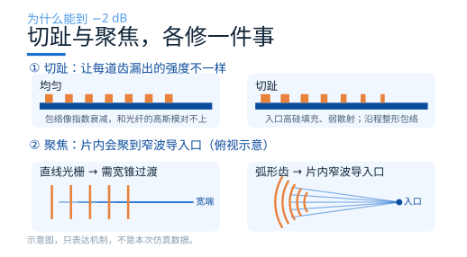
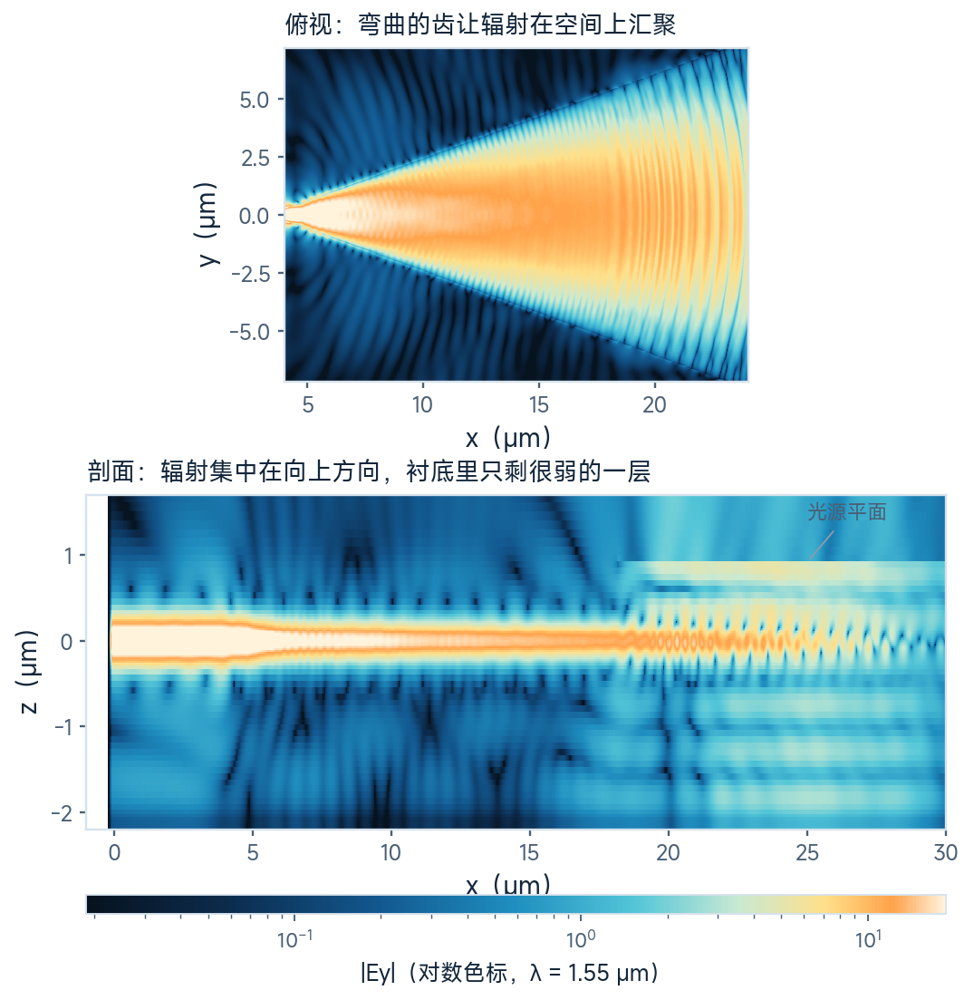
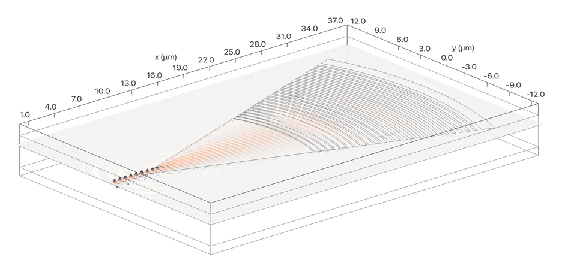
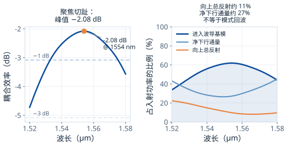

# 聚焦切趾光栅耦合器怎么设计？从逐齿计算到 3D 验证

如果你做过均匀光栅，手上通常已经有一个能把光送进芯片的周期。接下来要解决的是：怎样把这一个周期改成一张逐齿尺寸表，再画成能接到窄波导的聚焦版图？这篇写给有波导或 FDTD 基础、准备做第一版切趾光栅的读者。

## 先确定要改哪两件事

从芯片向光纤出耦合时，均匀光栅每齿散射的功率比例近似相同。随着剩余导模功率下降，后面的齿辐射得越来越弱，沿传播方向的包络近似指数衰减。光纤基模则近似高斯分布，中间强、两边弱。**切趾**让入口的槽较窄、散射较弱，再沿程改变槽宽，把辐射更多地分配到光纤模场覆盖的区域。**聚焦**则用弧形齿组织芯片平面内的相位，让从光纤入射的光汇向窄波导入口。

## 用相位匹配算出每一齿

先定工作波长、偏振、光纤模场与倾角，再从工艺设计套件（PDK）取得层厚、可用刻蚀深度、最小线宽和间距。以本文的 SOI 案例为例，设计波长是 1550 nm，目标为 TE 基模，硅层厚 220 nm，光纤模场直径取 10.4 μm。光纤在空气中相对法线倾斜 14.5°，折算到折射率 1.44 的二氧化硅上包层中约为 10°。在相位匹配公式中，折射率和角度要取自同一介质。

对每个候选刻蚀深度，用模式求解器分别求宽硅板未刻蚀区和刻蚀区的 TE 有效折射率 nₒ、nₑ。横截面厚度分别取硅层全厚和刻蚀后剩余厚度。令 xᵢ 为第 i 个周期起点到首周期起点的距离，Fᵢ 为该周期内**未刻蚀硅齿**的宽度比例。按线性切趾先给出 Fᵢ，再用一阶相位匹配估算周期 Λᵢ。

Fi = F0 − R xi neff,i ≈ Fi no + (1 − Fi) ne Λi ≈ λ0 / (neff,i − nc sin θc)

从 x₁ = 0 开始。硅齿宽取 FᵢΛᵢ，槽宽取 (1 − Fᵢ)Λᵢ，下一周期从 xᵢ + Λᵢ 开始。nₒ 大于 nₑ 时，Fᵢ 越小，按这个模型得到的周期越长。固定周期只改槽宽，会同时改变局部相位匹配。线性切趾和折射率加权是首版近似，实际散射强度与槽宽的关系要靠仿真核对。这个方法可追溯到同时调整填充比例和周期的设计策略。[Marchetti 等，2017](https://doi.org/10.1038/s41598-017-16505-z)

### 两个周期怎样落到尺寸表

以下用假设的模式折射率 nₒ = 2.80、nₑ = 2.40 演算。先在周期公式中代入 nₒ，得到参考周期约 0.608 μm。按官方案例的做法，用 100 nm 最小特征尺寸给首齿比例赋初值，得到 F₀ ≈ 1 − 0.10 / 0.608 ≈ 0.836。取 R = 0.031 μm⁻¹，可算出下表。

| 周期起点 | 周期 | 硅齿宽 / 槽宽 |
| --- | ---: | ---: |
| 第 1 齿，0 | 624 nm | 521 / 103 nm |
| 第 2 齿，624 nm | 626 nm | 511 / 115 nm |

计算时保留未取整的尺寸，到导出版图时再按工艺网格取整。逐齿检查 0 < Fᵢ < 1，并对取整后的齿宽、槽宽和弧端做设计规则检查。如果齿或槽超出工艺范围，调整 F₀、R 或齿数后重算全表，以免局部改宽后破坏相位。换到另一套工艺时，先用不同槽宽的均匀光栅标定散射强度，再按目标高斯包络选几何，通常比照搬线性斜率更稳妥。[Zhao 与 Fan，2020](https://arxiv.org/html/2002.05885)

## 先用二维选参数，再画弧齿

1. **先筛刻蚀深度和切趾斜率。** 在沿光栅中心轴的 x–z 截面做 2D FDTD。对每个刻蚀深度重算 nₑ，再扫 R 与光斑中心位置。以高斯束入射，在窄波导一侧用模式监视器读目标方向的 TE 基模功率。保留 R = 0 的均匀对照，并同样优化光斑位置。2D 用于筛选纵向参数，横向会聚留给 3D 验证。
2. **把逐齿表转成扇形版图。** 案例用同心圆弧近似等相位曲线，扇形全开角 40°，首个周期从半径 16 μm 处开始，共 25 个周期。每个周期从内向外先留刻蚀槽、再画未刻蚀硅齿，径向尺寸直接取逐齿表。圆心靠近窄波导与扇形的连接端。倾角或横向孔径变大时，比较圆弧与等相位曲线的 3D 结果，检查边缘齿的相位误差。
3. **用 3D 检查光谱和工艺余量。** 先在 3D 中微调光斑位置与倾角，再扫波长与横向偏移，并检查刻蚀深度和线宽偏差下的效率。除目标波导模式外，记录向下净通量。若关心激光反馈，用波导基模出耦合激励，在输入侧做反向基模投影。若要量化切趾本身的收益，保持材料层叠、刻蚀深度、扇形几何和端口口径一致，仅比较均匀与切趾两版。

## 用光谱和功率收支验收

[官方案例](https://www.lingcompute.com/photon/learning-center/examples/notebooks/FocusedApodGC)用 8 个刻蚀深度、6 个切趾斜率和 5 个光斑位置筛选 2D 结构，报告约 −1.9 dB 的最佳值。本项目已有的 3D 仿真采用 90 nm 刻蚀、R = 0.031 μm⁻¹、光斑沿轴位置参数 5.0 μm。这组结构在 1554 nm 的基模耦合效率为 **−2.08 dB（约 62%）**。均匀光栅案例的峰值为 −4.20 dB，两组仿真的层叠、刻蚀和版图均有差异，2.12 dB 只能作为案例峰值之差。

| 1550 nm 功率占比 | 均匀光栅 | 聚焦切趾 |
| --- | ---: | ---: |
| 进入波导基模 | 37.8% | 61.3% |
| 净下行通量 | 26.3% | 26.5% |
| 向上反射总通量 | 19.8% | 11.2% |
| 三项以外余量 | 约 16.1% | 约 1.0% |

向上总反射由平面通量求得。要确定多少光返回光纤，须投影到返回的光纤模式。三项功率也没有构成闭合面的完整分解，余量只能记作未分解功率。聚焦切趾案例相对峰值的 **1 dB 带宽为 42 nm**（1533–1575 nm），与均匀光栅案例的 39 nm 接近。整个 1520–1580 nm 扫描窗口都在 3 dB 范围内，因此完整的 3 dB 带宽至少为 60 nm，需扩扫才能找到两个带边。

复现时可以先用自己的 PDK 和模态折射率生成逐齿表，在相同层叠上比较 R = 0 与一个满足线宽约束的正斜率。要是光谱峰值提高、净下行通量仍接近本例的 27%，下一轮可单独扫描 BOX 厚度，或评估带反射层的结构，检查向上方向性还有多少改善空间。
