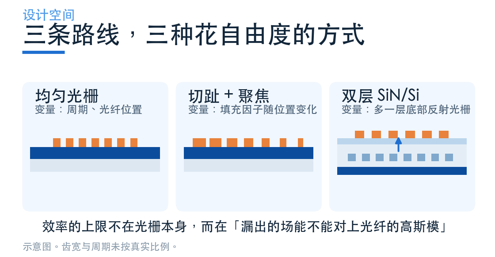
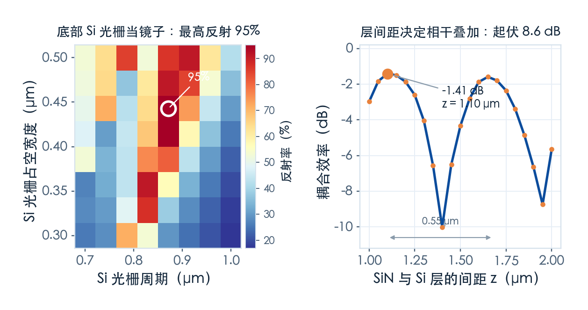
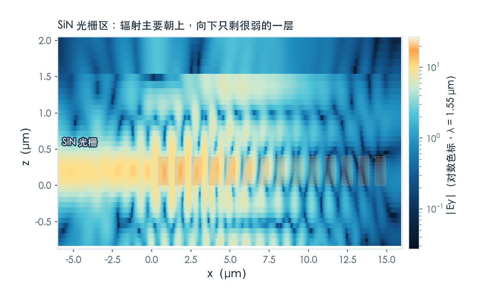
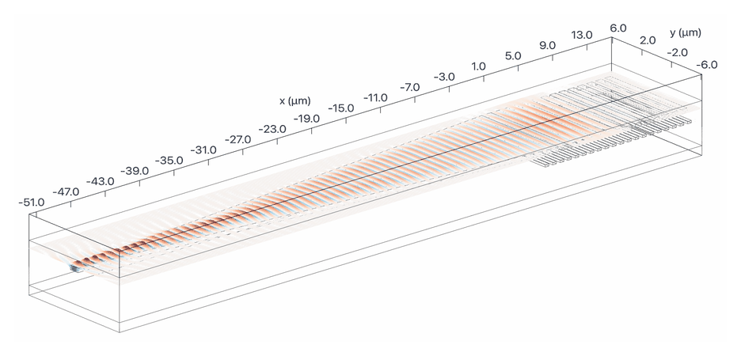

# 氮化硅效率低？在下面埋一面镜子

> **待审稿**：本文处于独立 PR 审核阶段，尚未收录为正式内容。定量结论、素材来源与授权仍需指定业内审核者核查。

前两篇都在 SOI 上做。这一篇换平台：**氮化硅（SiN）**。

换平台的理由很实在——SiN 的损耗低、透明窗口宽、不吸收可见光，是激光雷达、生物传感、非线性光学常用的平台。但它有个天生的短板：**折射率对比低**（SiN 约 1.97，SiO₂ 约 1.44）。

较低折射率对比会影响模式约束与光栅散射，但效率还取决于厚度、齿形和反射环境。本例扫描得到纯 SiN 设计点约 −6.18 dB，不代表所有单层 SiN 光栅的上限。

案例是学习中心的 [Design optimization of a bilayer SiN/Si grating coupler](https://www.lingcompute.com/photon/learning-center/examples/notebooks/BilayerSiNSiGC)，方法来自 Zou 等人 2015 年 *Optics Express* 那篇 *Ultra efficient silicon nitride grating coupler with bottom grating reflector*。

## 思路：把"方向性"单独拎出来修

第二篇记录了约 27% 净下行通量。BOX/硅界面的反射及往返相位会影响这一读数；本次没有厚度扫描，不能认定它是 2 μm BOX 太薄的必然结果。

本例选择增加一层硅光栅，重定向下行辐射并调整反射相位，以优化**方向性**。弱散射本身并不必然意味着更大的下行占比。

硅光栅提供可设计的反射幅度、相位和衍射方向，并与 SiN 层协同工作。金属或多层介质反射器也可能用于其他设计；本例没有逐一比较，不能断言它们原则上不可用。

## 三段扫描：把三个自由度分开调

案例的流程是把一个三变量问题拆成三个单变量问题，依次收敛：

**第一步，只调 SiN 光栅。** 先不管硅层和衬底，扫描齿宽 w_gc、周期 p_gc、光纤位置 x_fiber 三个参数。原案例用的是 6×6×5 = 180 个 2D 仿真；我们为了控制费用降到 4×4×4 = 64 个。

结果是 w_gc = 0.40 μm、p_gc = 1.067 μm、x_fiber = 4.93 μm，纯 SiN 光栅的效率 **−6.18 dB**。这个数字很说明问题——同样的 SOI 光栅能到 −4 dB，SiN 直接掉了 2 dB。

**第二步，单独设计硅反射光栅。** 这一步只关心"反射率"，不关心耦合。扫齿宽 w_gr 和周期 p_gr，用一个通量监视器量反射回来的比例。

最好的一组是 w_gr = 0.443 μm、p_gr = 0.871 μm，反射率 **95.2%**。

**第三步，调两层之间的距离。** SiN 的直接上行辐射与经硅层反射的光在上方相干叠加。往返相位随间距变化；近轴近似下距离每变 λ/(2n) 约完成一个 2π 周期，斜入射还要计入传播角。

右图那条曲线就是这件事的直接证据：z 从 1.0 扫到 2.0 μm，耦合效率在 −1.41 dB 和 −10.0 dB 之间来回摆，起伏 **8.6 dB**。周期 0.55 μm，正好对上 λ/(2n_clad)。最优 z = **1.10 μm**。

这个摆动说明层间距需要控制。具体允许偏差应在工作点附近扫描，并结合膜厚统计；本次没有建立 ±100 nm 的通用工艺门槛，也没有给各参数做完整敏感度排序。

## 3D 验证：−1.41 dB 掉到 −2.00 dB

原案例全程只做 2D，正文最后一句就是"下一步需要建 3D 来验证"。所以这个 3D 模型是我们自己搭的：把 2D 的最优参数拉伸成有限宽度，加一条 50 μm 的线性锥形把单模 SiN 波导过渡到 10.4 μm 的光栅宽度。

**这个模型不是 Notebook 给出的结果**，需要单独标注。2D 的 −1.41 dB 和 3D 的 −2.00 dB 也不是同一个口径。

3D 结果：**峰值 −2.00 dB，在 1539 nm**。与 2D 相差约 0.6 dB；有限宽度、锥形过渡与模式匹配都可能参与，本次没有分离各项贡献。

这里要坦白一处不足：这个场监视器的纵向范围只覆盖到 SiN 层下方约 0.9 μm，**没有覆盖到 1.1 μm 处的硅反射光栅**，所以图上看不到"光被折回来"的那一段。反射镜的作用只能从指标上看——

本次双层 3D 的净下行通量为 **10.4%**；均匀 SOI 与聚焦切趾分别为 26.3%、26.5%。这些跨平台数字不能作为同一结构加镜前后的配对收益；反射器机制还应结合本例 2D 设计扫描理解。

## 效率、带宽与通量一起看

| | 均匀 SOI | 聚焦切趾 SOI | 双层 SiN/Si |
| --- | ---: | ---: | ---: |
| 峰值耦合效率 | −4.20 dB | −2.08 dB | −2.00 dB |
| 1 dB 带宽 | 39 nm | 42 nm | 62 nm |
| 净下行通量（1550 nm） | 26.3% | 26.5% | 10.4% |
| 向上总反射（1550 nm） | 19.8% | 11.2% | 19.8% |

这张表里最值得看的是**带宽**。

双层结构的 1 dB 带宽为 62 nm。带宽同时受群折射率、相位匹配、泄漏长度、光纤包络和反射相位影响；不能从「泄漏弱」直接推出「带宽宽」。3 dB 区间为 1500–1595 nm，触及扫描下边界，因此只能报扫描窗内 **≥95 nm**。

本例向上反射总通量约 **19.8%**。它是高斯入射下上方平面统计的总量，不能等同于波导回波或光纤反射模式；需要在对应激励下做模式投影才能评估反馈。

## 这一篇的结论

- 本例纯 SiN 设计点为 −6.18 dB，不是单层 SiN 光栅的普遍上限。
- 硅反射光栅扫描峰值反射率 95.2%；双层 3D 净下行通量为 10.4%，不能与 SOI 的 26% 作加镜前后对照。
- 层间距靠相干叠加工作，0.55 μm 一个周期，8.6 dB 的摆动——这是工艺上最脆弱的地方。
- 本例 1 dB 带宽 62 nm；3 dB 带宽在扫描窗内至少 95 nm，尚未找到完整短波带边。
- 向上总反射与目标模式回波需分别测量，不能由一个指标替代另一个。

---

**想自己跑一遍？** 完整 Notebook 在[学习中心](https://www.lingcompute.com/photon/learning-center/examples/notebooks/BilayerSiNSiGC)。注意它全程是 2D 的，最后的 3D 验证要自己搭——这正是我们做的事。国内入口：[tidy3d.fangzhen.cloud](https://tidy3d.fangzhen.cloud/)。
