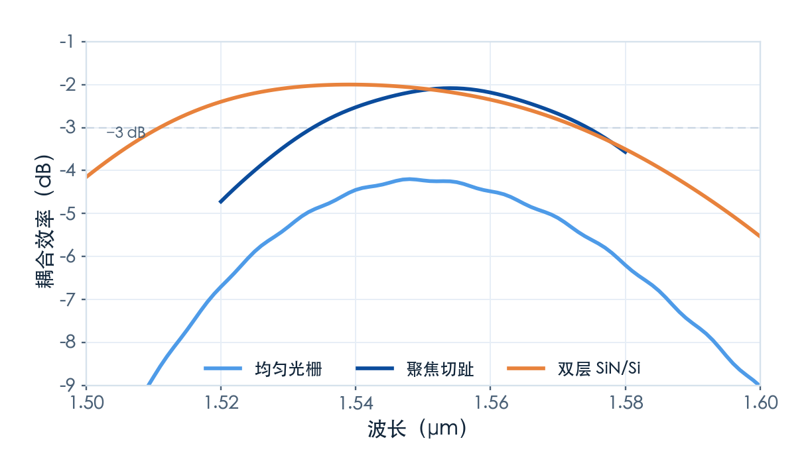

# 三条路线怎么选：一张表说清

> **待审稿**：本文处于独立 PR 审核阶段，尚未收录为正式内容。定量结论、素材来源与授权仍需指定业内审核者核查。

三篇案例讲完，这一篇做三件事：把三个数字放在同一张表上、给一套能照着走的选型顺序、说清这些数字不能怎么用。

先说结论：**这三条不是三个可以互相替代的选项。** 均匀光栅是理解起点，切趾是 SOI 上的主力方案，双层结构是氮化硅平台的解法。选哪个，先看你的平台，再看你要什么。

## 数据放在一起

| | 均匀 SOI | 聚焦切趾 SOI | 双层 SiN/Si |
| --- | ---: | ---: | ---: |
| 峰值耦合效率 | −4.20 dB | −2.08 dB | −2.00 dB |
| 峰值波长 | 1548 nm | 1554 nm | 1539 nm |
| 1 dB 带宽 | 39 nm | 42 nm | 62 nm |
| 3 dB 带宽 | 69 nm | ≥60 nm（触边界） | ≥95 nm（触边界） |
| 净下行通量（1550 nm） | 26.3% | 26.5% | 10.4% |
| 向上反射总通量（1550 nm） | 19.8% | 11.2% | 19.8% |
| 设计变量 | 2 个 | 3 个（含曲线版图） | 6 个（含层间距） |
| 版图 | 直线，简单 | 曲线，需 GDS | 两层，需对准 |
| 待核查的工艺敏感项 | 周期、线宽 | 刻蚀深度、切趾因子 | 层间距及两层尺寸 |

三条曲线的形状比数字更能说明问题：均匀光栅那条又低又窄，聚焦切趾那条高但同样窄，双层那条顶点差不多高、但两边塌得慢。

## 数字不能怎么用

有三处口径差异必须说清楚，否则这张表会被误读成"排名"。

**第一，材料平台不同。** 前两个是 SOI（硅 3.48 / 氧化硅 1.44），第三个是 SiN（1.97 / 1.44）。折射率对比差了近一倍，这不是"设计好坏"的差别，是物理起点的差别。

**第二，仿真维度不同。** 双层案例原 Notebook 只有 2D（−1.41 dB），表里的 −2.00 dB 是我们自建的 3D 模型算的。SOI 那两个是原 Notebook 的 3D。三个都是 3D 了，但双层那个 3D 的宽度、锥形长度是我们选的，不是官方给的。

**第三，监视器与网格不同。** 三个任务的网格精度、监视器位置、仿真域大小都不一样。比如双层案例的场监视器没有覆盖到反射器那一层，所以它的"向下只剩很弱一层"这个判断只到 SiN 下方 0.9 μm 为止。

所以这张表能回答"机制上谁强在哪"，不能回答"哪个器件性能最好"。

## 选型顺序

按这四步走，大部分场景能直接落到一个答案上。

**第一步：平台定死了吗？**

如果工艺是 SiN，可先评估本例的底反射结构；−6.18 dB 只是本次纯 SiN 设计点，不是单层上限。其他光栅形状、反射结构及端面路线仍是候选。

如果是 SOI，往下走第二步。

**第二步：效率是第一优先，还是够用就行？**

要效率，做聚焦切趾，−2.08 dB。代价是 240 次参数扫描的设计工作量、曲线版图、以及对刻蚀深度和切趾因子的双重敏感。

−4.2 dB 够用（比如短距离互联、或者后面有光放大器），用均匀光栅。两个设计变量，直线版图，一次扫描就能收敛。

**第三步：带宽是硬指标吗？**

如果系统要求 1.53–1.57 μm 的 40 nm 窗口，需检查整个指定区间是否落在相对带宽和绝对插损预算内。常用 C 波段约为 1530–1565 nm，不能直接把二者等同。换成双层或端面时还需核查平台与工艺。

**第四步：反射敏感吗？**

激光反馈需要测量返回激光器所接收模式的功率。本表的 19.8% / 11.2% / 19.8% 是高斯入射时的向上总反射，不能据此宣称回波收益或切趾是必选。波导激励时则应测源后反向模式。

## 从哪开始动手

如果你还没跑过任何 Tidy3D 案例，建议的顺序是：

1. **先跑均匀光栅。** 它只有两个变量，2D 扫描 77 个任务，跑完能看懂"周期是硬约束、位置是软约束"这件事。这一步建立的是直觉。
2. **再跑聚焦切趾。** 注意官方标注：整个 Notebook 超过 1 FlexCredit，因为那 240 次 2D 扫描不便宜。想省，可以直接用正文给的 etch_d=0.09、R=0.031、src_pos=5.0 做 3D 验证——我们就是这么做的。
3. **最后看双层。** 它需要理解相干叠加，先看层间距那条曲线。

国内产品入口为 [tidy3d.fangzhen.cloud](https://tidy3d.fangzhen.cloud/)，Notebook 可从学习中心获取。本次未验证国内注册、Notebook 上传与浏览器执行流程，请按平台当前文档配置环境和账号。首次运行应先核查求解费用、边界和监视器，再按案例设置求解；任意缩域或粗化网格可能改变物理结果。

## 参考材料

- 案例页（学习中心）：
  - [Uniform linear grating coupler](https://www.lingcompute.com/photon/learning-center/examples/notebooks/GratingCoupler)
  - [Focusing apodized grating coupler](https://www.lingcompute.com/photon/learning-center/examples/notebooks/FocusedApodGC)
  - [Design optimization of a bilayer SiN/Si grating coupler](https://www.lingcompute.com/photon/learning-center/examples/notebooks/BilayerSiNSiGC)
- 原始论文：
  - R. Marchetti, C. Lacava, A. Khokhar, et al., "High-efficiency grating-couplers: demonstration of a new design strategy," *Sci. Rep.* **7**, 16670 (2017). [DOI: 10.1038/s41598-017-16505-z](https://doi.org/10.1038/s41598-017-16505-z)
  - J. Zou, Y. Yu, M. Ye, L. Liu, S. Deng, X. Zhang, "Ultra efficient silicon nitride grating coupler with bottom grating reflector," *Opt. Express* **23**, 26305–26312 (2015). [DOI: 10.1364/OE.23.026305](https://doi.org/10.1364/OE.23.026305)
  - R. Waldhäusl, B. Schnabel, P. Dannberg, E.-B. Kley, A. Bräuer, W. Karthe, "Efficient coupling into polymer waveguides by gratings," *Appl. Opt.* **36**, 9383–9390 (1997). [DOI: 10.1364/AO.36.009383](https://doi.org/10.1364/AO.36.009383)
- 官方文档：
  - [Tidy3D Notebooks 索引](https://docs.flexcompute.com/projects/tidy3d/en/latest/notebooks/docs/index.html)
  - [监视器 API](https://docs.flexcompute.com/projects/tidy3d/en/stable/api/monitors.html)

## 全系列回顾

- **第一篇｜综述**：相位匹配约束周期；效率、相对带宽、净下行通量与向上总反射需要一起看。
- **第二篇｜均匀光栅**：−4.20 dB。周期是硬约束，位置是软约束；2D 到 3D 掉 1.8 dB。
- **第三篇｜聚焦切趾**：−2.08 dB。切趾整形包络、聚焦缩短片内过渡；向上总反射约 11%，不是模式回波。
- **第四篇｜双层 SiN/Si**：−2.00 dB。底反射与相干叠加调方向性，净下行通量约 10.4%；跨案例数字不是加镜前后对照。
- **第五篇｜横向比较**：就是这一篇。

一篇关于"光怎么进芯片"的讨论，最后落在一个很朴素的结论上：**每一次效率提升，都是把某一项损失单独拎出来、用一个新自由度去换的。** 均匀光栅只有一个自由度（周期），所以只能到 −4 dB；切趾多了一个（填充因子随位置变），补上了模式匹配；双层再多一个（层间距），补上了方向性。

下一组讲片上布线——光在芯片上怎么转弯、怎么交叉，又是另一套账：弯曲损耗随半径下降，串扰却随长度累积，两者要一起算。
