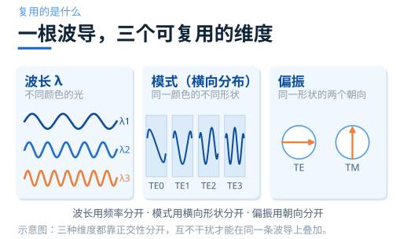
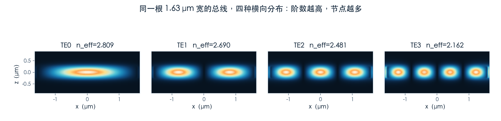
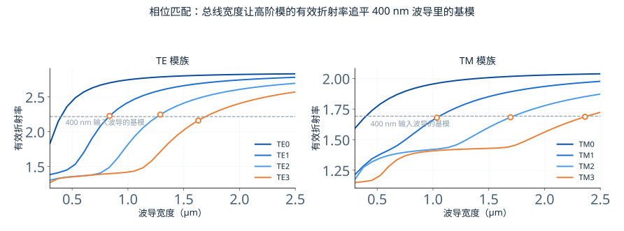
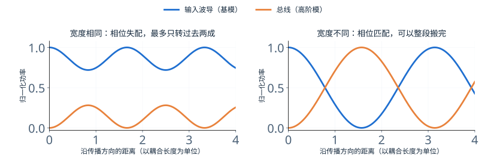
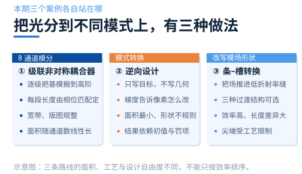

# 同一根波导里的光，怎么按模式分开？

> **待审稿**：本文处于独立 PR 审核阶段，尚未收录为正式内容。定量结论、素材来源与授权仍需指定业内审核者核查。

一根单模波导只能跑一个通道。想加容量，最直接的办法是换更宽的波导——宽波导能同时容纳好几个横向分布不同的模式，每个模式都是一个独立的通道。这就是**模分复用**。

难点不在「怎么让多个模式同时存在」，那自然会。难在**怎么在需要的地方把它们分开，并且保证分开之后还是原来那个模式**。本组三篇围绕三个官方 Notebook，把 8 通道模分解复用器、逆向设计的模式转换器、条–槽转换器逐个跑通，最后给一套判断顺序。

## 01　模式是什么：一根波导里的几个「形状」

光在波导里的横向分布不是任意的。给定宽度和厚度，只有有限几种分布能稳定传播，它们叫**模式**，按零点个数从低到高编号：TE0 是基模，TE1 有一个零点，依此类推。

这些形状彼此正交。正交的意思是：一个纯 TE1 的光，不会被一个只认 TE0 的接收端读到。正因如此，它们才能当作独立通道使用。

模式数由波导尺寸决定。1550 nm、220 nm 厚的硅波导，宽度做到 1.6 μm 左右就能支持 TE0–TE3 四个 TE 模。这是本期所有设计的物理基础。

正交性也解释了模分最麻烦的地方。波长通道之间靠滤波器隔离，滤波器的抑制比可以做到几十 dB，而且是「单向」的——不同波长之间不会因为传播距离而互相转换。模式不一样：只要波导里有一点不对称、一个急弯、一处宽度抖动，模式之间就会耦合。这种耦合是累积的，走的路越长，漏过去的越多。所以模分器件的难点往往不在「怎么分」，而在「分开之后怎么保持」。

## 02　怎么把光「搬」到另一个模式上

有了几个模式，下一个问题是怎么把一个通道的光从 TE0 换成 TE1。最常用的办法是**非对称定向耦合器**：两根宽度不同的波导靠近到几百纳米，让它们的模场重叠。

两根等宽波导靠在一起，会周期性交换功率，但交换不完全——因为两根波导里同一个模式的相位速度一样，来回摆动的幅度取决于耦合强度，光会在两根波导之间来回跑。

把其中一根做宽，让它支持的模式变成高阶模，情况就变了：**当宽波导里高阶模的有效折射率，正好等于窄波导里基模的有效折射率时，两个模式同步**，功率才会单向地、完整地从一根搬到另一根。

这张图是本期最基础的一张：横轴是波导宽度，纵轴是有效折射率，四条曲线对应四个 TE 模。400 nm 输入波导的基模折射率画成一条水平虚线，它与 TE1、TE2、TE3 三条曲线的交点，就给出了三段耦合器各自需要的总线宽度。

注意这三个交点分散在 0.8 到 1.7 μm 之间，跨度很大。这意味着一个「八通道」器件不可能用一根等宽总线把所有模式都接上——每接一个高阶模，总线就得换一次宽度，中间靠锥形过渡衔接。这正是 8 通道器件要做到 200 μm 长的原因。

## 03　本期三个案例，代表三种做法

**级联非对称耦合器**：把上面这种「一段耦合器搬一个模式」的结构串起来。8 通道模分复用器就是六段耦合器加锥形过渡，全长约 200 μm。它的优点是版图规整、带宽宽；代价是面积随通道数线性增长。

**逆向设计**：不画结构，只写目标函数——「让输出端的 TE1 功率最大」。优化器通过伴随法算出每个像素该怎么改，二十步之后自己长出一个形状。它的优点是面积可以做到极小；代价是结果依赖初值与罚项，形状不规则，可解释性差。

**条–槽转换**：换一个方向——不改模式的阶数，改模场的位置。槽波导由两条硅脊夹一条低折射率缝组成，场集中在缝里，适合做光与物质的强相互作用。条–槽转换器负责把光从「关在硅里」搬到「关在缝里」。

三个案例的波段、维度、指标定义都不同：8 通道器件是 3D、1550 nm；逆向设计是 2D、1.0 μm；条–槽是 3D、1550 nm。所以本组只讲机制与各自的取舍，**不做跨案例的性能排名**。

## 04　接下来三篇怎么读

第二篇讲 8 通道模分：相位匹配怎么落到版图上，六段耦合器各自的谱线长什么样，整器件为什么只验了两个入口。

第三篇讲逆向设计：目标函数怎么写、二十步里发生了什么、为什么最终结构的效率不能直接当作器件的规格。

第四篇讲条–槽：为什么要把场推进低折射率区，三种过渡结构各差在哪里。

第五篇把三个案例放进同一张指标表，给出选型顺序与各自的边界。

想先动手的话，可以直接打开学习中心的对应案例页，注册国内平台后按 Notebook 跑一遍——本期所有读数都来自这些 Notebook 的求解结果。

- [8-Channel mode and polarization de-multiplexer](https://www.lingcompute.com/photon/learning-center/examples/notebooks/8ChannelDemultiplexer)
- [Inverse design optimization of a mode converter](https://www.lingcompute.com/photon/learning-center/examples/notebooks/Autograd3InverseDesign)
- [Strip to slot waveguide converters](https://www.lingcompute.com/photon/learning-center/examples/notebooks/StripToSlotConverters)

注册入口：[https://tidy3d.fangzhen.cloud/](https://tidy3d.fangzhen.cloud/)
