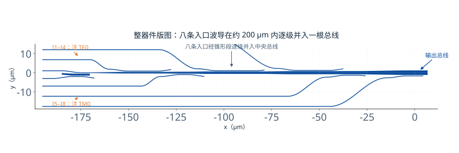
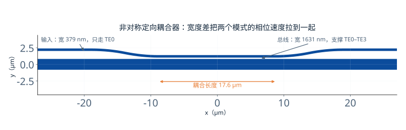
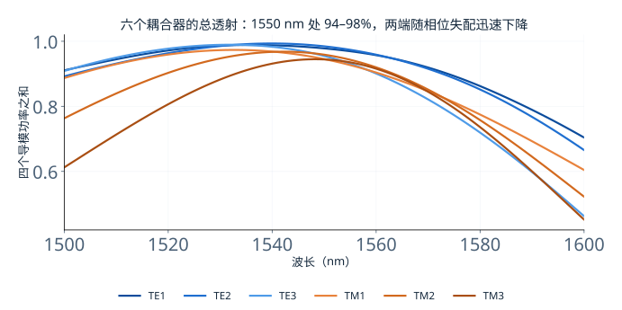
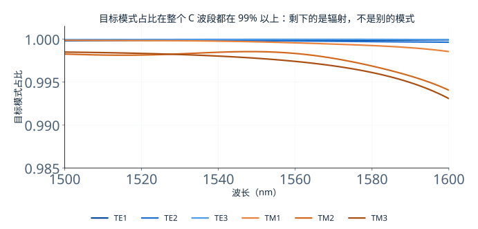
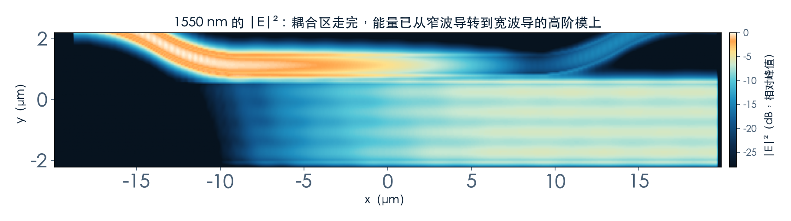
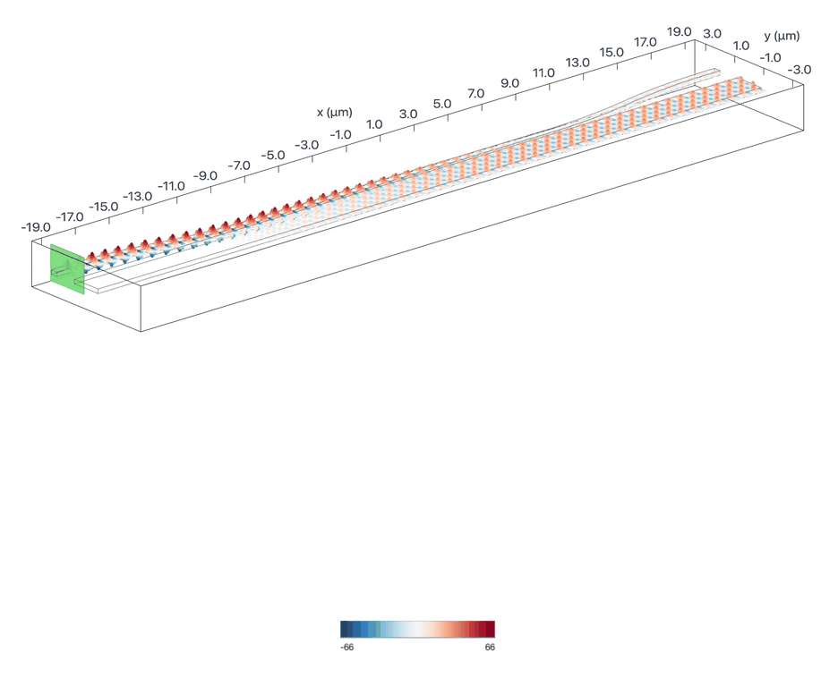
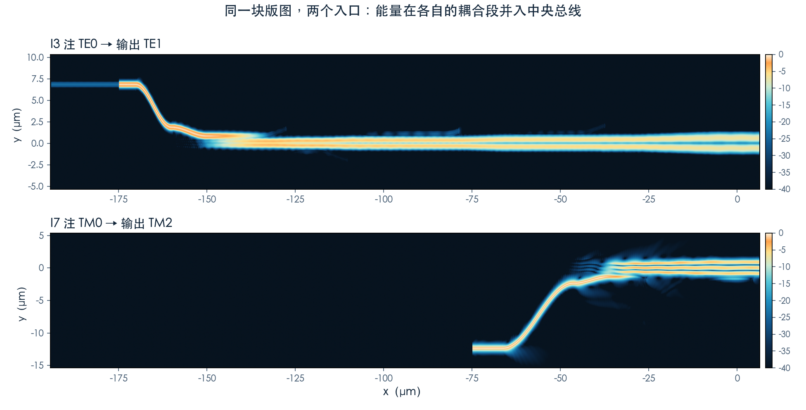
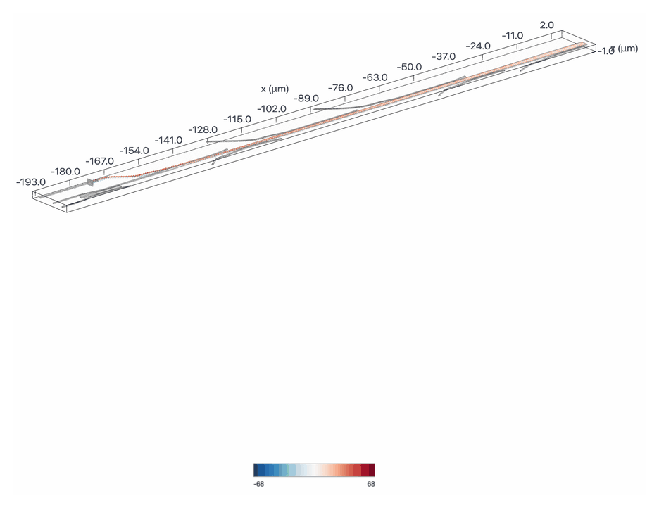
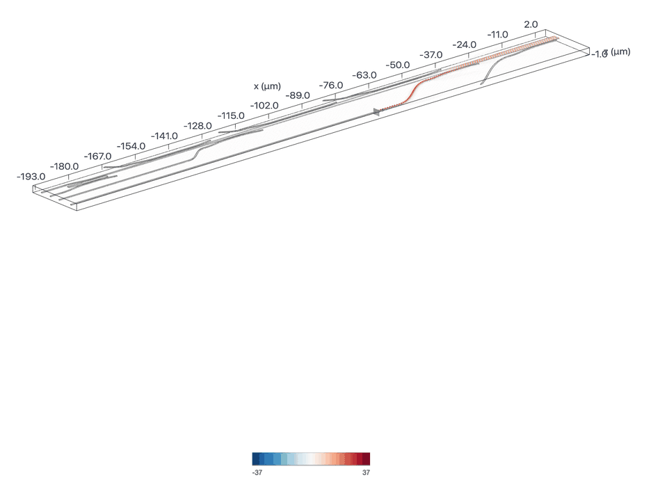
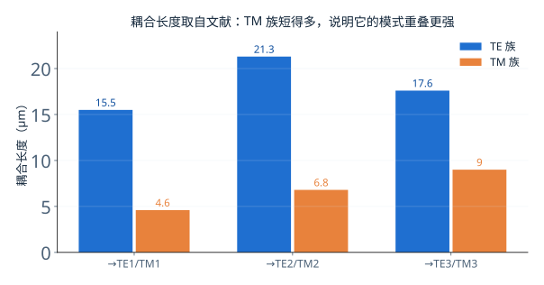

# 八个入口，一根总线：模分复用器怎么装配

> **待审稿**：本文处于独立 PR 审核阶段，尚未收录为正式内容。定量结论、素材来源与授权仍需指定业内审核者核查。

把四段非对称耦合器串起来，再配上锥形过渡和八条入口波导，就得到一个约 200 μm 长的 8 通道模分（与偏振）解复用器。这一篇讲它怎么装起来、每一段各自表现如何，以及为什么本期的验证只覆盖了两个入口。

## 01　一段耦合器长什么样

先看最小单元。两条波导在中间一段平行靠近，间隙 200 nm；输入端是一根 400 nm 的窄波导，只走 TE0；总线端宽 1.631 μm，能同时支持 TE0–TE3。两端的余弦弯曲把波导拉开，避免非耦合区互相干扰。

耦合长度不是随便定的。它要满足两个条件：相位匹配（总线宽度由上一期的有效折射率曲线定），以及**长度刚好让功率搬完**——短了搬不过去，长了又搬回来。本期六个耦合器的长度直接取自参考文献，没有重跑参数扫描。

## 02　六段各自的表现

每一段单独求解一次，看两个量：总线出口的总功率，以及目标模式在四个已存模式里的占比。

两个量要一起看。总功率回答「有多少光到了总线」，模式占比回答「到的那部分是不是想要的那一阶」。总功率 95% 而占比 60%，说明光到了但形状不对，属于没搬干净；反过来总功率 80% 而占比 99%，说明搬得很干净但路上漏了。

本次六个耦合器在 1550 nm 的表现是：TE1 总透射 97.81%、TE2 98.45%、TE3 95.49%；TM1 94.53%、TM2 95.88%、TM3 94.41%。对应的目标模式占比都在 99.78% 以上。

需要说明口径：这里的占比分母是**四个已存模式的功率之和**，不含辐射模与未统计的端口。所以「99.9%」不等于「没有损耗」，只等于「在导模里没有跑错」。TE3 那一段总透射 95.49%，意味着约 4.5% 的光既不在四个导模里，也不是目标模式——它辐射掉了或反射回去了。

还有一个容易被忽略的细节：总透射曲线在 1520 nm 以下和 1575 nm 以上掉得很快，到 1600 nm 只剩 45% 左右。这不是辐射，而是**耦合长度固定**带来的带宽限制——波长偏离设计点后，相位匹配条件被破坏，功率搬不完，剩下一部分留在输入波导里从原路出去。我们的监视器只放在总线端，所以看到的是「总功率下降」。换句话说，这六个耦合器的模式纯度是宽带的，但功率转移不是。

## 03　整器件：两个入口各走一遍

六段拼起来之后，全器件长 200 μm、宽约 35 μm。八条入口在左侧，四条走 TE0、四条走 TM0，经 1.8° 的锥形过渡汇入中央总线。

原 Notebook 只激励两个入口作为演示：I3（注 TE0，应转成 TE1）与 I7（注 TM0，应转成 TM2）。本期照做，没有扩到八口全表征。

读数：I3 出口的四个模式功率之和为 98.56%，其中 TE1 占 99.80%，其余三个模式合计 0.18%。I7 出口合计 95.57%，TM2 占 99.65%，其余合计 0.21%。

I7 的总功率比 I3 低约 3.0 个百分点，主要差在弯曲段的泄漏——场图上能直接看到拐角处的散射亮点。原 Notebook 也指出了这一点，并建议改用 Euler 弯来改善。

从单段到整器件，效率会掉一点，这几乎是必然的：单段模型两端只有一对弯曲，整器件里有八条入口、七段锥形过渡和若干级联节点，每一处都贡献一点散射。把六个耦合器的单段结果（94–98%）与整器件的 98.56% 放在一起看，差的那几个百分点就是这些「装配开销」。

## 04　六个长度为什么差这么多

TE1 / TE2 / TE3 三段分别是 15.5 / 21.3 / 17.6 μm，TM 三段只有 4.6 / 6.8 / 9.0 μm。差距不是笔误，而是耦合强度的差别。

TM 模的模场在垂直方向更集中，两根波导靠近时重叠更强，功率交换得快，需要的长度就短。TE 模场更铺展，交换慢，需要更长的距离才搬得完。TE2 比 TE3 还长，是因为它对应的总线宽度（1.29 μm）离输入波导最近，相位匹配做得最「松」，耦合系数最小。

这也解释了为什么版图上 TE 段占了大半长度：器件的总长基本由最长的 TE2 段决定。

## 05　这篇不能说什么

**不能说「八通道全部验证」。** 只激励了 I3 与 I7 两个入口，其余六个入口的行为没有本次数据。整器件的结论只覆盖这两条路径。

**不能说「耦合长度已优化」。** 六个长度是文献值，本次没有扫描。谱线平坦说明这些值可用，不代表它们是最优。

**不能说「纯度 99.9% 等于没有串扰」。** 口径只统计四个导模。真实系统里还要算上辐射、反射与相邻通道的串扰，这些本次没有测。

**I7 的 95.6% 不能直接和 I3 的 98.6% 比优劣。** 两者是不同的偏振、不同的弯曲路径、不同的对称边界，只能各自说明「这条路径通了」。

下一篇换一个完全不同的思路：不写几何，只写目标，让优化器自己长出结构。
