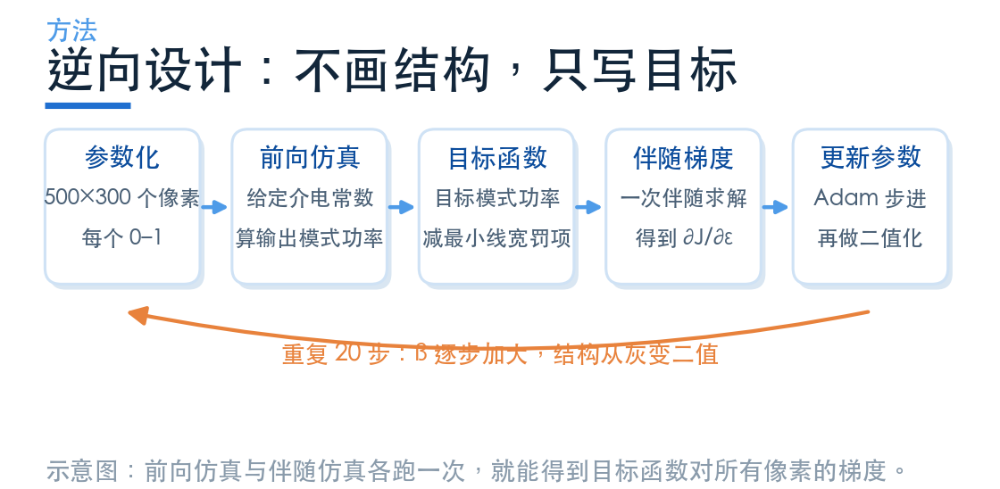
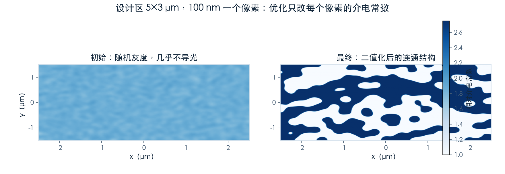
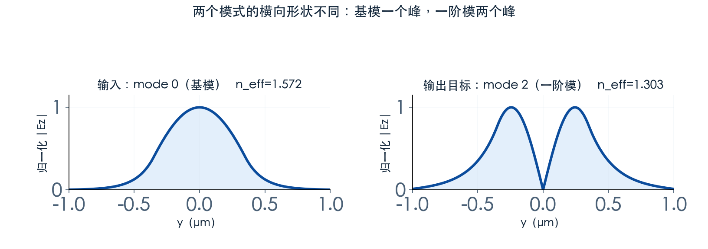
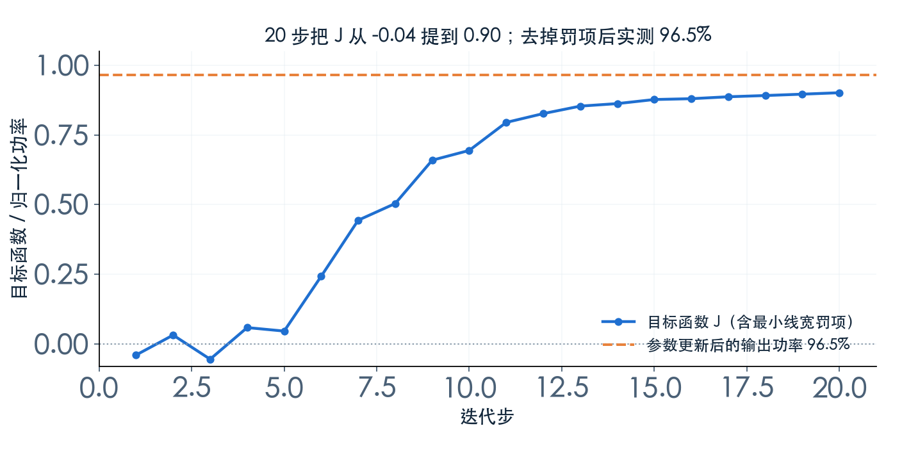
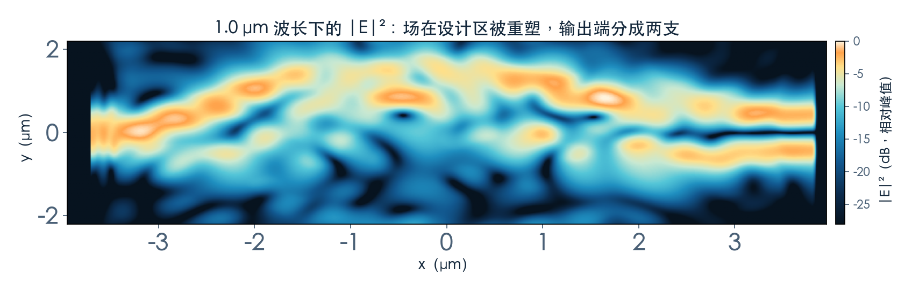
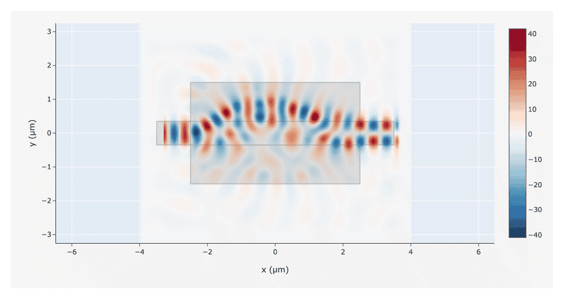

# 不画结构，只写目标：逆向设计怎么长出一个模式转换器

> **待审稿**：本文处于独立 PR 审核阶段，尚未收录为正式内容。定量结论、素材来源与授权仍需指定业内审核者核查。

前面那篇的耦合器，几何是人定的：宽度、间隙、长度都写死在代码里，仿真只是验证。这一篇反过来——**不写几何，只写目标**，让优化器自己决定结构长什么样。

任务还是那个任务：把 1550 nm 换成 1.0 μm 的 TE0 变成 TE1。但做法完全不同。

## 01　把结构变成一堆可调的数字

设计区是 5×3 μm 的矩形，切成 100 nm 一格的网格，也就是 50×30 个像素。每个像素有一个 0 到 1 之间的数，代表它「有多像硅」：0 是空气，1 是满介电常数。

仿真时，这堆数字先过一个卷积滤波器做平滑，再过一次 tanh 投影做二值化，然后才变成介电常数分布。两个处理都是为了最后能造出来——没有它们，优化结果会是一团灰度和一堆比光刻精度还细的碎片。

## 02　目标函数：一句话，加上一条约束

目标函数只有一项：输出端 mode 2（也就是一阶模）的功率。但光有这一项不够——优化器会找到各种「理论上很优、实际上造不出来」的解。所以在后面减掉一项**最小线宽罚项**，惩罚那些对腐蚀和膨胀不稳定的结构。

为什么是 mode 2 而不是 mode 1？因为在这个二维模型里，波导支持的四个模式按折射率排序：mode 0 与 mode 1 是一对（Ez 主导），mode 2 与 mode 3 是另一对。要「从基模转一阶模」，在同一对里选就是 mode 0 → mode 2，两者的场形差别是横向多一个节点，属于同一个偏振族。这一点如果搞错，优化器会把能量搬到正交偏振上，效率看着不低，实际器件却不工作。

`J = P(mode 2) − w(β) · penalty`

权重随 β 增长，而 β 本身在二十步里从 1 加到 20。前期约束轻，先让结构自由生长；后期约束重，把结构逼成二值。

## 03　二十步里发生了什么

每一步只做两件事：跑一次前向仿真，得到当前结构的输出功率；跑一次伴随仿真，得到目标函数对每个像素的偏导。有了梯度，Adam 就往让功率变大的方向挪一小步。

二十步，四十次求解，总共不到 1 FC——这是逆向设计最反直觉的地方：**它比参数扫描便宜得多**，因为梯度一次给出所有像素的方向，而不是逐个试。

曲线前半段（β 小、约束轻）上升很快，中间有一次明显的回落——那是 β 加大、罚项开始起作用的位置。结构被迫从「自由形状」往「二值形状」收，性能先掉一点，再爬回去。这不是优化失败，而是约束收紧的正常代价。

还要注意 J 与最终功率不是同一个量：J 里减掉了罚项，所以第 20 步的 J 是 0.90，而参数更新后重新跑一次、只看输出功率是 96.5%。两个数放在一张图上容易误读，所以图里把功率画成一条独立的虚线。

最终复核的转换效率是 96.5%，而同样这套参数在随机初值时只有 0.01%。

## 04　这个 96.5% 该怎么读

**它是单波长、单模式的数。** 整个优化只在一个频率上做，没有带宽目标。实际器件的带宽要靠额外的手段（多频目标、鲁棒性罚项）去换，本期没有做。

**它是理想几何的数。** 结构按二值化后的像素直接仿真，没有考虑光刻的圆角、侧壁粗糙度和线宽偏差。原 Notebook 在结尾也提醒了这一点。

**它依赖初值。** 随机种子固定为 2，换一个种子会得到另一个结构，效率也会不同。逆向设计给的是一族解里的一个，不是唯一最优。

**2D 与 3D 不能混比。** 这个案例是二维仿真（z 方向无限延伸），与前面 8 通道器件的三维结果不是一个口径。

二维近似的意义在于把「方法」和「器件」分开。二维里没有厚度方向的约束，模场是无限高的一条带，所以效率数字偏乐观；但优化流程、罚项写法、梯度怎么用，与三维完全一样。先在这个便宜的环境里把方法跑通，再换三维，是逆向设计常规的做法。

还有一点值得记住：整个优化只花了不到 1 FC。前面 8 通道器件的两个整器件任务各花了 2.4 与 2.7 FC，加起来是它的七倍多。逆向设计贵在「想清楚目标函数」，不贵在算力——这也是它近几年在器件设计里普及得快的原因。

所以这个案例的价值不在「96.5% 这个数」，而在**方法**：它示范了怎么把一个器件需求写成目标函数，以及优化器在约束下会做出什么形状的取舍。

下一篇换一个更朴素的思路：不改模式的阶数，改模场待的地方。
