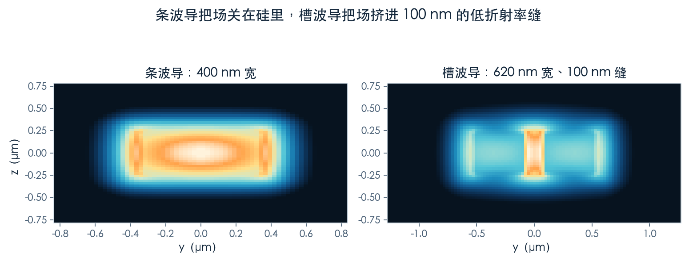
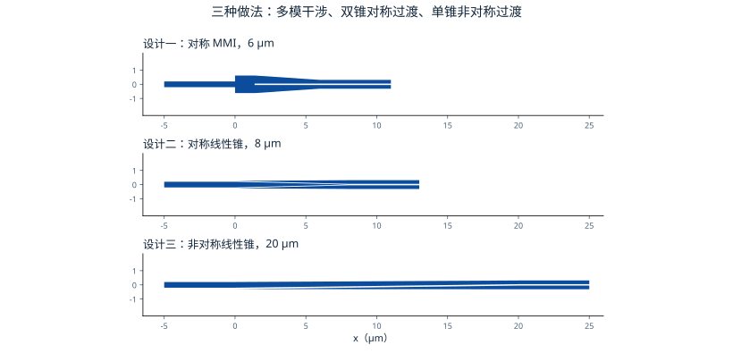
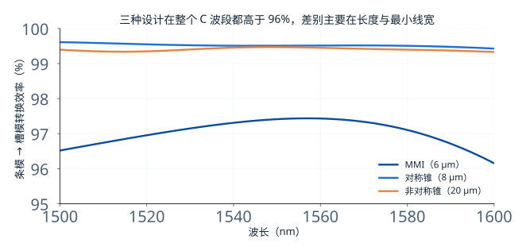
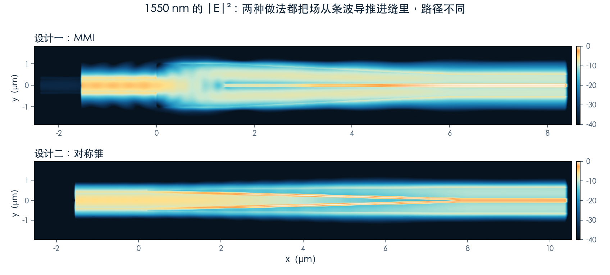
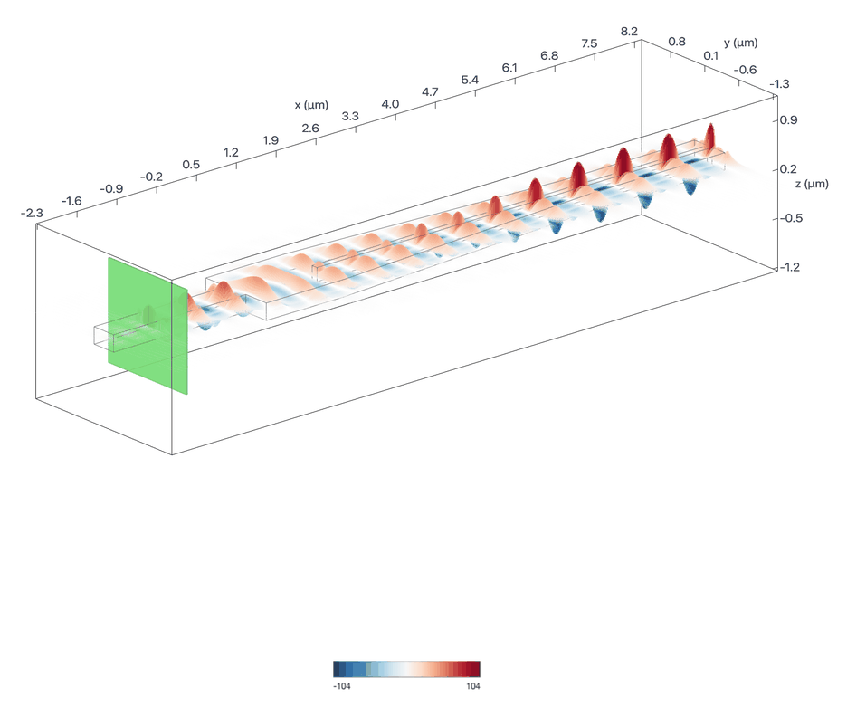
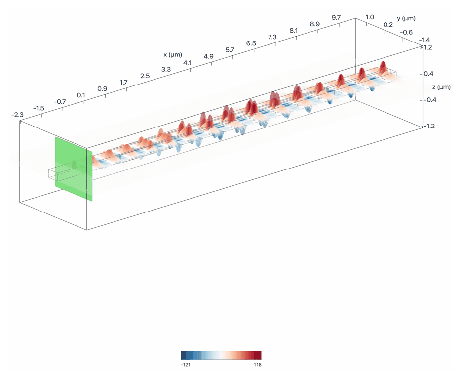
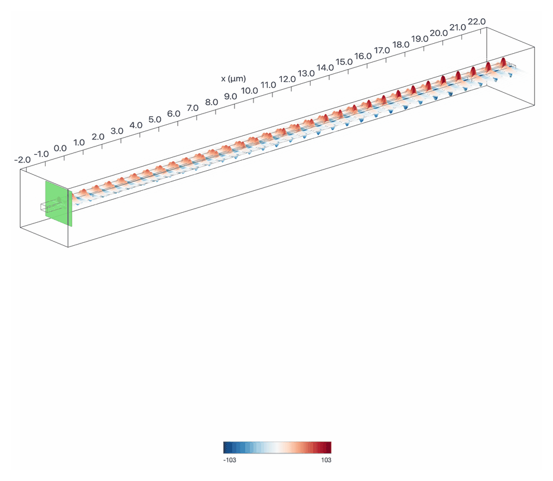

# 把光从硅里搬进缝里：三种条–槽转换器

> **待审稿**：本文处于独立 PR 审核阶段，尚未收录为正式内容。定量结论、素材来源与授权仍需指定业内审核者核查。

前两篇都在改**模式的阶数**：TE0 换成 TE1、TE2、TE3。这一篇换一个目标——阶数不变，改**模场待在哪里**。

槽波导由两条硅脊夹一条低折射率缝组成。光不走硅，走缝。这件事的意义在于：光与物质的相互作用强度正比于场在材料里的占比，而缝里可以填任何东西——电光聚合物、非线性材料、传感用的液体。想让光「摸到」这些材料，就得先把场推进去。

代价是：普通波导是条状的，槽波导是双脊的，两者接不上。中间需要一个**条–槽转换器**。

## 01　场为什么会进缝里

这是麦克斯韦方程的边界条件在起作用：电场在垂直于介质界面的方向上，会按介电常数之比反向跳变。硅的介电常数是 12，二氧化硅是 2，比值 6 倍。所以硅—缝界面两侧，缝里的场强是硅里的六倍左右。

两条脊靠得足够近时，两侧的场在缝里叠加，形成一个峰值。缝越窄、脊越宽，这个峰越尖。本期的槽波导是 620 nm 宽、100 nm 缝、250 nm 厚，TE0 模的场大部分就在这条缝里。

## 02　三种接法

原 Notebook 给了三种转换器，都在 C 波段工作，都从 400 nm 的条波导进、620 nm 的槽波导出。

**设计一：对称 MMI。** 一段 1.38 μm 长、1.24 μm 宽的多模区，靠自成像把输入场复制成两个对称的像，分别对准两条脊。之后是一段锥形收束。全长 6 μm，结构里没有尖锐的尖端。

**设计二：对称线性锥。** 中心一根锥形硅逐渐收窄到零，上下两条硅脊从两侧包过来，最终形成缝。全长 8 μm，理论上接近 100%，但锥尖是尖锐的。

**设计三：非对称线性锥。** 一条硅脊的上边缘向外扩，另一条从下方补进来，形成缝。全长 20 μm，结构最简单，但同样有尖端，而且尺寸最长。

## 03　三种的实际效率

三个设计各跑一次，都是单频段宽带求解，看输出端槽模的功率。

1550 nm 处：MMI 97.41%、对称锥 99.51%、非对称锥 99.47%。整个 1500–1600 nm 范围内的最低值分别是 96.16%、99.43%、99.33%，对应插损 0.114 dB、0.021 dB、0.023 dB。

MMI 低了一个多百分点，原因在版图上能看到：它的多模区与输出锥之间有一个宽度突变，那里会激发出少量高阶模与辐射模。原 Notebook 说 MMI 设计「>95%」，本次结果符合这个范围，但没有达到另外两种的水平。

两个线性锥的效率几乎一样，差别在长度与形状：对称锥 8 μm、非对称锥 20 μm，效率只差 0.04 个百分点。这提示一件事——**当效率已经接近理论上限时，再加长度换不到什么**。

## 04　为什么槽波导只支持 TE

条波导同时支持 TE 与 TM，槽波导只支持 TE——这不是设计选择，是几何决定的。槽里的场靠两条脊的场叠加形成，要求电场在缝的两侧同向跳变；TE 模满足这个条件，TM 模不满足，它的场在缝里互相抵消，根本形不成束缚。

这也是为什么「条–槽转换」只需要一种转换：从条波导的 TE0 出发，到槽波导的 TE0 结束。如果输入是 TM，得先转成 TE，再转槽——多一步，多一份损耗。

## 05　真正的差别在工艺

三个设计的理想效率都在 96% 以上，所以选型不该只看效率。真正的分水岭是**能不能造**。

对称锥与非对称锥都有尖锐的尖端——锥宽收到零的那一点。实际光刻做不到零宽，尖端会被截成几十纳米的一段，这段残留会改变相位，效率掉多少取决于工艺。原 Notebook 在结尾明确说了：本案例只仿真理想几何，实际器件需要考虑制造约束。

MMI 没有尖端，这是它唯一的结构优势。代价是效率低一点，以及多模区的宽度对波长敏感。

还有一条没测但必须提：**槽波导的缝宽对工艺极其敏感**。100 nm 的缝偏 10 nm，有效折射率就变，相位匹配就偏。三种转换器都建立在「缝正好是 100 nm」这个前提上。

## 06　这一篇的边界

三个设计都是 3D、1550 nm、TE0 单模输入，条件一致，所以**这一篇内部的效率可以直接比**。这与前两篇不同——那两篇的案例跨波段、跨维度，只能讲机制。

但仍有三条不能推：

- 只仿了理想几何，没有做工艺偏差扫描，所以「对称锥更好」只在理想条件下成立。
- 只测了转换效率，没有测反射。尖端处的背反射对某些系统是致命的，本次没给数。
- 没有测温度稳定性。缝里的场对材料折射率变化更敏感，这是槽波导的固有短板。

下一篇把三个案例放进同一张表，给出选型顺序与各自的适用边界。
