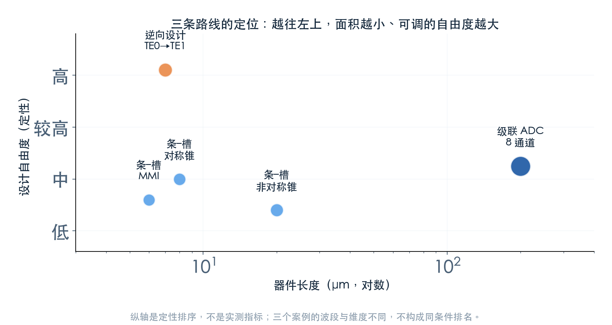
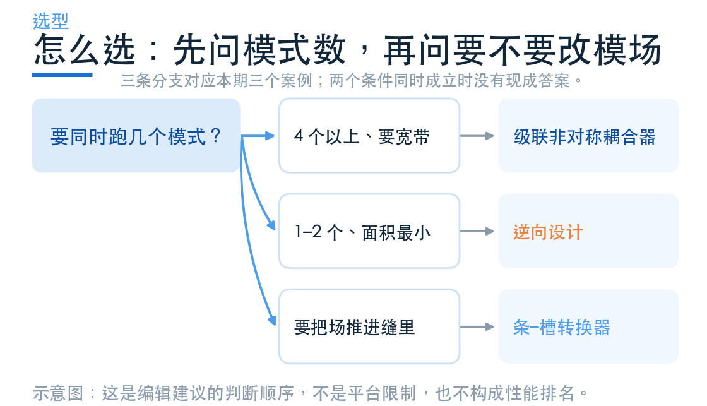

# 模分该选什么？三条路线的边界

> **待审稿**：本文处于独立 PR 审核阶段，尚未收录为正式内容。定量结论、素材来源与授权仍需指定业内审核者核查。

三个案例讲完，最后这篇把它们的数字放进同一张表。先说明一件事：**这张表不是排名**。三个案例的维度、波段、指标定义都不一样，把它们按某个数字排序，等于把不同口径的测量混在一起。

能比的只有机制与代价。所以下面先给指标口径，再给定位，最后给判断顺序。

## 01　三个案例放在一起

| | 8 通道模分 | 逆向模式转换 | 条–槽转换 |
| --- | --- | --- | --- |
| 维度 | 3D | 2D | 3D |
| 波段 | 1500–1600 nm | 1.0 μm 单点 | 1500–1600 nm |
| 器件长度 | 约 200 μm | 7 μm（含缓冲区） | 6 / 8 / 20 μm |
| 目标 | TE0→TE1/TE2/TE3 | TE0→TE1 | 条模→槽模 |
| 本次读数 | 整器件 98.56%（TE1 占 99.80%） | 96.5% | 97.41 / 99.51 / 99.47% |
| 验证范围 | 八个入口中的两个 | 单波长、理想几何 | 三种设计、理想几何 |

表格里最容易被误读的是最后一行。8 通道器件只验了两个入口，逆向设计只验了一个波长，条–槽只验了理想形状。这三个「只」都不是省略，而是本次求解的实际边界。

## 02　定位：面积、自由度、工艺

把三个案例放进「器件长度—设计自由度」这张平面，位置就清楚了。

**级联耦合器**在右上角：面积最大，但设计自由度高——每一段的宽度和长度都可以独立调，而且每一段的行为都能用耦合模理论算清楚。它的可预测性是三者里最好的。

**逆向设计**在左上角：面积最小，自由度也最高（每个像素都是变量），但代价是结果不可解释、依赖初值、带宽要靠额外约束去换。

**条–槽转换**在左下：面积小，自由度低——本质上只是几何过渡，没有多少可调的余地。它解决的问题不是「模式阶数」，而是「场待在哪里」，所以和前两者不在同一个任务上。

三者其实回答三个不同的问题：**分几个通道**、**怎么用最小面积换模式**、**怎么换模场的介质**。选型的第一步是认清自己要回答哪一个。

把它们和另外两个维度放在一起看会更清楚。波长维度的器件（上一组讲的微环、Bragg）靠频率选择性工作，通道之间不会因为传播距离而互相串；模式维度的器件靠几何正交性工作，一旦版图里有不对称，串扰会随长度累积。偏振维度的器件介于两者之间——正交性来自材料的各向异性或结构的双折射，同样怕工艺偏差。这就是为什么模分器件对版图质量格外敏感：它的隔离度不是一个滤波器的指标，而是整条路径的累积结果。

## 03　判断顺序

**第一问：要同时跑几个模式？**

四个以上、并且要宽带，走级联非对称耦合器。它的版图规整、每段可独立验证，代价是长度随通道数线性增长。8 通道做到 200 μm，16 通道大致翻倍。

一到两个模式、面积敏感，走逆向设计。它能把器件压到几个微米，但要接受三件事：只在一个波长上优化过、形状不规则、结果依赖初值。

**第二问：是不是要把场推进另一种材料？**

如果是，那前两条路都不解决问题——需要的是条–槽转换。它不改阶数，只改模场位置，是后面接调制器、传感器、非线性波导的前置器件。

**两问都成立时没有现成答案。** 例如「四个通道 + 每个通道都要接槽波导」，需要级联耦合器后面再接四组条–槽转换，本期的三个案例都没有覆盖这种组合。

## 04　三条实践建议

**先定口径，再看数字。** 模式纯度的分母是哪些模式、插损含不含辐射、带宽按什么阈值算——这三件事不定清楚，任何比较都没有意义。本篇的来源入口与已知口径边界见[来源与证据记录](sources/05-comparison.md)；原始读数与制作工程由制作方保留，审核需要时由维护者安排核查。

**耦合长度不要凭感觉调。** 它由相位匹配和耦合强度共同决定，前者靠有效折射率曲线查，后者靠扫描或理论估。本期六个长度直接用了文献值，正是因为扫描的代价（六段 × 十几个点）远超收益。

**逆向设计的结果要当成「一个可行解」，不是「最优解」。** 换初值、换罚项权重、换步数，都会得到不同结构。它的价值在于给出人想不到的形状，而不是给出一个可以写进规格书的数字。

## 05　本组的交付说明

三篇深度解读加这篇比较，共四个 Notebook、十四个云端求解任务。所有读数来自本次执行，图片由本次数据重绘，没有引用 Notebook 内嵌截图。

想自己跑一遍，从学习中心的案例页进；注册入口在国内平台。

- [8-Channel mode and polarization de-multiplexer](https://www.lingcompute.com/photon/learning-center/examples/notebooks/8ChannelDemultiplexer)
- [Inverse design optimization of a mode converter](https://www.lingcompute.com/photon/learning-center/examples/notebooks/Autograd3InverseDesign)
- [Strip to slot waveguide converters](https://www.lingcompute.com/photon/learning-center/examples/notebooks/StripToSlotConverters)

注册入口：[https://tidy3d.fangzhen.cloud/](https://tidy3d.fangzhen.cloud/)

下一组换一个维度：偏振。分束与旋转解决的是不同的问题，指标也另有一套。
