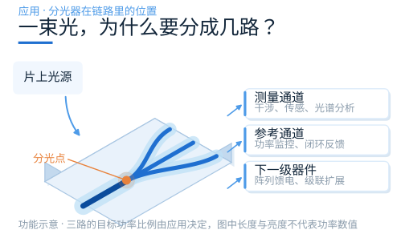
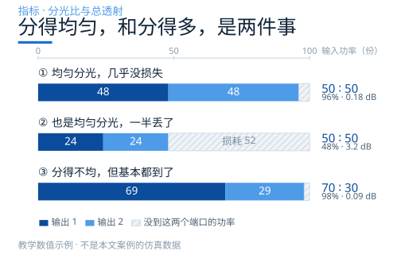
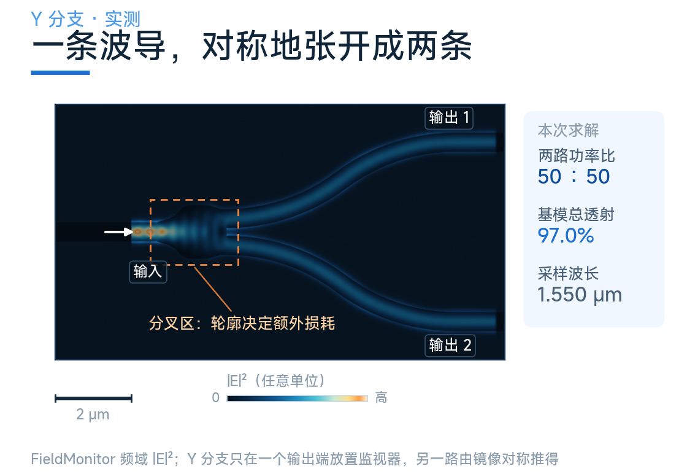
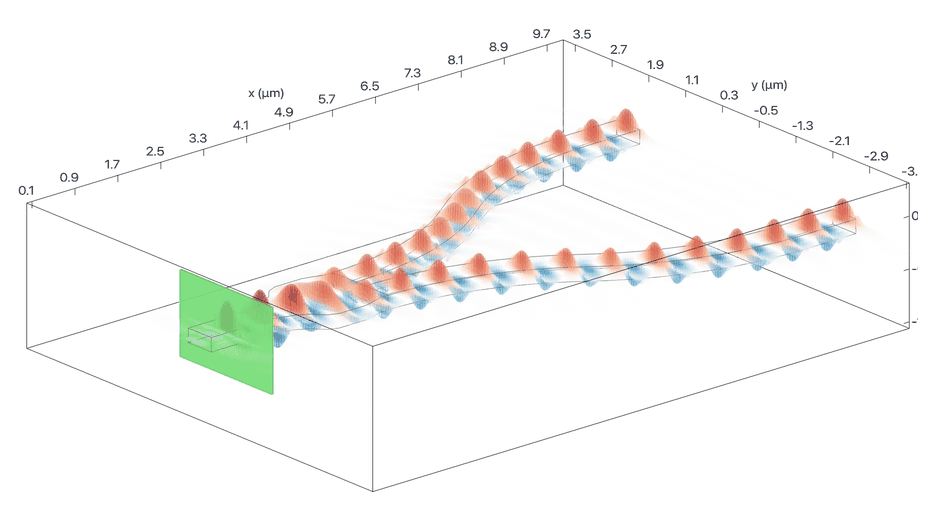

# 一束光，怎么被“掰”成两路？

光子芯片上，光经常要分叉。

一部分进测量通道，一部分留作参考；或者把功率摊给后面一排器件。做这件事的元件，叫**光功率分光器**。

听上去很简单：一条路变两条路。真做设计，问题立刻来了——

- 两路要各占一半，还是按 70∶30 分？
- 换个波长，比例会不会跑？
- 光进去 100 份，出来还剩几份？

片上能实现分光的结构主要有三种：**Y 分支、定向耦合器、多模干涉器（MMI）**。它们不是三个可以互相替代的选项，而是三条不同的物理路径。

这是系列的第一篇。我们从最直观的一种讲起——Y 分支。它会顺带把“怎么评价一个分光器”这件事说清楚，后面两篇都会用到。

## 先把两个指标说清楚

刚接触分光器的人，最常犯的错是把“分得匀”当成“做得好”。

想象输入是 100 份功率。第一种情况，两路各出 48 份，剩下 4 份损耗掉了；第二种情况，两路各出 24 份，剩下 52 份没了。两种情况下比例都是 50∶50——**但第二种器件明显更差**。

只看比例，你看不出这个差别。

所以有两个数必须同时盯。

**分光比**回答“怎么分”。它是两路输出功率之比，与损耗无关。理想均分是 50∶50，用分贝写就是各 −3.01 dB。

**总透射**回答“到得了多少”。它是两路输出之和除以输入。取对数就是插入损耗：总透射 96% 约合 0.18 dB，48% 则是 3.2 dB。

工程上还会用第三个词：**均匀性**（imbalance）。它只关心两路之间差多少，也用 dB 表示。48∶52 的均匀性是 0.35 dB，45∶55 是 0.87 dB。

还有一个容易被忽略的口径问题：**这里的“输出”，是端面上的全部光功率，还是只算你要的基模？**

杂散光、高阶模、衬底泄漏都会打到端面上，却不进入后级波导。工业上更常用模式分辨的口径。本文所有数字只统计前向基模功率——这也是 Tidy3D 模式监视器给出的口径。

## 三条路线，分野在设计自由度

指标清楚了，再看结构。三种做法的差别不在“谁更先进”，而在于**你把设计自由度放在哪里**。

**改变几何。** 让一条波导慢慢张开成两条。光在里面始终是同一个模式，只是通道变宽了。这是 Y 分支。

**让能量交换。** 两条波导靠得很近，倏逝场重叠，功率在两条波导之间来回“换手”。这是定向耦合器。

**让模式干涉。** 把光送进一段很宽的波导，激发多个模式，走一段距离后重新聚成两个像。这是多模干涉器。

## Y 分支：让几何把光掰开

Y 分支最容易从外形理解。输入波导经过一段分叉区，接到两条输出支路。

当结构和激励都满足镜像对称时，两路功率必然相同。这不是调出来的，是算出来的——对称性本身就保证了这一点。

### 关键在“慢慢张开”

设计 Y 分支的全部功夫，都花在那个“慢”字上。

分叉处的过渡越突然，光越容易激发出不需要的成分，多出来的部分就变成辐射损耗。所以真实的 Y 分支会用一条缓慢变化的轮廓：分叉前先把波导加宽，再让两条支路以平缓的角度分开。

这种过渡叫**绝热**。意思是让光在每一步都“来不及”察觉结构在变——模式形状始终跟着波导走，不产生新的模式。判断标准很朴素：把分叉区拉长一倍，损耗还在明显下降，说明它还不够绝热。

代价是面积。过渡越平缓，器件越长。**Y 分支的核心权衡就是用面积换损耗。**

### 三个容易被忽略的细节

**分叉前的加宽量。** 加得太少，模式被挤在尖端；加得太多，又会激发高阶模。官方案例用多个宽度参数描述这段轮廓，就是为了把这个平衡点调出来。

**输出弯曲半径。** 分叉之后两条支路通常要拉开距离，好让后级器件有地方放。这段弯曲本身也带来损耗和串扰：弯得太急，光往包层里漏；两条支路靠得太近，又会重新耦合。**Y 分支的实际面积，往往由输出弯曲决定，而不是分叉区。**

**对称性能不能兑现。** 器件设计完全对称，但刻蚀出来的两条支路未必。加工偏差打破对称，50∶50 就会偏离。这一条在另外两种结构上同样成立，只是 Y 分支对它的依赖最直接。

### 实测：97% 的总透射

官方案例在本地的求解结果：

- 1.55 μm 处，两路基模总透射约 **97.0%**；
- 1.53–1.57 μm 内，总透射稳定在 **96.6%–97.0%**，几乎不随波长变化；
- 两路各 50%。

那个“几乎不随波长变化”，是 Y 分支最值钱的地方。第四篇会把三种结构的波长响应放在一起看，那时差别会非常明显。

需要说明：原始求解只在上支路放置了模式监视器。为核实等分，另做了一次几何、源、网格与求解时长都不变的补测，在下支路补放一个模式监视器；两路在 101 个频点上的前向基模功率最大相差 2.3×10⁻⁷，50∶50 与 96.6%–97.0% 的总透射现在是两路独立读数，不再是按对称性推出的量。

动画里能看清一件事：光在分叉区是**连续摊开**的，没有突变，也没有来回振荡。这就是绝热过渡的直观样子。

### 什么时候选它

需要宽带等分、结构越简单越好的场合。1×2、1×4 的分光树，基本都用它。

本例的对称 Y 分支由对称性保证等分。非对称 Y 分支可以通过截面与绝热模式演化设计实现 70∶30 等比例；打破对称并不必然带来额外损耗，具体仍需优化验证。

## 下一篇

下一篇讨论另一种控制分光比的机制：让两条波导靠近，通过倏逝场交换功率。它适合构成 2×2，也提供不同于非对称 Y 的设计自由度。

下一篇讲定向耦合器：它的比例可以连续调，代价是敏感。

### 配套案例

[Y 分支：Waveguide Y junction](https://www.lingcompute.com/photon/learning-center/examples/notebooks/YJunction)

更多案例见[灵算光子学习中心](https://www.lingcompute.com/photon/learning-center/example-library)，国内产品入口为 [Tidy3D 平台](https://tidy3d.fangzhen.cloud/)。本次未验证新用户注册与浏览器直接执行 Notebook 的完整路径，请按当前平台文档操作。

本文数值来自本地实际求解。各 Notebook 的材料模型、端口配置及统计条件不完全相同，不构成同条件下的定量性能排名。
