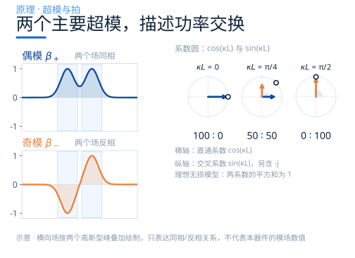
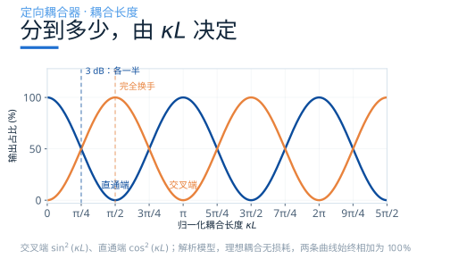
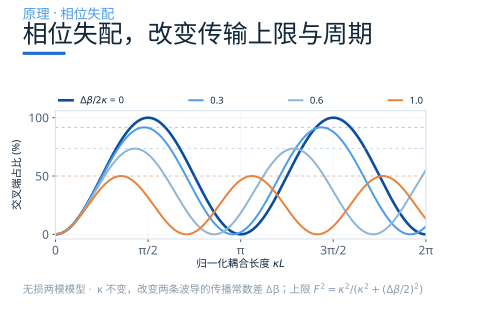
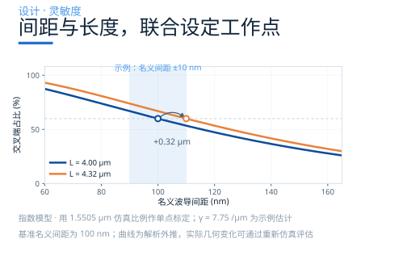
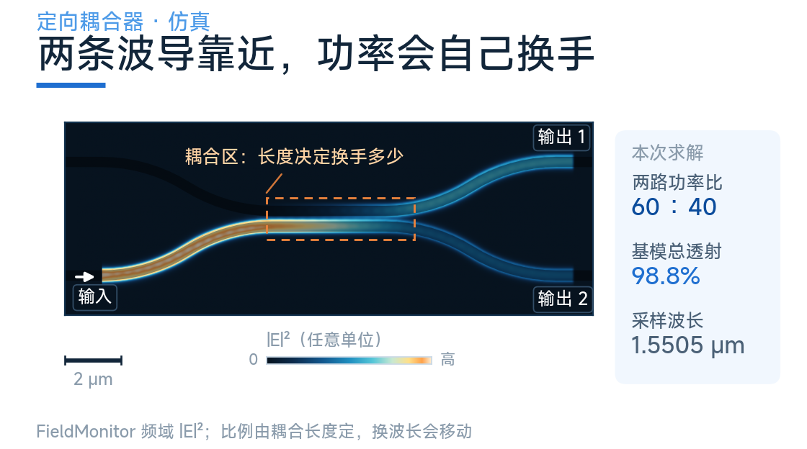
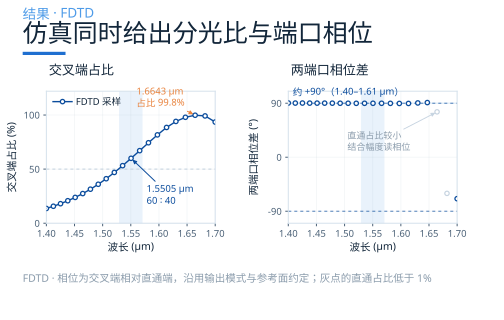
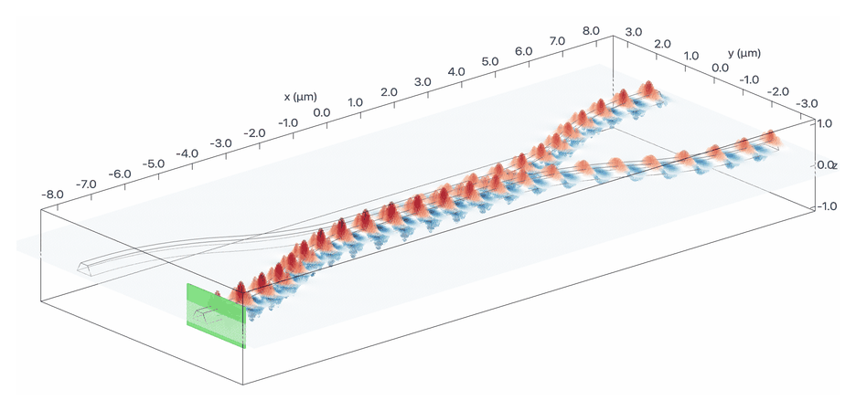

# 两条波导靠得够近，光就自己换手

上一篇用对称 Y 分支介绍了几何等分。

如果需要 70∶30 这样的特定比例，或者要做 2×2 的交叉与直通，定向耦合器提供了另一种设计方式。

这时候要换一种机制：不让光分叉，而是让功率在两条波导之间“换手”。

这一篇从两个主要超模的相位关系出发，说明分光比如何随长度、间距、波长和相位失配变化，再结合仿真数据理解具体器件的响应。

## 光并不老老实实待在波导里

光被波导约束时，电磁场会延伸到包层中；在均匀包层的倏逝区域，场幅度沿横向指数衰减。这个尾巴叫**倏逝场**，衰减长度由模式有效折射率、包层与波长决定。

把两条波导靠近，两个模式的倏逝场产生重叠，就可能发生波导之间的功率交换。相位匹配和相互作用长度共同决定交换的程度。

要理解功率为何按正弦平方变化，可以把两条波导作为一个整体来看。

## 用两个主要超模理解功率交换

对两条相同波导的基模耦合，常用一个前向两模模型描述：在选定偏振、其他模式与反射可忽略时，主要考虑一对偶、奇超模。实际截面还可能支持其他偏振或高阶模式。

- **偶模**：选定的主场分量在两条波导中同相；
- **奇模**：该分量在两条波导中反相，在对称面上有节点。

在本文的记号中，这一对超模的传播常数为 β₊、β₋，取 β₊ > β₋。

在理想对称、功率归一化的两模基底中，从**一条**波导输入，对应偶、奇超模的等幅叠加：

（偶模 + 奇模）/ √2 = 单条波导中的场

两个超模的传播常数不同，经过长度 L 后积累的相对相位为：

Δφ = (β₊ − β₋) · L ≡ 2κL

然后重新叠加。相位差为 0 时，叠回原来那条波导；相位差为 π 时，两个模式在第一条波导里正好反相抵消，全部叠到第二条。

这就是超模拍频对功率交换的描述。**场连续分布在整个耦合截面中，两个超模的相对相位决定功率主要集中在哪条波导。**

对称、相位匹配时，耦合系数 κ 等于两个超模传播常数差的一半：

κ ≡ (β₊ − β₋) / 2

忽略共同传播相位，采用下文矩阵的相位约定，单位振幅单端输入得到：

直通端振幅 = cos(κL) 交叉端振幅 = −j sin(κL)

理想无损模型中的两路功率为 cos²(κL) 和 sin²(κL)，相加为 1。系数圆表示这两个实系数的平方和，交叉端的复振幅还包含 −j。

## 写成方程：耦合模理论

耦合模理论（CMT）用两条孤立波导各自的模式作为基底，描述它们沿传播方向的相互作用。下面采用均匀、互易、无损的前向两模模型，去掉平均传播相位，并把 κ 取为实数：

dA₁/dz = −jκA₂ − j(Δβ/2)A₁ dA₂/dz = −jκA₁ + j(Δβ/2)A₂

A₁、A₂ 是功率归一化的复振幅，Δβ = β₁ − β₂ 是两根孤立波导对应模式的传播常数差。相位匹配时 Δβ = 0，方程的解为：

A₁(L) = cos(κL)·A₁(0) − j·sin(κL)·A₂(0) A₂(L) = −j·sin(κL)·A₁(0) + cos(κL)·A₂(0)

写成矩阵，就是同一个式子换个写法：

M = [ [ cos κL,&nbsp; −j sin κL ], [ −j sin κL,&nbsp; cos κL ] ]

这个理想矩阵满足 **M†M = I**，所以保持输入振幅向量的总功率；仅仅“元素不超过 1”并不足以证明功率守恒。

在 0 < κL < π/2 的第一段内，cos 与 sin 都为正，按这个约定交叉端相对直通端为 −90°。跨过其他分支时，两系数的符号可能改变，相对相位可变为 +90°；若某路振幅严格为零，该路相位才没有定义。比较仿真相位时，还要统一时间因子、模式相位和监视器参考面。

κ 可以由相位匹配截面的超模分裂求得，也可以在明确功率归一化的模式基底下，用介电常数扰动与模场的重叠积分近似计算。对整个器件，也可用多个长度点拟合有效耦合参数，并评估接入过渡的贡献。

固定截面、在有限间距范围内，常用下面的指数关系估算趋势：

κ(s) ≈ κref exp[−γ(s − sref)] γ ≈ (2π/λ) √(neff² − nclad²)

仅作量级示例，取 neff = 2.4、nclad = 1.45、λ = 1.55 μm，得到 γ ≈ 7.75 μm⁻¹，场幅度的 1/e 衰减长度约 130 nm。这个指数模型给出“间距增加 10 nm，κ 约减少 7.5%”的估计。本例为硅波导、二氧化硅衬底和空气上包层，实际 γ 应结合其截面和间距扫描提取。

## 分到多少，由 κL 决定

对相位匹配、κ 恒定的理想平行段，直通端功率为 cos²(κL)，交叉端为 sin²(κL)，均相对输入功率归一化。

这张图提供了几个常用参考点：

- **κL = π/4** 时，两路各一半，这就是 3 dB 耦合器；
- **κL = π/2** 时，功率完全换到另一条波导；
- 继续加长，功率还会换回来，如此往复。

在上述理想模型中，**分光比随 κL 连续变化**。具体器件还要考虑相位失配、损耗、弯曲接入和波长响应。

### 从目标比例反推长度

本例版图的名义波导宽度为 450 nm、间距 100 nm，平行段约 4.0 μm。在 1.5505 μm 附近，将仿真的 60∶40 输出占比代入 sin²(κL)，并选择最短的反正弦分支，可折算出 **κeff ≈ 0.2215 μm⁻¹**。

这是完整器件响应的单点等效标定，可能包含接入区域的耦合作用。下表演示使用同一理想模型换算参考长度：

| 目标（交叉 ∶ 直通） | κL | 理想模型参考 L |
| --- | --- | --- |
| 50 ∶ 50 | 0.785 (π/4) | 3.55 μm |
| **60 ∶ 40** | **0.886** | **4.00 μm** |
| 70 ∶ 30 | 0.991 | 4.47 μm |
| 80 ∶ 20 | 1.107 | 5.00 μm |
| 90 ∶ 10 | 1.249 | 5.64 μm |
| 100 ∶ 0 | 1.571 (π/2) | 7.09 μm |

第二行是参与标定的仿真点。其他长度是解析换算值，需要通过相应结构的仿真确认；单个功率点也不能独立确定所处的周期分支。

### κ 是怎么拿到的

实际设计可先求均匀耦合截面的偶、奇超模，直接由 β₊ − β₋ 得到 κ；也可扫描多个耦合长度，用功率和复振幅响应拟合模型参数。

选择足以判断周期分支的长度范围，并结合超模拍长，可以减少反演歧义。改变间距、宽度或截面后，应重新计算相应的模式与耦合参数。

### 同一比例，可以对应不同长度

同样是 50∶50，κL 可以取 π/4，也可以取 3π/4。在相同 κ、相同截面且不考虑其他色散项时：

- 波长响应满足 dPcross/dλ = L·sin(2κL)·dκ/dλ；这两个均分点的斜率绝对值相差三倍。
- 后一个工作点所需的平行段长度为前者的三倍，完整器件占地还包括接入波导。
- 长度响应满足 dPcross/dL = κ·sin(2κL)；两个均分点对同样的绝对长度误差有相同的一阶敏感度，较长分支的相对长度容差反而更紧。

通常可从最短分支开始设计，再结合布局、带宽与工艺要求选择工作点。

## 两条波导一旦不一样

前面的正弦平方等幅交换式对应 Δβ = 0。如果两条波导宽度不完全相同（或者一侧多一层包层、有局部应力），传播常数就有了差。在相同的无损两模模型中，单位功率单端输入得到（P₂ 是交叉端功率）：

P₂ = F² · sin²(√(κ² + (Δβ/2)²) · L)，&nbsp;&nbsp; F² = κ² / (κ² + (Δβ/2)²)

这里可以读出三个结论。

**一、最大可转移功率由 F² 决定。** 当 Δβ ≠ 0 且 κ 有限时，上限低于 100%；|Δβ|/(2|κ|) = 0.3 时约为 91.7%，等于 1 时为 50%。

**二、振荡周期改变。** 固定 κ 时，功率随长度的周期为 π/√(κ² + (Δβ/2)²)。失配增大使这个周期缩短，但不代表两条波导之间的耦合系数 κ 变强。此时超模分裂的一半也应写成这个根号，不能直接当作 κ。

**三、长度可以移动工作点，但不能提高 F²。** 对低于上限的目标分光比，仍可能通过改长度达到目标；要恢复接近完全转移，还需改善相位匹配或调整耦合强度。

若在理想无损模型的交叉传输峰值处，定义消光比为 10log₁₀(Pcross/Pthrough)，要求其高于 20 dB，需 |Δβ|/(2|κ|) < 0.1，即

|Δneff| < 0.2 · |κ| / k₀，&nbsp;&nbsp; k₀ = 2π/λ

以 κ = 0.2215 μm⁻¹、λ = 1.55 μm 为示例，得到 |Δneff| < 0.011。若要换成线宽差要求，应先对实际截面求 d neff/dw，并同时考虑厚度、侧壁角和包层影响。

这个模型也说明：在其他条件不变时，κ 越小，同样的 |Δβ| 对最大转移比例的影响越大。选择间距时，应联合评估耦合强度、相位匹配和制造公差。

## 几何参数到底怎么调

设计参数往往同时影响耦合强度、相位匹配和色散，可以按下面三个目标联合调整：

| 设计目标 | 主要模型量 | 常用调整参数 | 需要同时检查 |
| --- | --- | --- | --- |
| 目标分光比 | κ、L、Δβ | 间距、长度、宽度、接入过渡 | 透射、周期分支、端口相位 |
| 相位匹配与最大转移比例 | Δβ、κ | 两臂截面、包层、局部相位调节 | 工艺偏差及不同波长处的匹配 |
| 带内响应 | κ(λ)、Δβ(λ)、损耗 | 宽度、间距、长度、材料与纵向轮廓 | 整个目标波段的比例和透射 |

### 在匹配模型中，联合调整间距与长度

在单一波长、Δβ = 0 的均匀模型中，保持 κL 就能保持分光比。用前述 γ = 7.75 μm⁻¹ 的指数示例，名义间距增加 10 nm，4.00 μm 长度下的交叉占比约从 60.0% 变为 53.5%；把模型长度增加到约 **4.32 μm**，可恢复原工作点。

在这个示例中，间距增加 10 nm 对比例的影响约为 6.5 个百分点，长度增加 10 nm 的影响约为 0.2 个百分点。这是指定工作点与参数假设下的灵敏度比较，实际公差应通过几何扫描评估。

工艺偏置也应按实际几何解释。本例设置 dilation = 20 nm、侧壁角 30°、参考面为底面。正扩边让底面每侧边界向外移动 20 nm，因此名义 450 nm 的波导在底面宽约 **490 nm**，底面间距由 100 nm 变为约 **60 nm**。侧壁向上收窄，220 nm 高度内的线宽与间距随高度变化；耦合响应由整个截面决定。

### 相位匹配，需要检查两臂差异

在镜像对称的平台上，共同调整两臂宽度通常保留几何对称性；两臂不同的线宽、包层、局部温度或应力等，则可能引入 Δβ。接入弯曲和过渡也应纳入完整器件评估。

若目标需要接近完全转移，可通过截面匹配、局部有效折射率调节或耦合结构设计改善匹配；仅改变均匀耦合段长度不会提高该模型中的 F²。

### 带宽，可以通过几何与色散联合设计

宽度、间距和截面同时影响 κ(λ) 与 Δβ(λ)，长度则选择相位积累的工作区间。可先联合优化均匀耦合器，再按需求考虑渐变间距、渐变宽度或经过专门设计的干涉补偿结构，并在整个目标波段检查比例与透射。

## 仿真结果：分光比、透射与相位一起看

本例从左下端口输入，右上为交叉端、右下为直通端。在 1.5505 μm 处，两路前向基模功率相对源归一化功率约为 **59.3% 和 39.5%**，相加得到基模总透射 **98.8%**；按两路之和归一化，分光比为 **60∶40**。

在 1.53–1.57 μm 窗口内，本次仿真实际保存了以下三个采样点：

| 采样波长 | 交叉 ∶ 直通 | 基模总透射 |
| --- | --- | --- |
| 1.5355 μm | 53.2∶46.8 | 98.9% |
| 1.5505 μm | 60.0∶40.0 | 98.8% |
| 1.5658 μm | 67.1∶32.9 | 98.5% |

这些数据描述了本例的带内响应。若需要判断是否满足特定的等分带宽，应明确比例、透射和相位容差，并按需要增加采样点。

**功率占比与输入归一化透射需分别读取。** 在 1.6643 μm 的采样点，交叉端占两路输出之和的 **99.8%**；该端基模功率相对源归一化功率约为 **89.8%**，两路总透射约 **89.9%**。这些数值分别描述输出分配和输入功率的接收情况。

**相位比较需要统一约定。** 在当前输出模式的相位约定及 x = 8 μm 的参考面下，1.4000–1.6136 μm 的采样点中，arg(Across/Athrough) 约为 **+90°，偏差在 0.4° 内**。这与理想模型的正交相位关系相符；正负号须结合时间因子和模式基底解释。更长波段的相位变化也在图中保留。

**很小的振幅仍可具有相位。** 在 1.6643 μm 处，直通端占两路输出之和约 0.19%，并未严格归零，其复振幅仍有数值相位。读这一区域时，应把相位与对应幅度一起看。

**模型标定与验证各有用途。** 从输出占比反解 arcsin√P 得到的是一个主值分支，不能独立证明真实 κL 的周期阶次。可进一步用截面超模、多个长度或独立几何点检验模型，并结合反射、辐射与其他模式的统计分析功率去向。

## 它还是个 2×2 器件

定向耦合器有四个物理端口。忽略反射时，可以用两路输入到两路输出的前向传输矩阵描述：

M = [ [ cos κL,&nbsp; −j sin κL ], [ −j sin κL,&nbsp; cos κL ] ]

完整四端口散射矩阵还需包含反向传播和反射。对上面的理想模型，κL = π/4 时是 3 dB 正交耦合器，单端输入得到等幅、相差 90° 的两路输出；κL = π/2 时实现交叉传输。

两个理想 3 dB 耦合器与两臂相移可以组成马赫-曾德尔干涉仪（MZI）。按上面两个相同矩阵串联、两臂相位差为 φ 的约定，单端输入时两输出功率为：

P₁ = sin²(φ/2)，&nbsp;&nbsp; P₂ = cos²(φ/2)

交换端口编号或改变第二个耦合器的连接约定，可以对调两个表达式。通过电光或热光效应调节 φ，可实现功率调节与开关。

这组简式以两个耦合器均为理想 50∶50 为前提。实际耦合器的比例、相位及损耗随波长变化时，仍会进入整个 MZI 的响应。宽带性能需要联合设计耦合器和相移段，并非简单串联就自动抵消色散。

这也是为什么耦合器在链路里出现得比“分光器”更频繁：它同时承担了分光和路由两个角色。

## 什么时候选它

需要非 50∶50 的特定比例，或者要做 2×2 交叉与直通。

先按目标波段和比例容差评估均匀耦合器；需要更平坦的带内响应时，再考虑几何色散优化、渐变耦合或专门设计的干涉补偿方案。第四篇会继续比较这些设计自由度。

## 下一篇

耦合器靠“两条波导”完成分光，占地是一条长条。如果面积更紧、出口不止两个，还有第三条路——把光送进一段宽波导，让多个模式自己干涉成像。

下一篇讲 MMI：用多模成像实现紧凑的分光与多端口功能。

### 配套案例

[定向耦合器：Directional coupler](https://www.lingcompute.com/photon/learning-center/examples/notebooks/DirectionalCoupler)

更多案例见[灵算光子学习中心](https://www.lingcompute.com/photon/learning-center/example-library)，国内产品入口为 [Tidy3D 平台](https://tidy3d.fangzhen.cloud/)，使用方式请参阅平台文档。

本文端口数值来自已完成的 FDTD 仿真结果；κeff ≈ 0.2215 μm⁻¹ 来自单点等效标定，γ = 7.75 μm⁻¹ 为解析示例估计，参考长度表和图 4 为模型换算。三类器件的定量比较，应统一材料模型、端口配置及统计条件。
