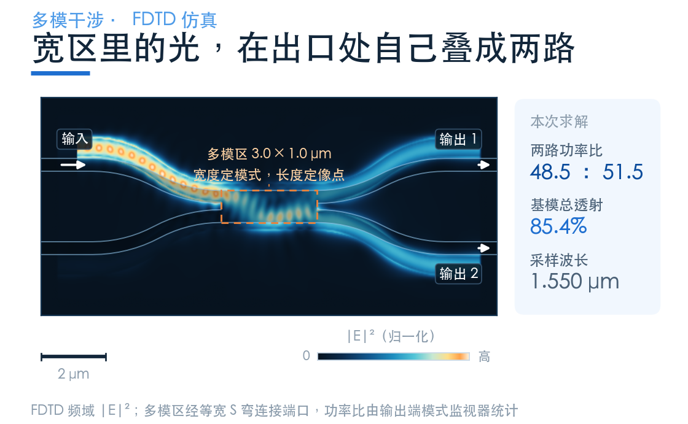
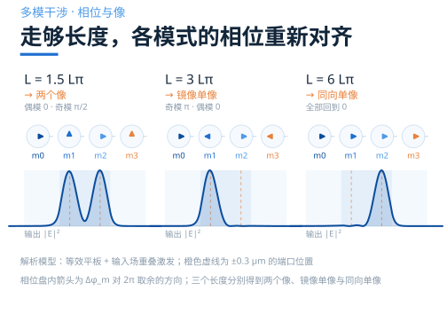
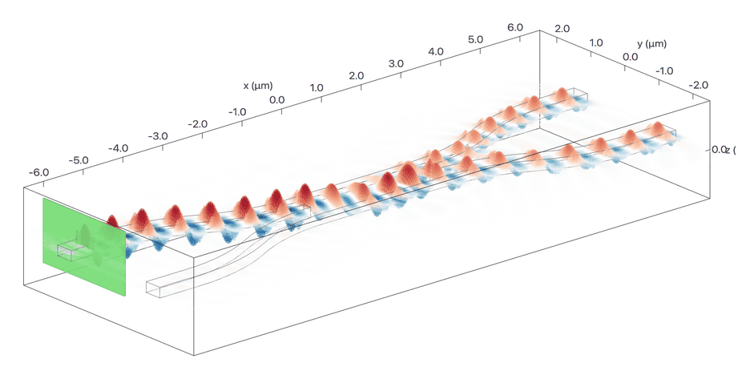

# 让一束光，在宽波导里自己干涉成像

> **待审稿**：本文处于独立 PR 审核阶段，尚未收录为正式内容。定量结论、素材来源与授权仍需指定业内审核者核查。

Y 分支靠几何，定向耦合器靠两条波导的能量交换。

第三条路更像"魔术"：把光送进一段很宽的波导，什么也不做，走一段距离，它自己变成了两个像。

魔术有说明书。这一篇把说明书摊开：为什么会有像、像落在哪个长度、改一个参数会怎样。

## 宽了，就有好几个模式

本例用 0.4 μm 宽的接入波导，以基模把光送进器件。

把宽度加到 1.0 μm，横向能容下的就不止一个了。每一个叫一个模式，各有自己的传播常数 βm——物理意义是"每走 1 μm，相位转多少弧度"。

本例的截面：220 nm 硅、1.0 μm 宽、二氧化硅包层，λ = 1.55 μm。宽区可以支持多个横向模式，实际导模数量、偏振与各阶 β 可通过截面模式求解得到。

输入从多模区上侧接入，连接处的波导中心在 y = +0.3 μm。窄波导的基模进入宽区后，会同时激发多个模式；各模式的权重由输入场与该模式的重叠决定。

**MMI 的第一步不是分光，是把光摊成几个模式。**

多模区里那些明暗相间的条纹，来自不同模式的相干叠加。对其中任意两个模式，纵向拍频周期由它们的传播常数差决定；多个模式一起参与时，场图会呈现更丰富的空间分布。

## 关键在模式的相位关系

每个模式都带着自己的 β 向前走。即使 β 等间距，相对相位也能在一定距离后重新对齐；MMI 多重成像的具体长度和位置，则与横向模场及模式间的相位关系共同有关。

在常用的等效平板波导近似下，低阶横向模式满足：

βm ≈ β₀ − m(m+2)·π / (3Lπ)

Lπ ≡ π / (β₀ − β₁) ≈ 4 nr We² / (3λ)

nr 是把垂直方向约束折算后，横向等效平板的芯层折射率；它与硅材料本身的折射率不同。We 是有效宽度，把场向侧面包层的延伸也算进去，修正量取决于截面、偏振和波长。

这两个式子各带一条信息。

第一，看 m(m+2)：0、3、8、15、24。β 随阶数升高而减小，各模式相对基模逐渐积累不同的相位差。在特定长度上，这些相位关系使输入场复现，或形成多个像。

第二，在 nr 和其他条件近似不变时，Lπ 与 We² 成正比、与 λ 成反比。**有效宽度加倍，同一成像阶次对应的参考长度约为四倍。** 这是估算尺寸的标度关系；带宽和工艺容差还要结合材料色散、端口和目标指标评估。

## 从单像复现，到两个像

采用场沿传播方向带有 exp(iβx) 的记号，走完长度 L，第 m 个模式相对基模的相位差是：

Δφm(L) = −m(m+2)·πL / (3Lπ)

先看两种单像复现。在对称横向截面中，模式的奇偶性让这两组相位关系特别直观。

**全部同相**：每个模式都多转了 2π 的整数倍，场原样复原，像与输入同向。

**奇模反相、偶模同相**：奇模多转了 π 的奇数倍，场变成关于中心的镜像。

取 L = 3Lπ 代进去看一眼。下表按解析式列出 m = 0–4，用于说明规律，并非本例三维模式求解结果：

| m | m(m+2) | Δφ / π | 相位 |
|---|---|---|---|
| 0 | 0 | 0 | 同相 |
| 1 | 3 | −3 | 反相 |
| 2 | 8 | −8 | 同相 |
| 3 | 15 | −15 | 反相 |
| 4 | 24 | −24 | 同相 |

偶数阶同相、奇数阶反相——这就是一个镜像单像。再走一倍到 6Lπ，全部变成 2π 的整数倍，像回到同向。

**两个像也能从同一张相位表读出来。** 在一般干涉的理想模型中，取 L = 3Lπ/2，偶模相对相位为 0，奇模为 π/2。输出场于是可以写成输入场与其镜像的等幅叠加；输入偏离中心、两个像空间上充分分开时，就能分别接入两个输出。

对这种一般干涉的 2×2 布局，±We/4 是常用的端口参考位置。其他激励方式和受限干涉布局有各自的参考长度与端口位置。具体器件还要结合实际 β、模式激发权重及输入输出过渡，用三维仿真确定工作点。

## 本例：刻度是 3.5 μm

本例模型取硅折射率 3.48、二氧化硅折射率 nc = 1.44。用 220 nm 硅层的 TE 平板基模估算，nr ≈ 2.85。再采用标量平板的侧向穿透修正估算长度标度：

We ≈ W + λ / (π√(nr² − nc²)) ≈ 1.2 μm

这里 W = 1.0 μm；具体偏振与全矢量边界条件的影响，可通过实际截面的模式求解纳入。

Lπ = 4 × 2.85 × 1.2² / (3 × 1.55) ≈ <strong>3.5 μm</strong>

这就是估算尺寸的"尺子"。本例沿用配套案例的多模区长度 **3.0 μm**，约 0.85Lπ；上节一般干涉理想模型的两像参考长度则约为 5.3 μm。3.0 μm 是本例具体结构的仿真工作点，不直接等同于该理想模型的两像复现长度。

FDTD 仿真结果：1.55 μm 处两路 **48.5∶51.5**，基模总透射 **85.4%**。

解析关系给出成像机制与长度标度，仿真给出具体截面和端口配置下的场分布、分光比与透射率。两者结合，就能把设计起点落实为可评估的器件。

## 照着做的五步

下面是设计与优化流程建议；本文展示的数据来自已完成的基线模型。

**第一步，定端口数、偏振和平台。** 明确目标分光比、工作波段、透射率和占地要求；材料、厚度与偏振共同决定模式谱。对本例的 TE 平板近似，nr ≈ 2.85。

**第二步，选 W 并检查模式。** 宽度影响可支持的模式数和拍长；输入位置与宽度决定哪些模式被有效激发。根据目标成像方式选择参与的模式，并检查高阶模是否接近截止。

**第三步，估算拍长与参考长度。** 可由模式求解得到 β₀、β₁，再算 Lπ；也可先用 We 做解析估算。本例从几何宽度 1.0 μm 修正为有效宽度约 1.2 μm，代入同一近似公式时，拍长估值约增加 44%。

**第四步，用仿真扫描长度。** 围绕所选成像方式的参考长度粗扫，再在目标工作点附近细扫；同时记录分光比和基模总透射。扫描范围与步长由工作点和所需精度决定。

**第五步，联合调整端口与过渡。** 以像的位置为参考，优化端口偏移和接口宽度；需要时加入局部锥形过渡，并联合评估其长度。本例接入波导宽 0.4 μm，使用等宽 S 弯连接多模区。最后按制造公差和目标波段扫描线宽、厚度、刻蚀与波长，评估带宽和容差。

## 改一个参数，会发生什么

这张表把解析趋势与需要仿真检查的指标放在一起。各行描述参数变化的影响，实际幅度取决于具体设计。

| 动什么 | 物理上变了什么 | 结果 |
|---|---|---|
| W 变大 | 通常支持更多横向模式，拍长按 We² 标度增加 | 同一成像阶次的参考长度增加；需联合优化激发和接口，评估带宽与容差 |
| L 变长 | 各模式的相对相位继续积累 | 分光比和透射随长度变化；理想模型有复现周期，实际周期性取决于模式谱 |
| 端口位置变化 | 与输出场的重叠改变 | 两路接收功率随之变化；对称移动也可能保持均分，需同时检查比例与透射 |
| 锥形长度变化 | 接口的模式匹配和各模式激发权重改变 | 可通过扫描寻找合适的过渡；高阶模本身就是多模成像的一部分 |
| 刻蚀深度、侧壁角变化 | 截面约束、有效宽度和各阶 β 改变 | 需按具体截面重新计算拍长与端口响应，变化方向取决于几何定义 |
| 波长变长 | nr、We 及各阶 β 都会变化 | 忽略色散时拍长按 1/λ 缩短；实际带宽由分光比和透射的光谱共同确定 |

最后一行值得单独说：Lπ 的 1/λ 关系是在其他量近似不变时的标度。实际设计中，材料与波导色散、成像方式、端口过渡和多模区形状都会影响带宽，可以通过联合设计改善带内响应。

## 仿真结果：近均分的双路输出

把场图与端口数据一起看，可以读出四项信息。

**两路输出接近均分。** 在 1.55 μm 处，两处输出监视器记录的前向基模功率，相对源归一化功率分别约为 **41.44% 和 43.95%**。两者相加约为 **85.4%**；再按输出之和归一化，得到 **48.5∶51.5**。分光比与总透射描述不同的指标。

**连接位置由几何明确给出。** 多模区与窄波导连接处的中心在 ±(W − wwg)/2 = ±0.3 μm，数值上接近上述 We/4 的参考位置。波导随后通过 S 弯向外展开，输出模式监视器位于 S 弯之后，因此这里统计的是整个已建模器件的响应。

**场图展示多模干涉。** 宽区中的场分布沿传播方向变化，并耦合到两个输出。结合模式展开，可进一步用各阶 β 和激发系数解释这些空间变化。

**光谱给出带内响应。** 读取 1.53–1.57 μm、每隔 10 nm 的仿真采样点，上路占两路输出之和的比例约为 **44.4%–53.0%**，基模总透射约为 **84.5%–87.8%**。这些采样值用于描述本例的波长响应，满足何种带宽要求还需对应具体指标。

基模总透射统计的是两个输出端的前向基模功率。若要分析其余功率的去向，可补充输入端反射、其他模式和包围器件的通量监视器，分别统计反射与辐射。

## 什么时候选它

需要紧凑的多端口分光结构，或者要做 1×N、N×N 功能时，MMI 是常用方案之一。

它利用多模区形成多个输出分布，适合在同一个干涉区域安排多个端口。具体选型时，把目标比例、端口数、插损、带宽、工艺容差和占地放在一起评估。

优化时可联合扫描多模区长宽、端口偏移与接口过渡，同时检查连接波导的弯曲响应。通过模式与场分布分析，确定各项参数对目标指标的影响。

## 下一篇

三种结构提供不同设计自由度：本例对称 Y 用几何等分，耦合器用模式交换，MMI 用多模成像。实际损耗、带宽与容差需按具体设计比较。

那么问题回到原点：**手上这个设计，到底该选哪个？**

下一篇把它们放在一起，用同一套指标横向比较，并给一个能直接用的选型顺序。

### 配套案例

[MMI：2×2 MMI power splitter](https://www.lingcompute.com/photon/learning-center/examples/notebooks/MMIPowerSplitter2x2)

更多案例见[灵算光子学习中心](https://www.lingcompute.com/photon/learning-center/example-library)，国内产品入口为 [Tidy3D 平台](https://tidy3d.fangzhen.cloud/)，使用方式请参阅平台文档。

本文端口数值来自已完成的 FDTD 仿真结果；有效折射率和拍长的解析估算已在正文中注明。三类器件的定量比较，应统一材料模型、端口配置及统计条件。
