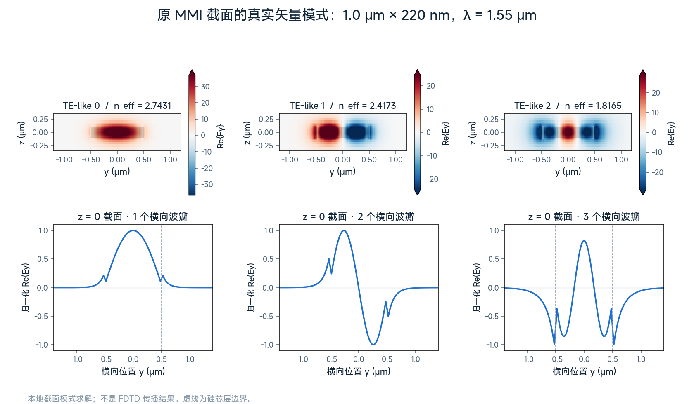
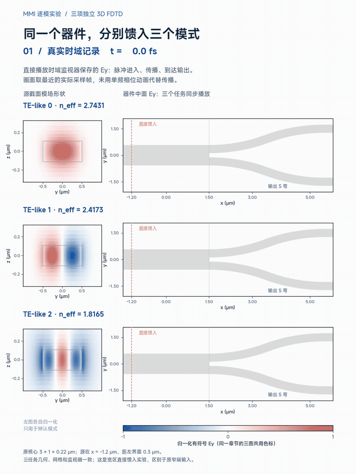
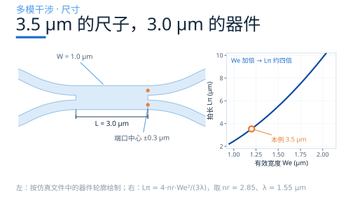
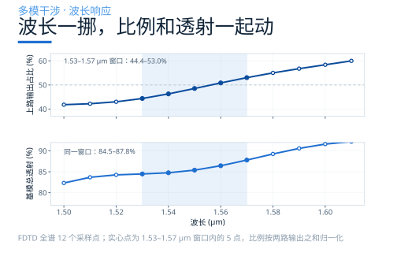

# 让一束光，在宽波导里自己干涉成像

Y 分支靠几何分叉，定向耦合器靠两条波导交换能量。MMI（多模干涉器）的办法是：让输入光在一段宽波导里激发多个模式，利用它们沿途积累的相位差，在出口形成需要的场分布。

这一篇先看真实截面里的模式，再把它们逐个送进同一个器件，最后回到一个工程问题：怎样用模式与拍长估长度，又怎样用 FDTD 判断是否分好了光？

## 宽了，就有好几个模式

接入波导宽 0.4 μm，原案例从这里激励基模。进入宽 1.0 μm、厚 220 nm 的硅波导后，光可以分布到多个模式。对实际截面做矢量模式求解，在 1.55 μm 下得到 **3 个 TE-like 导模**，有效折射率约为 2.743、2.417、1.817。

这里的“三个”指 TE-like 这一组，截面还求得了两个 TM-like 导模。模式网格从每波长 20 点加密到 28 点后，仍识别出同样的三个 TE-like 导模，有效折射率变化均约 0.1% 或更小；这是截面求解的加密核对，不代表整个器件的 FDTD 已做完网格收敛测试。

原输入连接处的波导中心在 y = +0.3 μm。窄波导基模进入宽区时，会按场重叠激发多个模式；每个模式的权重既有振幅，也有相位。**宽区支持几个模式，与这次输入实际激发了哪些模式，是两个问题。**

## 逐个馈入，先看清模式

为辨认每个模式的行为，我们增加了三次独立的 3D FDTD：保留材料、3.0 × 1.0 μm 核心和两侧 S 弯，把模式源放在宽区内 x = −1.2 μm，分别馈入 TE-like 0、1、2。每次只改变激励模式；源距核心左界面 0.3 μm，到右界面还有 2.7 μm。

每次都用频域 FieldMonitor 保存 1.55 μm 的场，用 FieldTimeMonitor 保存中面 Ey 的真实时序，并在核心与两路输出放置模式监视器。下面的动图先播放真实时域记录，再对照单频场的相位变化。

**单独一个模式在均匀、无损的直波导中，横向强度不会沿途自行分成两个像。** 图中到输出过渡后场型改变，是因为截面改变了；完整器件中的反射也会使宽区场偏离单向传播的纯模。

两路输出监视器给出另一条信息。下表均取 1.55 μm，两路前向基模功率之和相对各任务的源功率归一化：

| 宽区馈入模式 | 两路基模功率之和 | 两路基模分光比 |
|---|---:|---:|
| TE-like 0 | 71.5% | 约 50∶50 |
| TE-like 1 | 97.2% | 约 50∶50 |
| TE-like 2 | 23.4% | 约 50∶50 |

单个模式的横向场有确定的奇偶性，器件关于 y = 0 镜像对称，所以两路基模输出近等强；**均分不等于高透射**，TE-like 2 就是直观例子。这些数值只统计两路前向基模，不能把余量全部叫作辐射损耗。

原案例从上侧窄端输入，激发的是带确定相对相位的模式组合。三个独立实验的输出功率不能简单相加或取平均来复现它；要重建组合输入的结果，需要保留激励权重和复场相位。

## 相位排好，才能成像

每个模式带着自己的传播常数 β 往前走：β = 2πneff/λ。离开接口进入均匀宽区后，第 m 个前向模式相对基模积累的传播相位为

Δφm(L) = (βm − β₀)L

它要与接口激发时已有的相对相位一起，决定最终叠加场。**成像不要求所有模式同相；需要的是一组能重建目标场分布的相位关系。**

为了先估长度，可以用等效平板近似描述低阶模式：

βm ≈ β₀ − m(m+2)·π / (3Lπ) Lπ ≡ π / (β₀ − β₁) ≈ 4 nr We² / (3λ)

nr 是折算垂直约束后的等效芯层折射率，不等于硅本身的 3.48；We 是包含侧向场穿透的有效宽度。在这个近似模型中，相位差约为 −m(m+2)πL/(3Lπ)，由此得到一般干涉的三个参考长度：

- **L = 3Lπ/2**：偶模相对相位为 0、奇模为 π/2，形成输入场与其镜像的等幅叠加。
- **L = 3Lπ**：奇模为 π、偶模为 0，形成镜像单像。
- **L = 6Lπ**：相对相位回到 2π 的整数倍，形成与输入同向的单像。

## 用真实模式，校准拍长

材料取硅 3.48、二氧化硅 1.44，λ = 1.55 μm，硅层厚 220 nm。先用 TE 平板基模估得 nr ≈ 2.85，再加侧向穿透修正：

We ≈ W + λ / (π√(nr² − nc²)) ≈ 1.2 μm Lπ,估 ≈ 4 × 2.85 × 1.2² / (3 × 1.55) ≈ 3.5 μm

有了实际矢量模式，就可以直接用前两阶的有效折射率差计算：

Lπ,矢量 = λ / [2(neff,0 − neff,1)] ≈ 1.55 / [2 × (2.743087 − 2.417316)] ≈ 2.38 μm

**3.5 μm 与 2.38 μm 的差别提醒我们：平板公式用来找尺度，实际截面模式用来校准。** 网格加密后的拍长约 2.38 μm，变化约 0.07%。若把矢量拍长代入一般干涉的参考关系，双像长度约为 3.57 μm；本例核心为 3.0 μm，到底分得怎样，仍要看完整器件的输出读数。

原因是知道 β₀、β₁ 还不够：高阶模式的间距未必严格符合平板公式，输入权重、接口相位与两端过渡也会影响输出。±We/4 ≈ ±0.3 μm 可以作端口位置的初始参考，与本例连接处中心一致，但这个巧合本身不能证明形成了理想双像。

## 照着做的五步

1. **定端口、偏振、平台。** 写清目标分光比、波段、插损和占地；材料、厚度与偏振共同决定模式谱。
2. **选宽度，查模式。** 求实际截面模场与传播常数，再看输入位置会激发哪些模式；检查高阶模离截止有多远。
3. **算拍长。** 优先用 β₀、β₁；平板估值用于初选，不代替实际模式求解。
4. **扫长度。** 围绕参考长度粗扫，再细扫，同时记录分光比和两路基模总透射；本文的逐模实验没有做长度扫描。
5. **调端口与过渡。** 联合检查端口偏移、锥形和 S 弯；再按工艺公差扫线宽、厚度、刻蚀与波长，并检查数值收敛。

## 改一个参数，会发生什么

| 动什么 | 物理上变了什么 | 设计时看什么 |
|---|---|---|
| W 变大 | 可能支持更多模式，拍长改变 | 同一成像阶次的长度与接口重调 |
| L 变长 | 模式相对相位继续累积 | 分光比与透射随长度变化 |
| 端口位置 | 与输出场的重叠改变 | 比例、透射与对称性一起检查 |
| 锥形长度 | 模式匹配与激发权重改变 | 检查导模转换、反射和辐射 |
| 厚度、刻蚀、侧壁角 | 截面约束与各阶 β 改变 | 重算模式与端口响应 |
| 波长变长 | nr、We、β 都在变 | 实际带宽看完整器件光谱 |

We²/λ 是其他量近似不变时的标度。真实带宽由色散、成像方式与端口过渡共同决定。

## 原案例：近均分的双路输出

回到从上侧 0.4 μm 窄端输入基模的原案例。下面的谱线与逐模直接馈入实验具有不同的激励条件。

**两路接近均分。** 1.55 μm 处两路前向基模功率为源功率的 41.44% 与 43.95%，合计 **85.4%**；按两路输出之和归一化得 **48.5∶51.5**。这些数值属于原窄端输入案例。

**谱线有斜率。** 1.53–1.57 μm 的五个采样点，上路占比为 44.4%–53.0%，两路基模总透射为 84.5%–87.8%。要验证能否更平，需要再扫长度、宽度与过渡，不能只凭中心波长接近均分下结论。

**统计位置包含 S 弯。** 两个输出模式监视器位于 S 弯之后，读数属于整个已建模器件。85.4% 只计两路前向基模，原案例未将余量完整分解为反射、其他模式和辐射。

## 什么时候选它

要紧凑的多端口分光，或者要做 1×N、N×N，MMI 是常用方案之一。选型时把比例、端口数、插损、带宽、工艺容差和占地放在一起看。

本例给出的设计顺序是：**先求真实模式，再估成像长度，最后用完整器件验证输出。** 逐模馈入有助于辨认模场与接口响应；器件是否达到目标，仍由实际输入条件下的分光比和透射共同判断。

## 下期预告

三种结构给的是三种设计自由度：对称 Y 用几何等分，耦合器用模式交换，MMI 用多模成像。下一篇把它们放进同一套指标里横向比较，并给出选型顺序；损耗、带宽与容差仍需按具体设计验证。

### 配套案例

[MMI：2×2 MMI power splitter](https://www.lingcompute.com/photon/learning-center/examples/notebooks/MMIPowerSplitter2x2)

更多案例见[灵算光子学习中心](https://www.lingcompute.com/photon/learning-center/example-library)，国内产品入口为 [Tidy3D 平台](https://tidy3d.fangzhen.cloud/)，使用方式请参阅平台文档。

原案例与新增逐模实验分别使用各自已完成的 FDTD 数据，激励条件与数值口径不混用。图 2 为实际截面的本地矢量模式求解；图 3、4 为解析近似与标度示意。新增逐模结果仅覆盖 1.55 μm 下的三个 TE-like 模式，不代表全部偏振、波段或工艺公差已验证。
{: .note }
