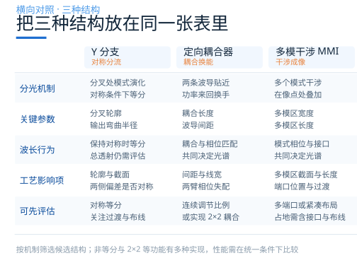
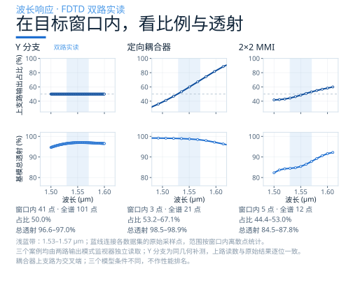
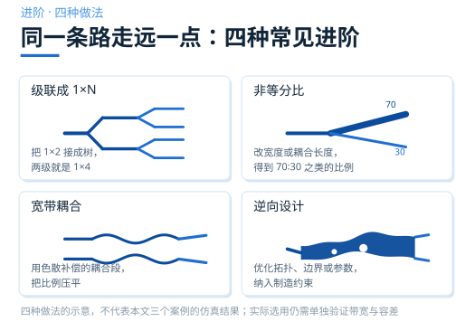
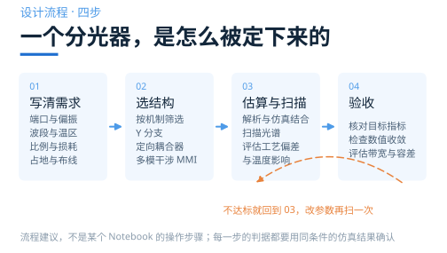

# 三种分光器，到底怎么选

> **待审稿**：本文处于独立 PR 审核阶段，尚未收录为正式内容。定量结论、素材来源与授权仍需指定业内审核者核查。

前三篇分别讲了 Y 分支、定向耦合器和 MMI。

这一篇把三者放在一起，看四件事：机制差别、波长行为、工艺影响，以及怎么按需求选。

## 一张表看清差别

这张表归纳的是**工作机制与设计关注点**。结构决定可利用的分光机制，材料平台、几何参数、端口与优化目标共同决定具体性能；三类结构都可以围绕目标波段继续优化。

**先理解机制，再用同一组需求评估候选设计。**

## 波长：按目标窗口评估

工作窗口由应用决定。单波长系统要考虑光源线宽与漂移，多波长系统则要覆盖指定信道；温度范围也应纳入需求。

下面把三个案例的 FDTD 波长响应放在一起，选取 **1.53–1.57 μm** 作为观察窗口。三个模型的材料与端口配置不同，这张图用于理解各自的响应，不能据此给结构排出性能名次。

三个原始数据集分别有 **101、21、12 个采样点**，其中落在所选窗口内的分别是 **41、3、5 个**。按这些离散点统计：

| 案例 | 窗口内点数 | 上支路输出占比 | 基模总透射 |
|---|---:|---:|---:|
| Y 分支 | 41 | 50.0%（对称推得） | 96.6%–97.0% |
| 定向耦合器 | 3 | 53.2%–67.1% | 98.5%–98.9% |
| 2×2 MMI | 5 | 44.4%–53.0% | 84.5%–87.8% |

Y 分支的水平线来自模型的镜像对称与对称激励：只记录了上支路，下支路取相同功率，因此占比恒为 50%。这体现了理想对称模型的等分性质，总透射仍随波长变化。

定向耦合器的三个窗口内采样波长约为 1.5355、1.5505、1.5658 μm，并非窗口两端。图中线段只连接原始采样点，表中范围也只是离散样本的最小值与最大值；带宽验收时，可按响应变化加密采样，确认目标窗口内的指标。

## 工艺：把偏差映射到性能

光刻和刻蚀会改变线宽、厚度、间距与侧壁角。偏差范围应采用目标工艺的统计数据或设计规则。

对 Y 分支，保持镜像对称的共同线宽偏差仍可保持等分，同时改变模式演化与透射；两侧不同的偏差则可能改变分光比。

对定向耦合器，间距与线宽会改变耦合系数 κ、传播常数和相位匹配，进而改变输出比例与透射。敏感度取决于几何与工作点，可用参数扫描量化。

对 MMI，多模区宽度、厚度与侧壁角会改变模式传播常数和成像条件；长度、端口位置及过渡共同影响输出。

温度会改变材料折射率、模式相位与耦合条件。部分设计在有限温区内可近似为光谱平移，实际变化也可能包含谱形与透射的改变；温度梯度还可能打破两路对称。

因此，**在目标波段内联合评估工艺与温度条件**。本文展示的是基线光谱，未进行工艺或温度扫描；这些机制说明了下一步可扫描什么，并不构成容差排名。

## 选型：三句话

可以先用三个判断筛选候选结构，再在同一平台、偏振、端口和指标定义下比较。

**第一句：等分且希望宽带时，可先评估对称 Y 分支。** 理想对称结构与对称激励保证等分，轮廓、长度及输出弯曲仍需设计，工艺误差也可能打破对称。

**第二句：需要连续调节比例或实现 2×2 耦合时，可评估定向耦合器。** 理想无损、相位匹配的两模模型中，改变耦合长度可覆盖 0–100% 的交叉端比例；实际范围与带宽需结合过渡段和相位失配评估。非等分与 2×2 也可由适当设计的 MMI 等结构实现。

**第三句：面积紧张或需要多个出口时，可评估 MMI。** 多重成像支持多端口，但长度、插损与带宽都需逐设计验证。

三个判断之外，还有一条更根本的原则：**先写需求，再选结构。** 明确端口数、偏振、波长与温度范围、目标比例、损耗及占地后，通常仍有多个可行方案；把过渡与布线也计入比较，才能做出适合系统的选择。

## 再往前一步

当系统需要更多端口或更宽的工作窗口时，可以进一步考虑下面四种做法。

**级联成 1×N。** 把 1×2 接成树，两级是 1×4，三级是 1×8。设计时计入各级损耗、布线与占地；相干应用还需满足指定的输出相位或群时延。等相位目标需要补偿器件与路径相位，其他应用也可能有意设置不同相位。

**非等分比。** 可通过定向耦合器的耦合长度、MMI 的端口和干涉区，或非对称 Y 的截面及绝热演化实现。非对称 Y 不等于必然增加损耗。

**宽带耦合。** 可沿传播方向调整耦合段的宽度或间距，也可采用马赫-曾德尔式级联。通过联合设计各段的耦合与相位响应，降低目标窗口内的比例变化；单纯把两个耦合器串起来并不会自动补偿色散。

**逆向设计。** 把目标分光比、透射和工作窗口写成优化目标，调整拓扑分布、边界形状或几何参数。伴随法是计算梯度的一种方法，也可以采用其他优化算法；最小特征尺寸、间距与工艺偏差等约束可在优化过程中纳入，并在最终版图中验证。

## 三个需要明确的评估条件

**波长与温度窗口。** 围绕应用指定的范围检查分光比、透射与必要的相位指标；采样密度应能分辨响应中的变化。

**分光比与损耗口径。** 本文分光比按两路前向基模功率之和归一化；基模总透射 T 则是这两路功率之和除以入射基模功率。按这一口径，额外损耗为 −10 log₁₀(T)，T 取 0–1 的数值。单路插入损耗还包含分光本身带来的功率降低：理想无损 50∶50 分光器每路约为 3.01 dB，而额外损耗为 0 dB。

**端口与终端条件。** 2×2 器件从一个端口注入时，应说明另一个输入端及输出端的终端条件；反射可能改变器件响应。仿真和实验都需要明确端口模式、偏振、参考面与边界或终端设置。端口未被激励，不等于它自动具备无反射终端。

## 最后：怎么验证一个设计

如果准备自己运行一个案例，可以把场图与端口数据结合起来看。

**看场图。** 光如何进入支路？分叉、耦合或多模区发生了什么？场分布帮助解释模式演化与能量传递。

**看端口数据。** 分光比和总透射随波长怎么变？需要时进一步记录反射、相位与其他模式的功率，按同一归一化口径写入报告。

场图帮助解释“为什么”，端口数据量化“多少”。正式验收还应检查网格、计算时间、边界距离及监视器设置的收敛性，并按目标范围评估工艺与温度变化；本文未新增这些扫描或收敛性验证。

## 开始你的第一次运行

这一系列的三个案例都在公开案例目录中：

1. 打开[灵算光子学习中心的分光器案例](https://www.lingcompute.com/photon/learning-center/example-library)，选一个结构，下载 Notebook；
2. 按所用平台的当前文档配置账号和 Notebook 运行环境；
3. 改一个参数——耦合长度、分叉宽度、多模区长度——看场图和曲线怎么变。

也可以直接[注册国内 Tidy3D 平台](https://tidy3d.fangzhen.cloud/)，从空白模型开始搭一个 Y 分支。第一次动手，只改一个参数，并记录它如何改变输出。当结构、场图和性能曲线能相互解释，分光器就不再只是一个名字。

### 配套案例

1. [Y 分支：Waveguide Y junction](https://www.lingcompute.com/photon/learning-center/examples/notebooks/YJunction)
2. [定向耦合器：Directional coupler](https://www.lingcompute.com/photon/learning-center/examples/notebooks/DirectionalCoupler)
3. [MMI：2×2 MMI power splitter](https://www.lingcompute.com/photon/learning-center/examples/notebooks/MMIPowerSplitter2x2)

本文按原理和设计关注点对照不同结构。各 Notebook 的材料模型、端口配置及采样条件不完全相同，不构成同条件下的定量性能排名。文中数值来自已求解并下载到本地的 FDTD 数据；Y 分支下支路由镜像对称推得，MMI 场监视器只覆盖核心段，输出功率由两个输出模式监视器统计。
