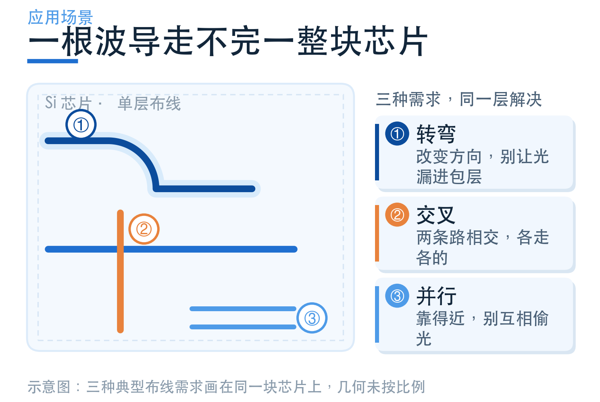
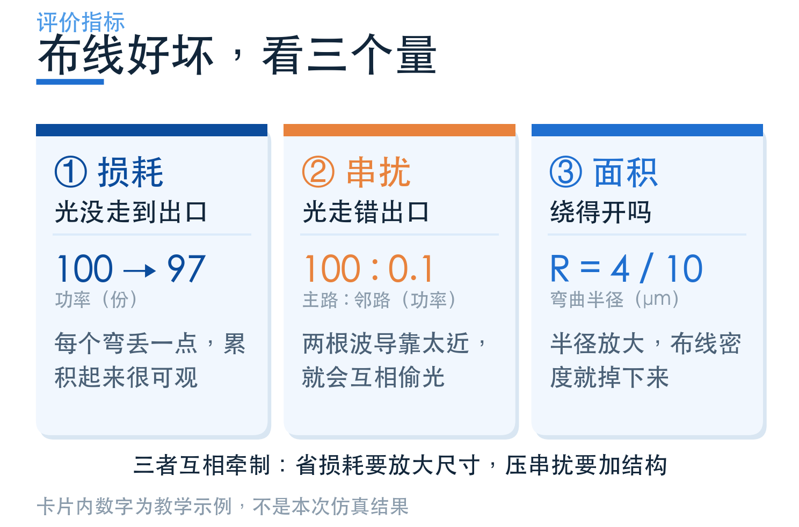
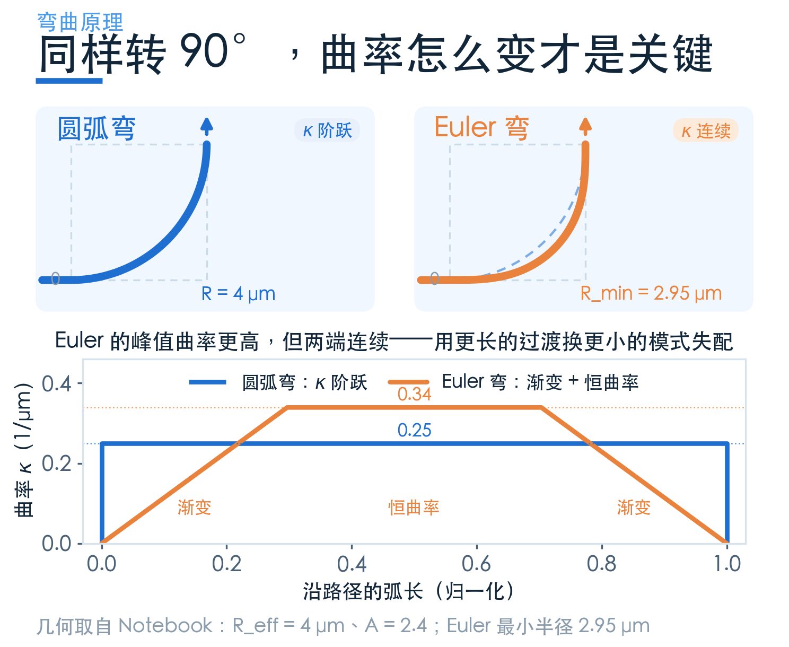
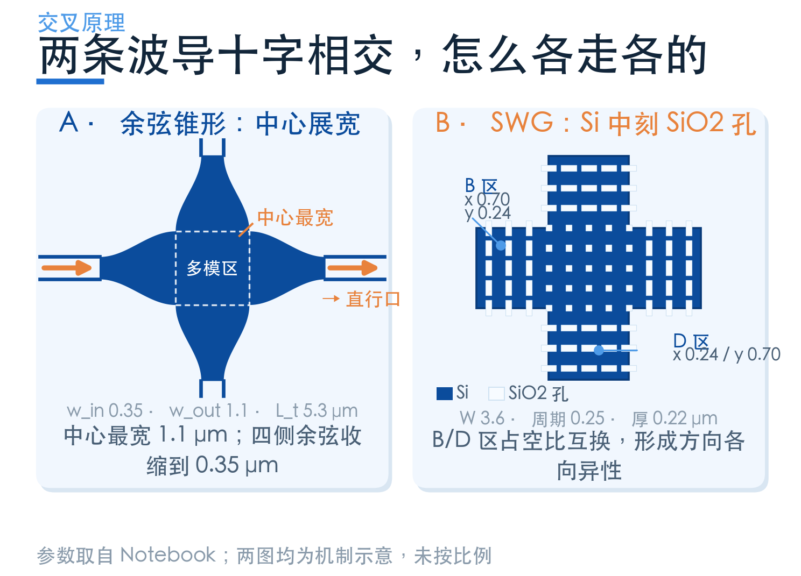
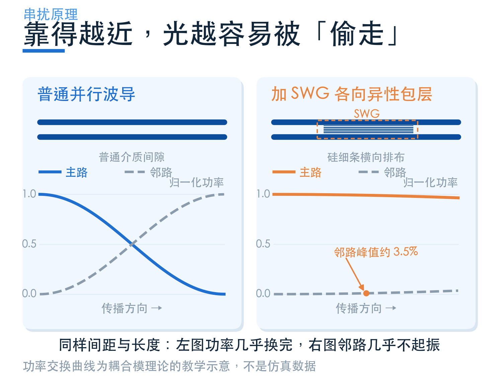

# 光怎么在芯片上拐弯、交叉，还不走错路？

> **待审稿**：本文处于独立 PR 审核阶段，尚未收录为正式内容。定量结论、素材来源与授权仍需指定业内审核者核查。

光子芯片上的波导，很少能从起点一直画到终点。器件要连接，端口要对齐，走线还要避让别的器件。于是，光要转弯、穿过十字路口，也会和旁边的波导并行一段。

这些地方看起来只是版图上的几笔，却决定了光还能剩下多少、会不会跑进别人的通道。本组图解围绕四个官方 Notebook，把**弯曲、交叉、并行串扰**三个问题拆开讲，再把它们放回布线选型中。

## 01　先分清：损耗与串扰问的不是同一件事

**损耗问“主路少了多少光”**。光可能被反射回去、辐射到包层，也可能转成不需要的模式。这里把插入损耗写成正值：输出越少，损耗越大。

**串扰问“光跑进了哪条错误的路”**。本文以邻路功率除以主路功率，再转成 dB；−30 dB 对应千分之一的功率比，−40 dB 对应万分之一。串扰越负，错误端口收到的相对功率越小。

**面积问“版图能不能放下”**。大半径通常有利于减小弯曲辐射，但也占用更多空间；增加过渡区或细密结构，同样会挤占工艺和布线资源。

先确定系统缺的是哪一项，再挑结构，往往比先找一个“最先进”的器件更有效。同样一根波导，只有两个弯和串联上百个弯，对每个弯的损耗要求就很不一样。

## 02　转弯：光不只在乎半径，也在乎怎么进入弯道

圆弧弯最直观：直波导接上一段固定半径的圆弧，再接回直波导。路径方向连续，但曲率会从零突然变成一个固定值。直波导里的模式因此需要重新适应弯曲环境。

Euler 弯在接缝处逐渐增加曲率，转过一部分角度后接入圆弧，最后再逐渐回到直线。它的作用是减缓模式变化，同时仍要控制弯曲区向外辐射的损失。

本次用相同材料、端口、网格设置比较圆弧和 Euler 弯。在 1550 nm，基模损耗分别约为 **0.0200 dB 与 0.0081 dB**。这组配对结果可以支持“在这个设计点上，平滑过渡改善了损耗”，不能直接替其他材料平台下结论。

## 03　交叉：不要把十字路口直接画成两条细线相交

波导到了交叉区，横向约束突然变化，光可能向两侧散开。一条路线是在中心附近展宽，借助受控的场分布变化，把光重新送进直行口。本组采用的案例是**余弦锥形交叉**。

另一条路线是在硅波导里布置亚波长孔阵。孔的形状、间距与占空比改变不同方向的等效折射率，让光更愿意沿原来的方向走。这就是这里的 **SWG 交叉**，SWG 指亚波长光栅。

两例分别工作在 **1260–1360 nm** 和 **1700–2200 nm**，硅厚度也不同。所以这一组适合比较“怎么控制光”，不能把两个最好的 dB 数抄到一起，宣布哪种结构全面胜出。

## 04　并行：波导之间没有连起来，也会交换能量

导模的场并不止于硅的边界，还会延伸到包层。两根波导靠得足够近，这部分倏逝场就会重叠。原本是独立通道的两条线，会变成一个耦合系统。

增大间距能减少重叠，但会降低布线密度。各向异性包层则尝试改变倏逝场的衰减和耦合关系，让同样长度里的能量交换变小。

本次还跑了带 SWG 包层与裸波导的完整对照。它们的中央并行段长 100 μm，包含两端的弯曲引线。这个案例讨论的是近距离并行走线，不能把它的串扰读数当成交叉节点的串扰。

## 05　四个案例，按问题逐个读

后面四篇的阅读顺序是：**第 2 篇看弯曲，第 3 篇看交叉，第 4 篇看并行串扰，第 5 篇把数字放回选型条件**。结构图解释几何，场图解释现象，端口曲线给出功率指标；三种图各自回答一个问题。

所有标注“本次 FDTD”的图，都从本次已完成任务的原始数据在本地重绘。原理示意、预算外推会另行注明；本组只复现 SWG 的 TE0 入射，没有重跑高阶模式，也没有做完整工艺容差扫描。

| 问题 | 本次案例 | 示例读数 | 读数条件 |
| --- | --- | --- | --- |
| 转弯 | 圆弧 / Euler | 0.0200 / 0.0081 dB | 1550 nm，有效半径 4 μm |
| 十字交叉 | 余弦锥形 | 插损 0.176 dB | 1310 nm，单侧串扰 −27.89 dB |
| 十字交叉 | SWG 孔阵 | 插损 0.461 dB | 1950 nm，TE0，单侧串扰 −42.66 dB |
| 并行串扰 | 裸波导 / 包层 | −11.06 / −63.84 dB | 1550 nm，并行段 100 μm |

这张表只把各自的读数放在对应条件下，**不构成跨器件的性能排名**。详细口径与曲线在后续各篇展开。

## 从一个 90° 弯开始尝试

可以先在[学习中心的 Euler 弯案例](https://www.lingcompute.com/photon/learning-center/examples/notebooks/EulerWaveguideBend)了解结构，再进入[国内产品入口](https://tidy3d.fangzhen.cloud/)查看适合自己的建模与运行方式。下载 Notebook 后，先检查环境、端口与费用估算，再提交求解；入门时先比较一对弯道，比一开始就运行大型串扰模型更容易读懂结果。

本组的其余来源：[余弦锥形交叉](https://www.lingcompute.com/photon/learning-center/examples/notebooks/WaveguideCrossing)、[SWG 交叉](https://www.lingcompute.com/photon/learning-center/examples/notebooks/SWGWaveguideCrossing)、[各向异性包层抑制串扰](https://www.lingcompute.com/photon/learning-center/examples/notebooks/ZeroCrossTalkTE)。
