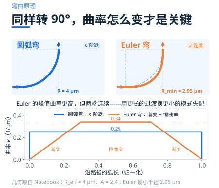
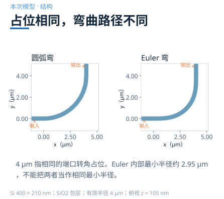
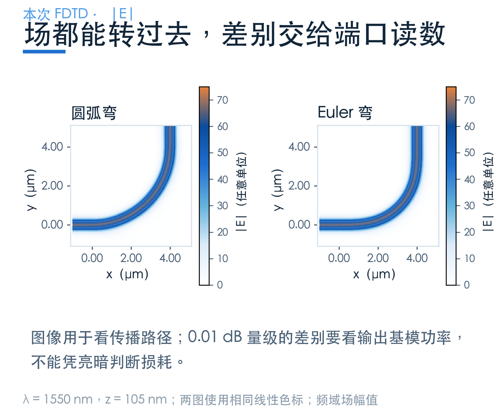
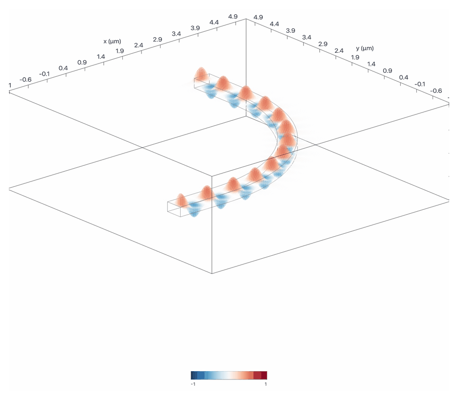
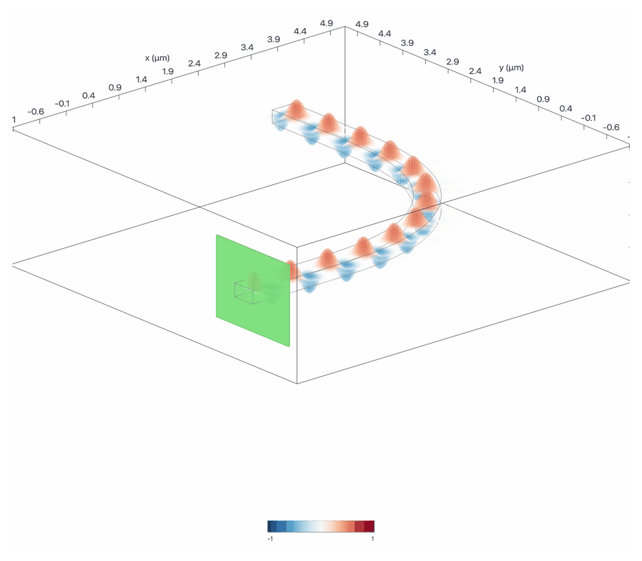
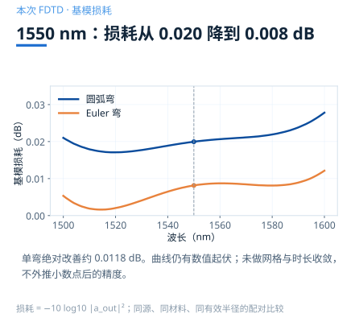
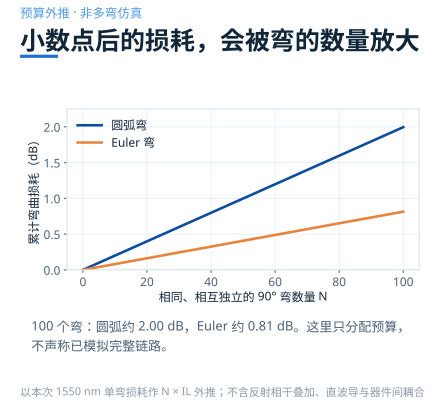

# 同样转 90°，Euler 弯为什么能少丢一点光？

> **待审稿**：本文处于独立 PR 审核阶段，尚未收录为正式内容。定量结论、素材来源与授权仍需指定业内审核者核查。

一个弯只损失零点零几 dB，看起来不值得专门优化。但如果一条光路要拐几十次、上百次，这点差别就会累积成可观的链路损耗。

本篇从一个有效半径 **4 μm** 的 90° 弯开始，用同一组仿真条件比较圆弧和 Euler 两条路径。先看它们怎么画，再看模式怎样通过，最后回答：这点改善什么时候值得用？

## 01　路径光滑，不代表模式变化也光滑

在直波导中，模式沿传播方向保持相同的横向形状。进入弯道后，内外两侧的传播条件改变，场会偏向外侧，也可能向包层辐射。若直段与弯段的局部模式对不上，还会产生额外散射和反射。

圆弧弯的方向是连续的，曲率却在接缝处从零跳到固定值。Euler 的想法很直接：让波导先轻轻弯起来，再逐步增加弯曲程度，出弯时反过来走一次。

这并不意味着 Euler 内部每一点都弯得更缓。**同样占位下，本例 Euler 的最小半径约 2.95 μm，比圆弧的 4 μm 更小**。设计是在过渡失配与局部弯曲辐射之间重新分配代价。

## 02　先把“同样半径”说准确

官方 Notebook 用有效半径描述 90° 转角的端口占位。圆弧与 Euler 都从横向直线进入，再从竖向直线离开，转角两端的相对位置相同。

本次模型采用宽 **400 nm**、厚 **210 nm** 的硅波导，周围为二氧化硅；两条路径使用相同的源、监视器与自动网格设置。材料在该案例中使用固定折射率，所以这里讨论的是这组模型条件下的结果。

若要把结果迁移到实际工艺，还要核查厚度、波导宽度、刻蚀截面、侧壁和材料色散。4 μm 只是这次比较的起点，并非对所有硅光工艺通用的设计规则。

## 03　场都转过去了，还能看出差别吗？

两幅场图里，光都沿着波导完成了 90° 转弯。这有助于检查传播路径与明显泄漏，却不足以判断百分之几以下的功率差异。

原因是场幅值与功率并不是同一个量，图像的色标、显示范围也会改变视觉感受。要比较损耗，必须回到出口，把场投影到需要的基模上，读取它携带的功率。

本篇采用输出监视器的前向基模振幅 a，功率透过率为 |a|²，再换算成正值损耗。这个读数包含模型中从源到监视器整段路径的效应；两组设置一致，才让差值具有可比较的意义。

## 04　这次实算：约 0.0200 dB 对 0.0081 dB

在 **1550 nm**，圆弧弯的基模透过率约 **99.54%**，Euler 弯约 **99.81%**；对应损耗约为 **0.01995 dB** 与 **0.00814 dB**。

两者每个弯的绝对差值约 **0.0118 dB**。相对于圆弧，本例的损耗减少约六成，但百分比不该盖过绝对数字：对只有一两个弯的光路，这点改善可能不是首要瓶颈。

谱线仍有细小起伏。这里沿用案例网格与运行设置，没有额外做网格、边界和时长收敛；因此正文保留足够表达差异的有效数字，不把小数点后更多位当成可靠精度。

## 05　把单弯指标放回链路预算

如果各个弯足够独立，可以先用“弯的数量 × 单弯损耗”做预算。按本次 1550 nm 的结果，100 个相同圆弧弯约 **2.00 dB**，100 个 Euler 弯约 **0.81 dB**，差别就接近 **1.18 dB**。

这类估算适合先筛选方案。当弯道紧邻其他器件、弯与弯之间几乎没有直段，或者反射积累会影响系统时，还要验证组合结构；不能仅凭一张单器件曲线保证整条链路的结果。

## 06　什么时候优先选 Euler？

当有效占位已经受限，又需要很多转角时，Euler 值得优先评估。如果半径很充裕、弯的数量很少，圆弧可能已经满足损耗预算。最终选择要把版图实现、工艺规则与系统收益一起看。

还应区分“固定有效半径比较”和“固定最小半径比较”。这两种约束得到的占位与损耗权衡不同。复用某篇文献或案例的数字之前，先确认作者固定的究竟是哪一个量。

下一篇进入十字交叉：波导到了节点，横向约束突然打开，要怎样让光继续直行？

## 自己改一个参数试试

[学习中心：Euler waveguide bend](https://www.lingcompute.com/photon/learning-center/examples/notebooks/EulerWaveguideBend)提供了几何构造与端口处理代码。建议先保持材料、宽度和厚度不变，比较一对固定有效半径的弯道；改半径后重新检查端口与网格，先估价，再运行。

[国内产品入口](https://tidy3d.fangzhen.cloud/)。本文结果来自本次案例求解；学习中心案例与国内产品的具体导入路径，以实际页面提供的功能为准。
