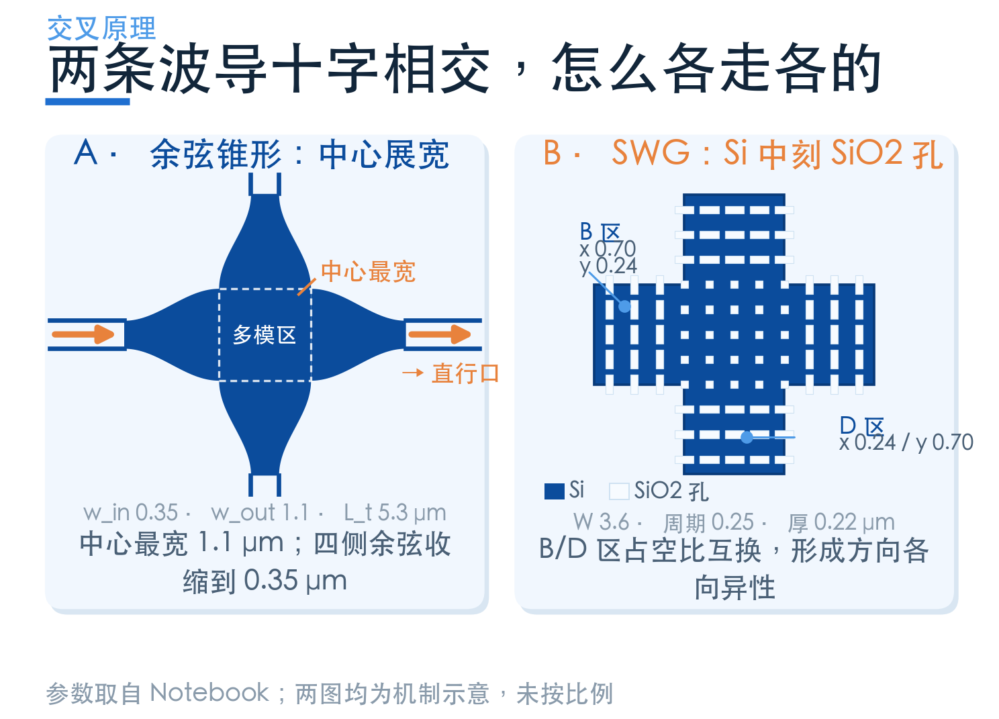
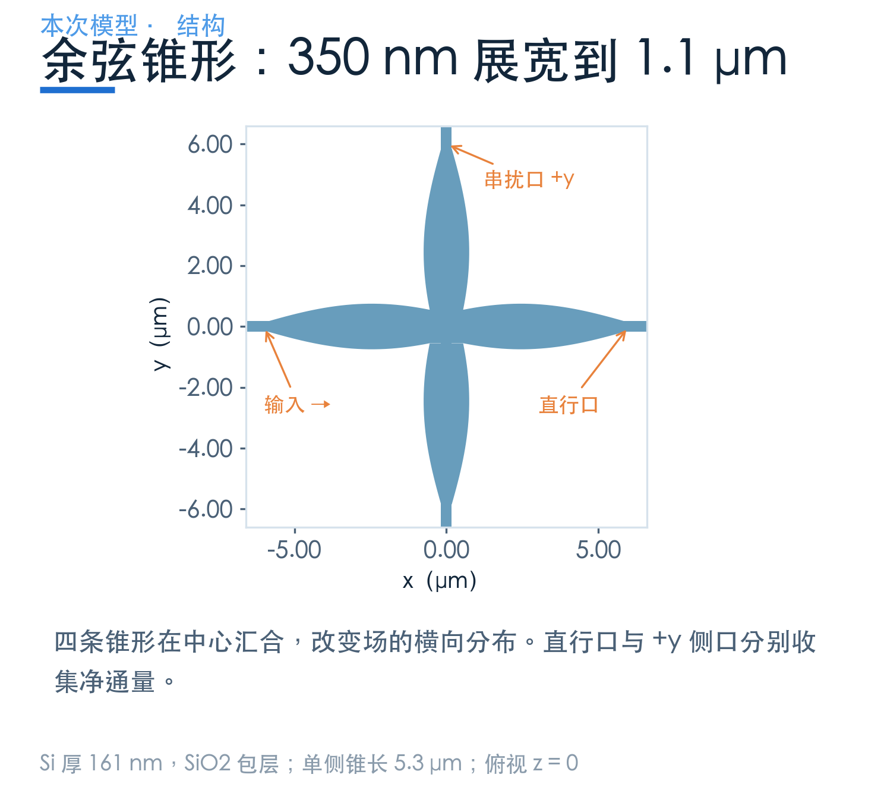
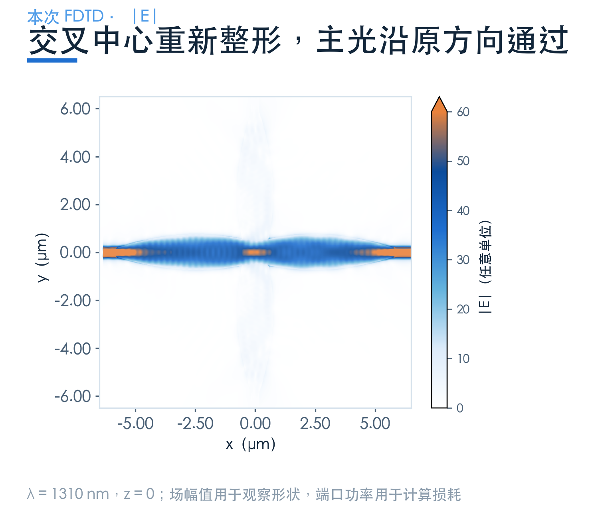
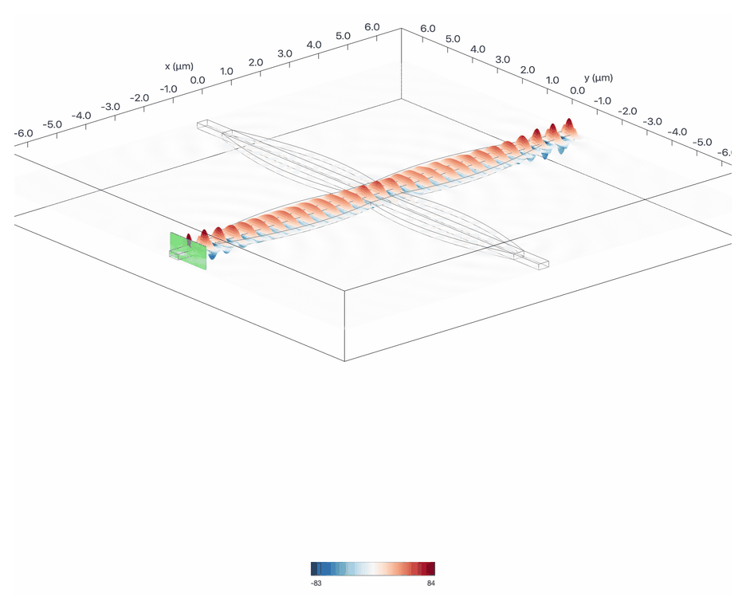
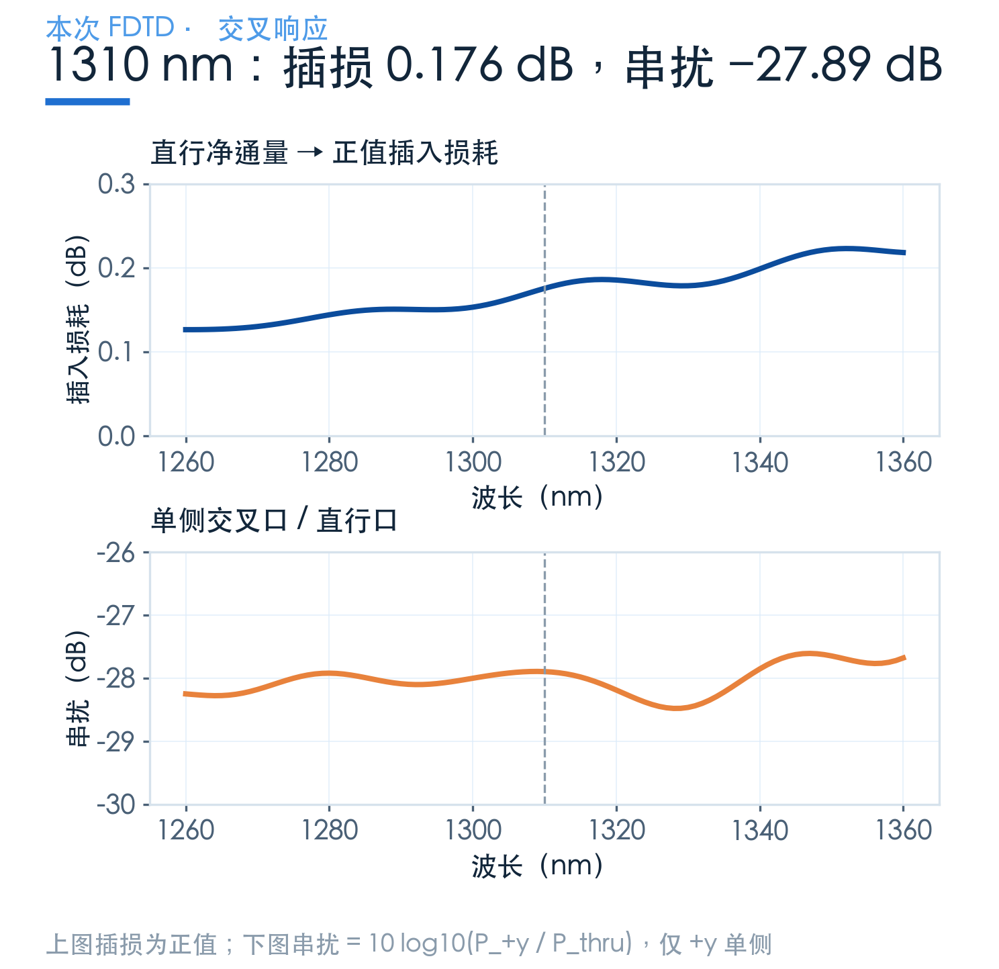
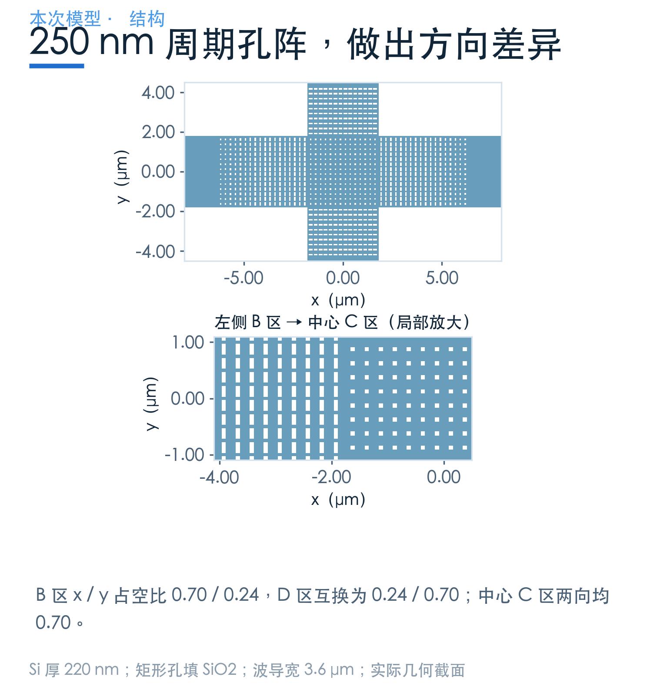
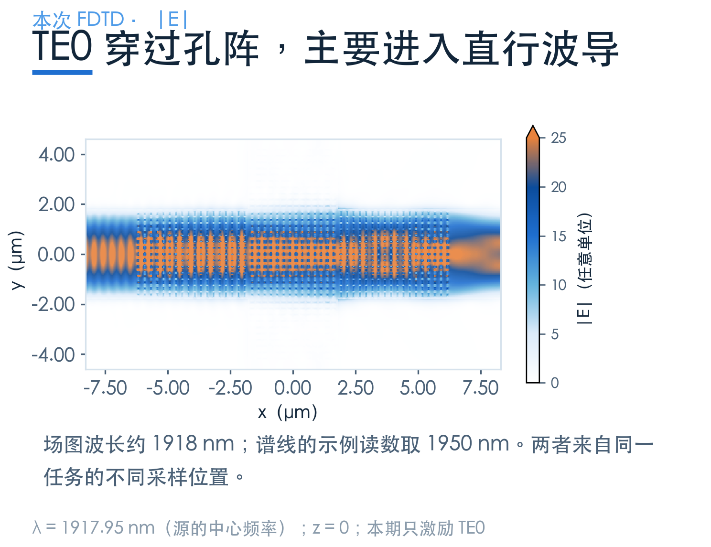
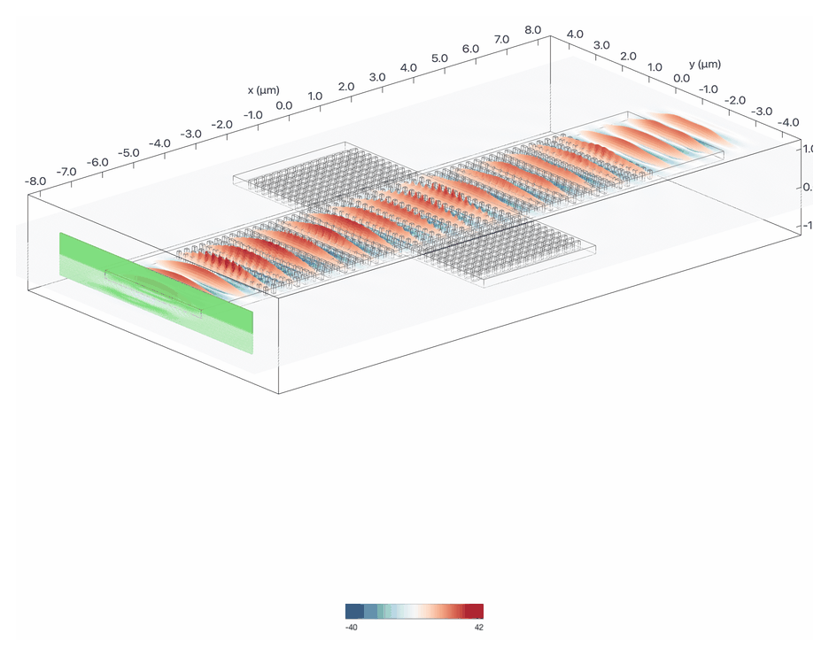
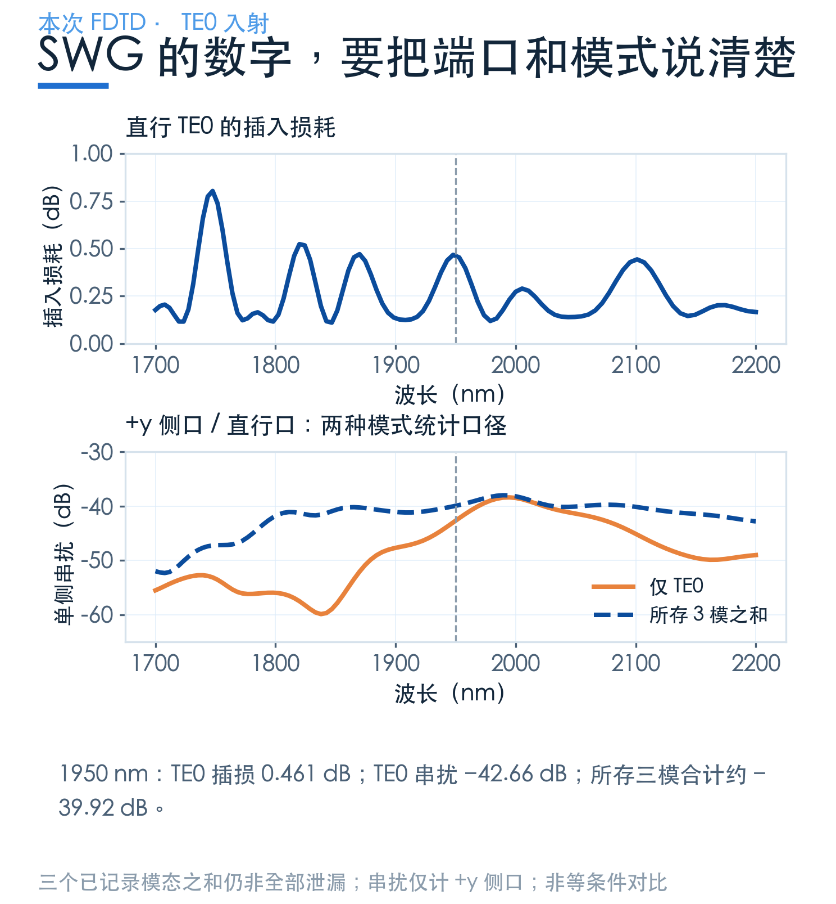

# 两条波导十字相交，怎样让光各走各的？

> **待审稿**：本文处于独立 PR 审核阶段，尚未收录为正式内容。定量结论、素材来源与授权仍需指定业内审核者核查。

在版图上，两条线交叉只占一个小点；在光子芯片上，这个点却会改变光的横向约束。光走到这里，可能继续直行，也可能向侧面散开，甚至返回输入方向。

本篇看两种结构：**余弦锥形交叉**，以及在硅波导中布置孔阵的 **SWG 交叉**。它们各自解决一个场分布问题，工作波段与材料设置不同，适合用来理解路线和代价。

## 01　两个思路：整形光束，或改变方向响应

余弦锥形让波导在靠近中心时逐渐展宽，调节横向场分布，使光在交叉中心形成合适的束形，再进入对面的出口。宽区可以容纳多个局部模式，它们的干涉参与了场的整形。

SWG 则把介质做出方向差异。孔阵的周期足够小，便可以用等效介质的思路帮助理解：光在不同方向、不同偏振下看到的响应不一样。真正的器件性能，仍由包含具体孔阵的三维求解决定。

## 02　余弦锥形：让场先准备好，再通过交叉

第一个案例采用 **161 nm 厚、350 nm 宽**的硅波导，二氧化硅包层。在交叉前后，各放置长 **5.3 μm** 的余弦锥形，中心全宽增加到 **1.1 μm**。

展宽本身并不自动等于低损耗。锥形过渡与中心宽度要配合，让进入中心的场分布有利于直行，同时减轻向两侧的散射。这里的关键是**横向场怎样变化**，不能只盯着交叉中心的宽度。

在 **1310 nm**，本次直行净通量约为入射归一化功率的 **96.04%**，换算为正值插损约 **0.176 dB**；单侧交叉口相对直行口的串扰约 **−27.89 dB**。

这里用的是净通量监视器，并未逐个分解输出模式。所以“96.04% 直行功率”与后面只统计 TE0 的指标，测量口径并不完全一样；未到达直行口的功率，也不能全部称为侧向串扰。

## 03　SWG：同样是硅，为什么能有方向性？

第二个案例采用 **220 nm 厚、3.6 μm 宽**的硅波导，在其中布置周期 **250 nm** 的矩形孔，孔内填充二氧化硅。不同区域使用不同的孔形和占空比，过渡区再逐渐调整它们。

横向 B 区的 x / y 硅占空比为 **0.70 / 0.24**；竖向 D 区交换为 **0.24 / 0.70**；中心 C 区两向均为 **0.70**。它不是一块折射率处处相同的普通十字波导。**占空比是“硅所占比例”**；填充因子按孔来定义时，两者互为补数，引用参数时先确认定义，避免把 0.70 与 0.30 混用。

还要注意：**250 nm 是周期，不是最小加工尺寸**。按这份模型的占空比，过渡区部分孔边长约为 70 nm。评估工艺时应逐项检查孔、硅桥和过渡区，不能用周期代替最小线宽。“亚波长”也不代表可以忽略细节；等效介质用于理解机制，本次求解中仍逐个保留了孔的实际几何。

这个设计的原始案例讨论多模工作。本期只复现 **TE0 入射**：宽波导本身可以支持多个模式，但只跑一个激励，不能证明所有高阶模式都具有相同性能。

在 **1950 nm**，直行 TE0 插损约 **0.461 dB**，侧口 TE0 与直行 TE0 的功率比约 **−42.66 dB**。若把端口已经记录的三个模式分别求和，再取侧口 / 直行口之比，则约为 **−39.92 dB**。

按原 Notebook 的等频率采样，先平均线性 TE0 直行功率、再转为 dB，得到约 **−0.265 dB**。它与“每个波长都有 0.265 dB 插损”是不同的陈述；图中起伏也提醒我们，带宽和中心点要一起看。

## 04　选型时，把三张标签贴回数字旁边

第一张是**工作波段**：余弦锥形例子在 O 波段，SWG 例子围绕 2 μm。第二张是**模式口径**：净通量、TE0、所存模式之和，回答的问题不同。第三张是**工艺条件**：厚度、孔阵最小尺寸与过渡区占位都要核查。

所以，本篇能支持的判断是：余弦锥形通过束形控制提供一种较简单的交叉路线，SWG 提供更细的方向与模式调节自由度。哪条路线适合具体芯片，需要回到同一工艺、同一波段、同一输出定义下比较。

## 从案例走到自己的交叉点

代码来源：[余弦锥形交叉](https://www.lingcompute.com/photon/learning-center/examples/notebooks/WaveguideCrossing)、[SWG 交叉](https://www.lingcompute.com/photon/learning-center/examples/notebooks/SWGWaveguideCrossing)。可以先从前者检查四臂结构与端口，再评估是否需要引入孔阵。

[国内产品入口](https://tidy3d.fangzhen.cloud/)。修改几何后先核查源、端口和网格；要验证多模能力，应逐个激励输入模式，并统计所有关心的输出模式及反射，费用估算后再运行。
