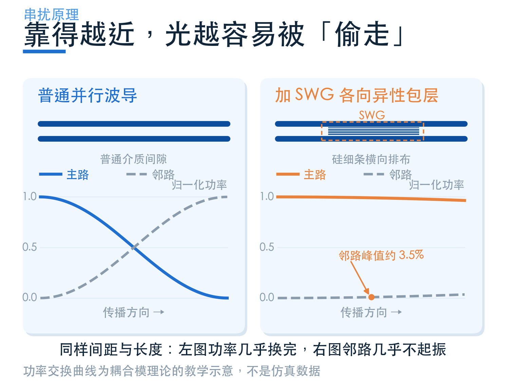
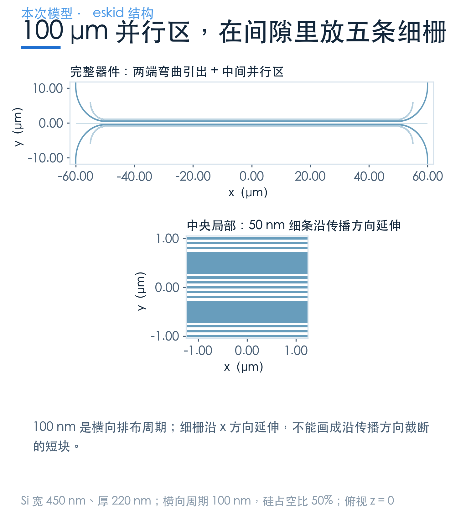
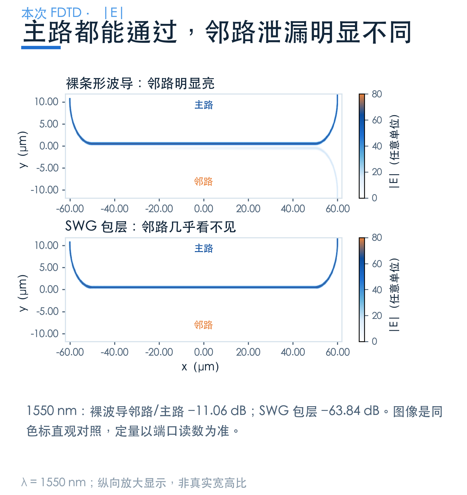
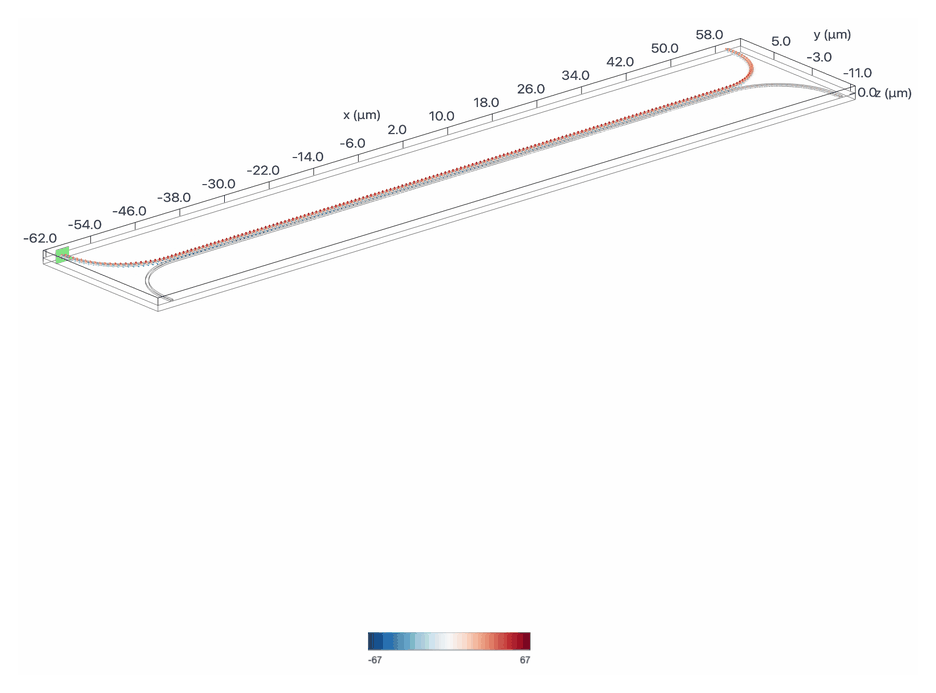
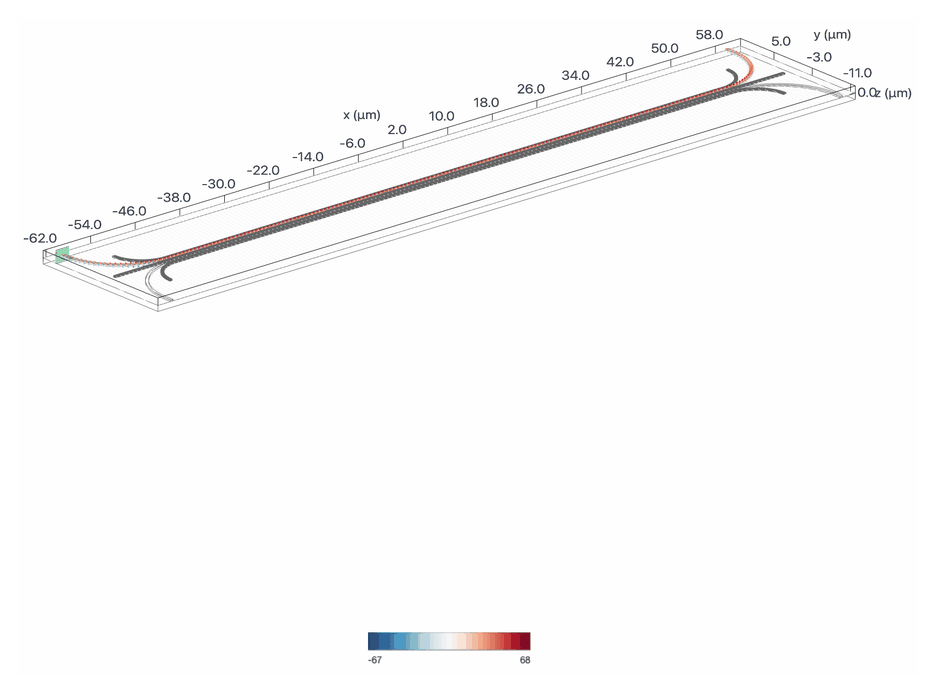
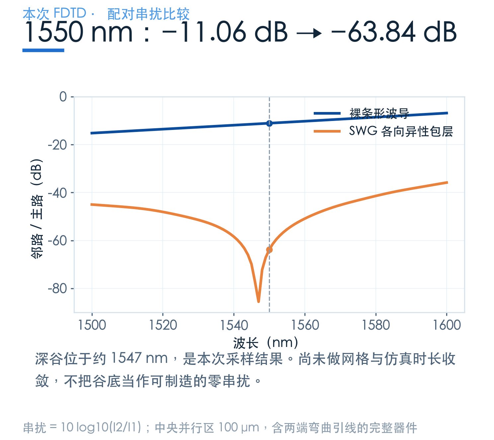
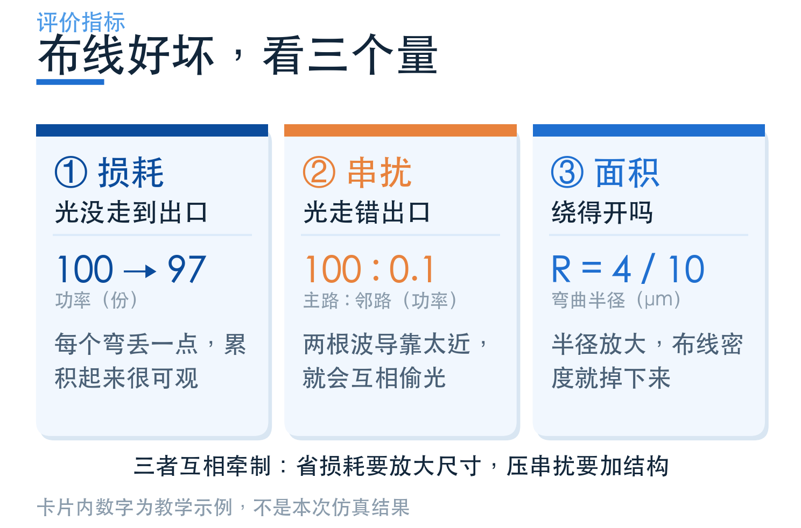

# 两根波导没有接触，光为什么也会串过去？

> **待审稿**：本文处于独立 PR 审核阶段，尚未收录为正式内容。定量结论、素材来源与授权仍需指定业内审核者核查。

把两根波导画得近一点，布线就能紧凑一点。但光并不完全被限制在硅里面：导模在包层里还有逐渐衰减的尾巴。邻居走得太近，这些尾巴就会重叠。

本篇用一对中央并行段长 **100 μm** 的波导作对照，看看加上各向异性 SWG 包层后，光是怎样更少地进入邻路，以及它为什么还不能被简单称为“零串扰”。

## 01　没有接触，也可以构成一个耦合系统

两根相同的近距离波导不再完全独立，它们共同支持对称与反对称的叠加模式。两者的传播常数不同，传播一段距离后就会产生相位差，表现为功率在两根波导之间交换。

在最简单的、无损且相同波导的耦合模模型里，这种交换随长度周期性变化。因此，串扰不仅取决于间距，还取决于波长、传播长度和模式；某个长度下串得少，不表示继续延长也一样。

最直接的办法是拉大间距，让场的重叠更弱。各向异性包层提供另一种自由度：改变场在横向的衰减和耦合关系，在不单纯增加间距的情况下压低串扰。

## 02　这个包层，细到什么程度？

案例的主波导宽 **450 nm**、厚 **220 nm**，位于二氧化硅衬底上。两根波导之间放置五条细硅栅，周围还有相应的包层结构；两端用 **10 μm 半径**的弯道将通道引出。

细栅的**横向排布周期为 100 nm，硅占空比为 50%**，也就是细条宽度约 50 nm。这里的周期沿横向排列，细条本身沿着传播方向延伸，不能把它误画成一路隔开的短块。

这也是它的工程代价。设计者获得了调节等效介质方向性的能力，同时要承担更小线宽、间隙控制和加工偏差的要求。“仿真里存在这个几何”，与“现有工艺能稳定做出来”，需要分别验证。

## 03　用一对完整器件比较，不只截取中间直段

本次分别求解带包层与裸条形波导，保留相同的主波导路径、输入输出端口和中央并行长度。取数对象是完整器件，所以结果里也包含两端弯曲引线的影响。

场图展示 **1550 nm** 的电场幅值。为了能看清长器件，图中纵向放大显示，两张图仍使用同一色标；宽高比例不能拿来测量间距。

两个输出端口朝向相反：主路在上方，输出向 +y；邻路在下方，输出向 −y。计算时分别选择各自出射方向的基模，再用邻路功率 I2 除以主路功率 I1。

## 04　1550 nm：约 −11.06 dB 变成 −63.84 dB

本次 **1550 nm** 处，裸波导的邻路 / 主路功率比约为 **−11.06 dB**，带包层模型约为 **−63.84 dB**，差值约 **52.78 dB**。

这是一组同波长、同主波导路径的配对比较，能够说明这个包层设计在该点上显著压低了串扰。但两个值的分母都是各自的主路功率，不能直接把差值当成相对于入射光的全部功率改善。

原始案例用“exceptional coupling”解释某个条件下对称与反对称模式传播常数趋于相同，耦合因而接近零。本文把它作为机制解释；这次没有额外求解超模来直接验证传播常数的简并。

图中约 **−85.6 dB** 的谷底，是离散波长采样得到的数值。极弱信号对网格、仿真时长、端口投影和数值误差都更敏感；未经收敛与容差检验，不能将其改写成器件具有精确的零串扰。

## 05　把低串扰放回布线代价里

对长距离并行线，串扰积累可能比单个弯的损耗更急迫；但对短连接，复杂包层未必必要。先缩短平行段、调整路径或增加间距，都应进入候选方案。

如果系统要求在整个波段里都低于某条串扰上限，就应检查曲线的最差值，以及线宽、间距偏差造成的变化。一个非常深的窄谷，未必比一个较浅但平坦、稳定的响应更适合产品。

## 进一步尝试前，先看模型规模

[学习中心：各向异性包层抑制串扰](https://www.lingcompute.com/photon/learning-center/examples/notebooks/ZeroCrossTalkTE)保留了完整建模与取数方式。这个案例的仿真域长达 125 μm，并包含细栅，计算规模明显大于前面的单弯；提交前应先检查精度需求与费用。

[国内产品入口](https://tidy3d.fangzhen.cloud/)。如果是首次运行案例，建议先完成一对简单弯道的建模与结果查看，再扩展到长距离串扰问题。下一篇把这几条路线放回同一套选型步骤。
