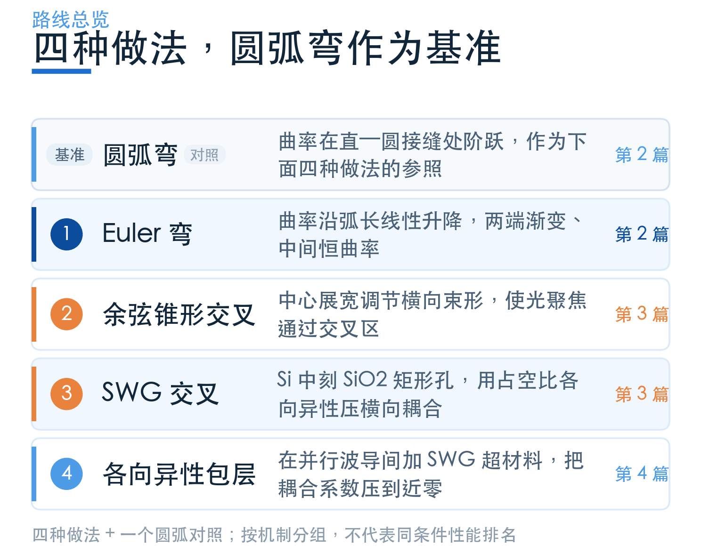
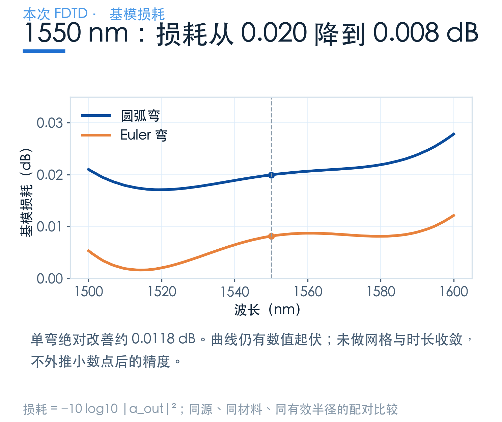
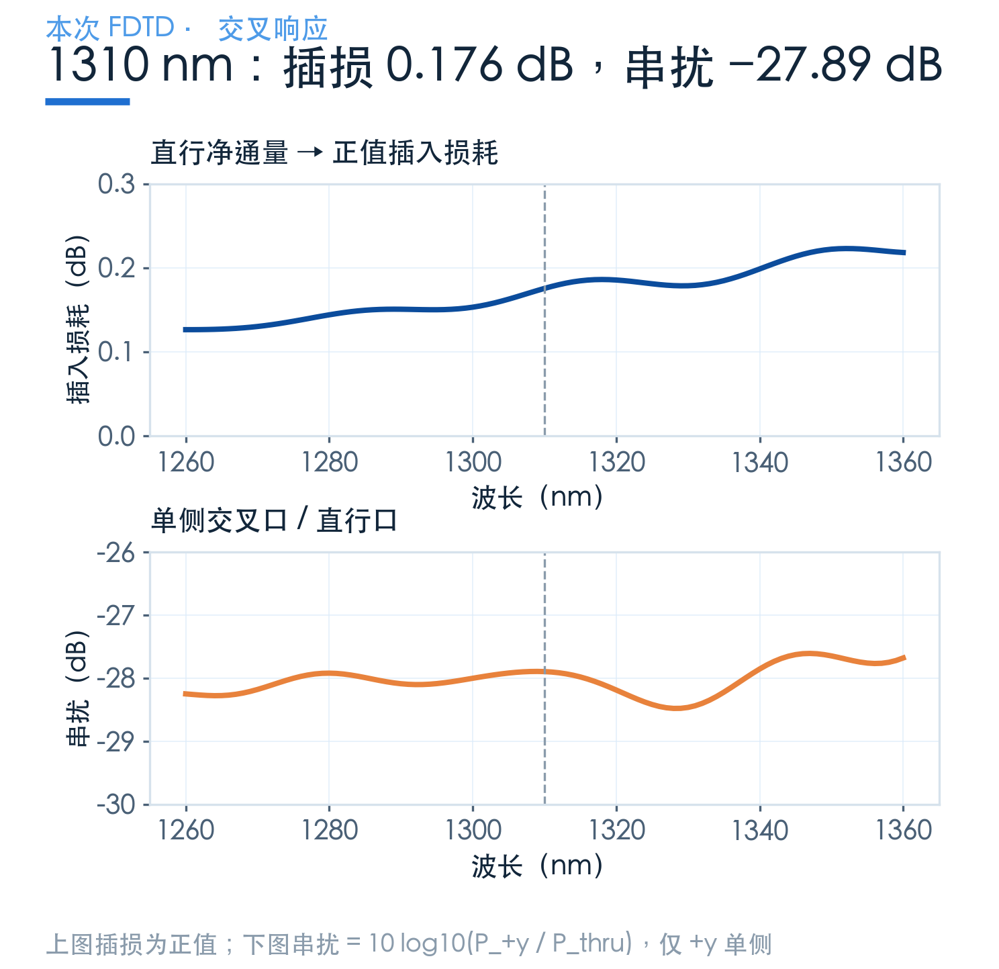
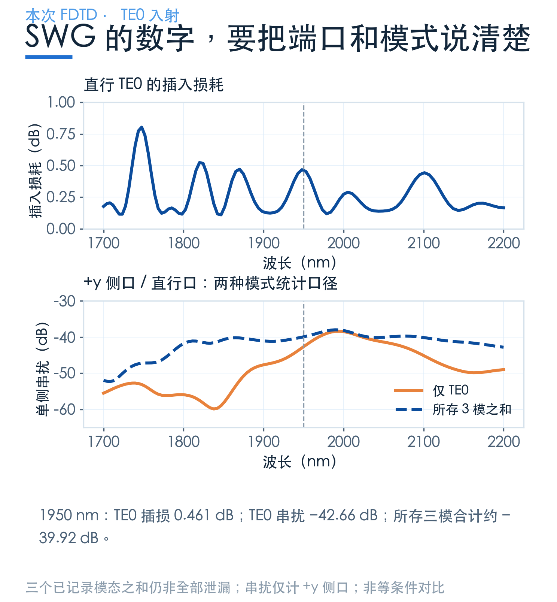
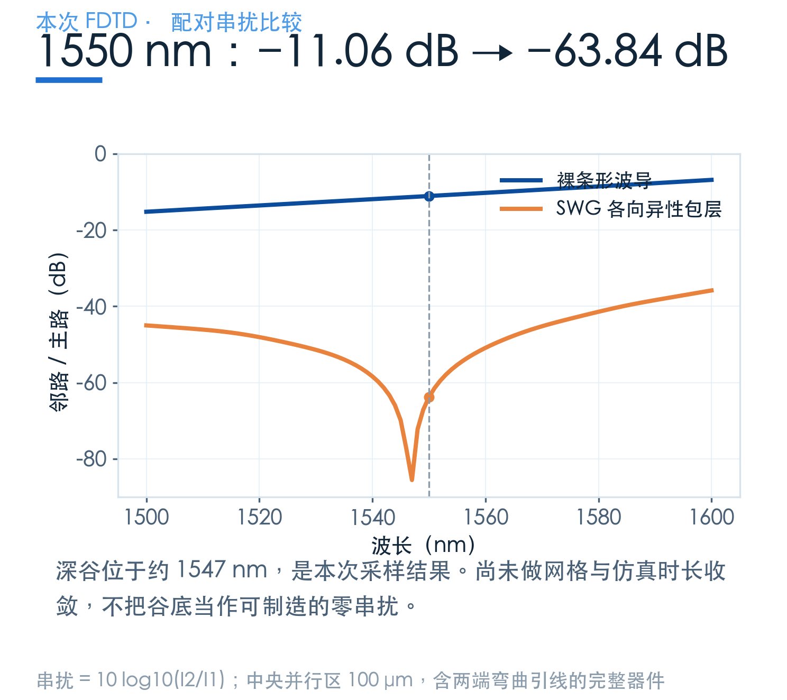
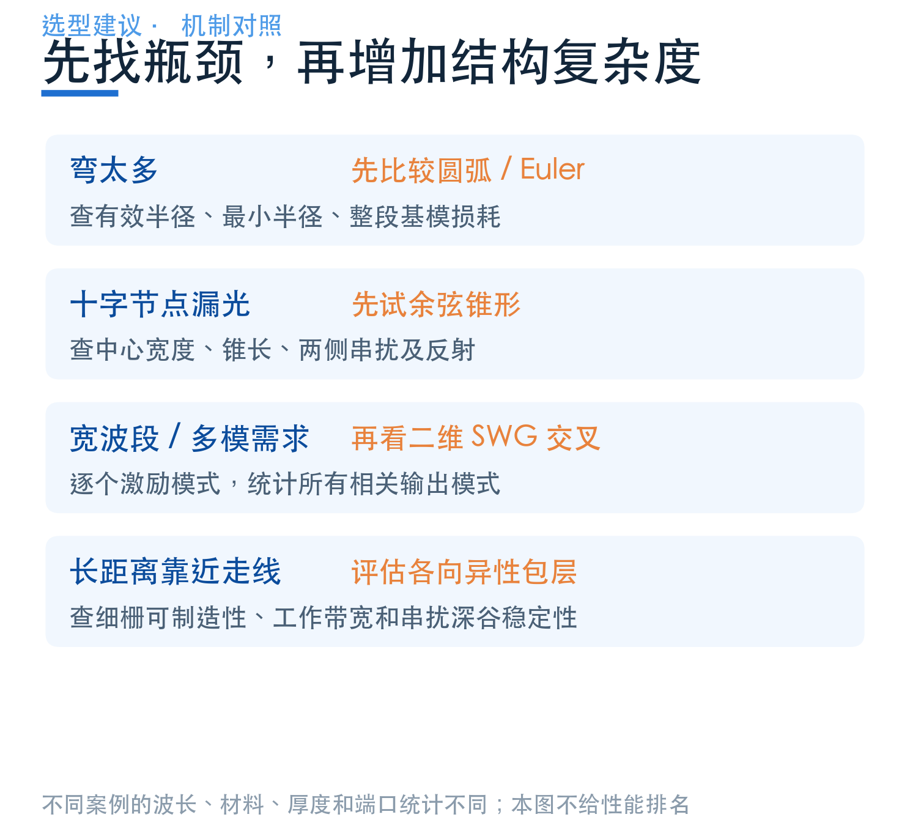
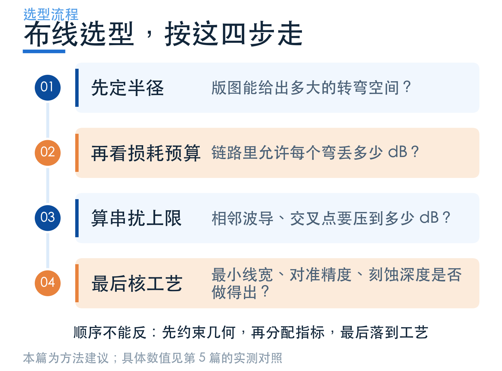

# 布线该选什么？把损耗、串扰和工艺一起算

> **待审稿**：本文处于独立 PR 审核阶段，尚未收录为正式内容。定量结论、素材来源与授权仍需指定业内审核者核查。

前面几篇讲了圆弧与 Euler 弯、余弦锥形交叉、SWG 交叉，以及抑制并行串扰的各向异性包层。它们都帮助光走到目标端口，但出问题的位置不同，解决问题的方法也不同。

选型时，先在版图上标出**哪里转弯、哪里交叉、哪里长距离并行**，再看损耗与串扰的预算。这样，仿真数字才能变成布线规则。

## 01　弯曲多：先给每个弯分配损耗预算

同材料、同端口设置和 **4 μm 有效半径**下，本次 1550 nm 的圆弧弯损耗约 **0.0200 dB**，Euler 弯约 **0.0081 dB**。这是一组可以配对比较的结果。

但单弯减少了多少，还要乘上光路中弯的数量。当只有一两个弯时，光纤接口或其他器件可能占据更大损耗；当弯很多、占位又受限时，平滑曲率过渡的价值就更突出。

选定单弯之后，还要检查它与邻近器件组合时的反射、模式失配和间距。独立元件的 dB 相加可用来做预算，不能替代密集连接区的整体验证。

## 02　十字节点：同时看直行、侧口和模式

余弦锥形交叉通过中心展宽控制束形。本次在 **1310 nm** 得到约 **0.176 dB** 的正值插损，以及约 **−27.89 dB** 的单侧串扰。

这条路线适合先建立清楚的交叉模型：四臂结构、场的整形和端口功率关系较直观。实际工艺中仍要核查薄硅层、中心宽度、锥形长度与允许的刻蚀截面，不能只复制一条曲线。

若要更细地调节方向和模式，SWG 孔阵提供了另一组设计变量。代价是细结构、过渡区和更复杂的模式统计。

这两个交叉案例的**波段、硅厚度、材料模型和端口定义不同**。SWG 的某个串扰数字更负，只能说明该模型、该波长、该口径下侧口更弱；不能据此宣布它在所有情况下优于余弦锥形。

## 03　长距离并行：带宽比一个深谷更重要

本次裸波导与各向异性包层的中央并行长度同为 **100 μm**，完整模型包含两端弯曲引线。1550 nm 时，邻路 / 主路的功率比从约 **−11.06 dB** 降到约 **−63.84 dB**。

如果产品要求跨带宽稳定隔离，就应看波段内的最差串扰、工艺偏差后的最差情况，而不是只记录最佳点。50 nm 细栅能否稳定加工，同样会影响这种结构是否值得采用。

## 04　把本次读数放在各自条件旁边

| 结构 | 读数波长 | 本次读数 | 统计口径 |
| --- | --- | --- | --- |
| 圆弧弯 | 1550 nm | 损耗 0.0200 dB | 输出前向基模 |
| Euler 弯 | 1550 nm | 损耗 0.0081 dB | 输出前向基模 |
| 余弦锥形交叉 | 1310 nm | 插损 0.176 dB；串扰 −27.89 dB | 净通量，单侧交叉口 |
| SWG 交叉 | 1950 nm | 插损 0.461 dB；串扰 −42.66 dB | TE0 入射与输出，单侧交叉口 |
| 裸并行波导 | 1550 nm | 串扰 −11.06 dB | 邻路 / 主路基模 |
| 各向异性包层 | 1550 nm | 串扰 −63.84 dB | 邻路 / 主路基模 |

表格方便查数，**只有两种弯之间、以及有无包层之间属于本组配对对照**。跨案例做选择时，应先统一工艺平台、波段、激励模式、输出统计方式和精度要求，再比较损耗、面积与加工代价。

## 05　四个问题，形成一条可执行的选择顺序

第一，版图给出多大空间？确认有效半径、实际最小半径、交叉过渡区和并行长度。第二，光路能损失多少？把总预算分给单弯与节点，保留连接及工艺余量。

第三，错误端口允许收到多少功率？把串扰指标写清楚：分母是输入还是主路，是单个模式还是多个模式，是一个侧口还是所有侧口。第四，结构是否符合工艺？细栅和孔阵需要连同带宽、容差一起验收。

一个实用起点是先建立简单的基准：圆弧弯、余弦交叉或裸并行波导。保持材料、源、边界与端口定义，再只改变目标结构，才能更清楚地知道改善从哪里来。

最后给仿真设置一个验收门槛：至少检查网格变化、运行时长与端口位置对关键指标的影响，再根据加工误差扫线宽和间距。本组结果用于解释案例机制；把毫米级布线或极深串扰谷变成产品承诺之前，还需要补齐这些证据。

## 用一个小案例完成第一次闭环

可以从[学习中心的 Euler 弯案例](https://www.lingcompute.com/photon/learning-center/examples/notebooks/EulerWaveguideBend)开始：下载 Notebook，核查材料、源与端口，先估价，再运行，最后读取基模损耗并对照场图。

进一步的案例：[余弦锥形交叉](https://www.lingcompute.com/photon/learning-center/examples/notebooks/WaveguideCrossing)、[SWG 交叉](https://www.lingcompute.com/photon/learning-center/examples/notebooks/SWGWaveguideCrossing)、[并行串扰抑制](https://www.lingcompute.com/photon/learning-center/examples/notebooks/ZeroCrossTalkTE)。

[国内产品入口](https://tidy3d.fangzhen.cloud/)。本文没有验证新用户完整注册与国内站导入流程，具体入口和运行方式请以实际页面为准；本组图文中的 FDTD 数值来自已经完成的本次任务。
