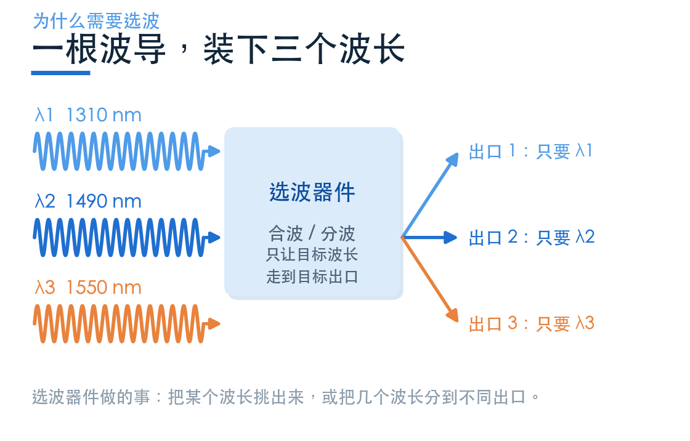
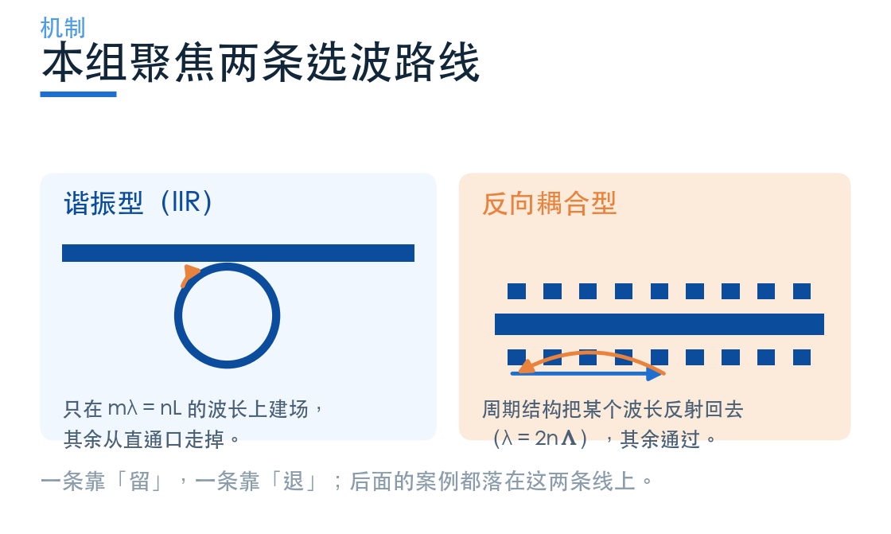
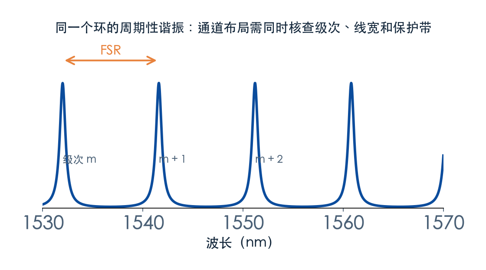
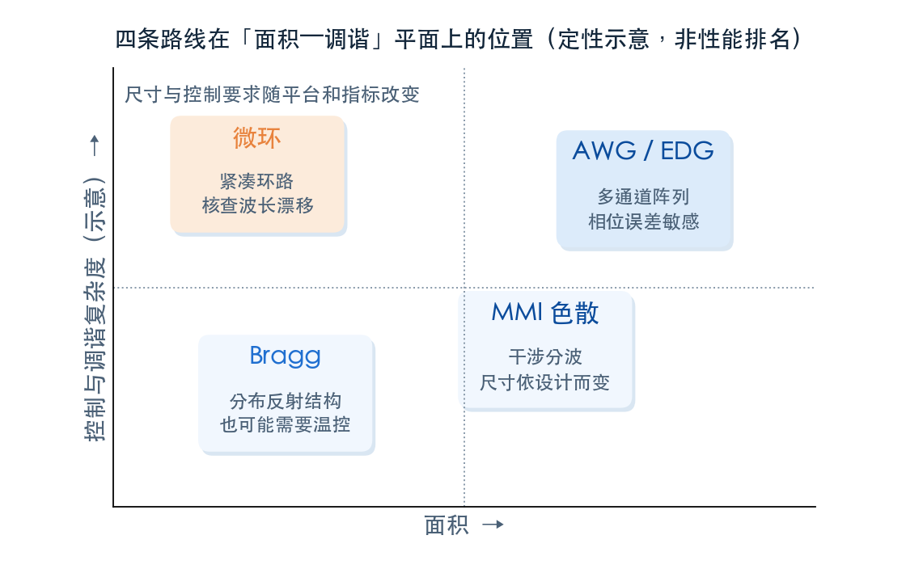

# 一个波长怎么被挑出来？

> **待审稿**：本文处于独立 PR 审核阶段，尚未收录为正式内容。定量结论、素材来源与授权仍需指定业内审核者核查。

一根波导可以同时跑好几个波长。这件事在系统里是好事——不用多铺光纤，容量就翻了几倍；但在器件层面立刻带来一个问题：到了该分开的地方，怎么把其中一个波长挑出来，而不伤到别的？

这就是**选波**。它听起来像是滤波器的事，其实包含了两种不同的任务：**挑一个**（滤波）和**分多个**（分波）。本组四篇围绕四个官方 Notebook，把微环、耦合区、Bragg 光栅与相变 Bragg 逐个跑通，最后给一套能照着用的选型顺序。

## 01　先分清：滤波与分波不是一回事

**滤波关注选定谱段的传输或抑制**，不由端口数量定义。add-drop 微环有四个口，能把目标谱段转到 drop，其余主要直通。

**分波是 1 进 N 出**：一路宽带光按波长分到 N 个出口，每个出口对应一个通道。通道之间要互相不干扰，所以指标里多了「通道间隔」和「串扰」。

两者的物理机制可以共用（微环既能滤波也能组阵列分波），但验收指标不同。混在一起讲，最容易出现的情况是：拿一个高 Q 微环的窄带数字，去论证一个 8 通道解复用器「性能很好」，而这两件事根本不在一个口径上。

本组只讲滤波这一侧。分波留给下一期——那一期要处理通道数、间隔、串扰与面积的四角权衡。

## 02　六个指标，先定义再比较

选波器件的规格表通常有十几个参数。真正决定选型的，是下面六个。

**插损**问的是目标通道损失了多少功率。**通道间隔**问相邻通道差多远：CWDM 用纳米记（20 nm 一档），DWDM 用频率记（100 GHz 约 0.8 nm，50 GHz 约 0.4 nm）。同一个器件，用 nm 记和用 GHz 记，写出来的数字完全不同。

**串扰**是最容易被含糊过去的量。相邻通道漏进来的功率、非相邻通道漏进来的功率、所有其他通道求和，是三个不同的数；只算一侧端口和算全空间，又是两个不同的数。正文每次出现这个量，都要写清是哪一种。

**3 dB 带宽**是相对通带峰值的半高宽；边沿陡度与邻道隔离还要看完整谱形。**FSR** 是相邻谐振级次的间距，需要结合总输入光谱核查假通道。**消光比**需要明确参考功率与测量端口。

六个量必须一起报。只报其中一两个，读者无法判断这个器件到底适合什么场景。

## 03　本组聚焦两条物理路线

本组讨论环谐振与 Bragg 反向耦合；AWG、MZI 与 MMI 等干涉选波不被这两类穷尽。

**谐振型**（IIR）：光在环里绕行，只有绕一圈相位回到自身的波长才会建立起场。条件是 `mλ = n_eff·L`，L 是环的周长。满足条件的波长被耦合出来，其余从直通口走掉。

**反向耦合型**：波导里做周期性扰动，正向模与反向模满足相位匹配时发生耦合，条件是 `λ = 2·n_eff·Λ`。相应谱段被反射，其余主要通过。

环谐振可以实现紧凑窄带，但要核查波长漂移和控制开销。Bragg 分布反射也会随温度和工艺漂移；提取反射光还要安排端口或环行器等光路。

两条路线都需要按线宽、温度范围和允许漂移评估是否调谐，不能由结构名称直接判断稳定性。

## 04　FSR 悄悄决定了你能放几个通道

谐振型器件的谱线是周期性的，周期就是 FSR。很多人只看单个峰的宽度，忽略了峰与峰的间距。

N 个等间距通道中心的跨度为 `(N−1)Δλ`，还需计入通道宽度与保护带。周期性谐振会在其他级次接收光，是否干扰取决于总输入光谱及其他级次的位置，不存在第 N+1 通道必然重合的规则。

先确定输入光谱、通道布局、线宽和隔离，再选环长与耦合。微环近似 `FSR = λ²/(n_g·L)`：本例 17.6 nm 的 FSR 内放不下两个相隔 20 nm 的中心。0.8 nm 密排要求足够窄的通带及隔离；增大半径会减小 FSR，并不自动提高 Q 或解决邻道串扰。

## 05　四条路线，各自占一个位置

把常见实现放进「面积—调谐」这张平面，位置就清楚了。

- **微环**：环路紧凑，线宽由加载 Q 决定；温度漂移与控制需求须按材料和通道预算核查。
- **Bragg 光栅**：反射式，带宽由耦合强度与长度等共同决定；本例有效光栅长 100×0.324 = 32.4 μm。
- **MMI 色散**：靠自成像长度随波长变化分波，结构极简，通道数少（2–4）。
- **AWG / EDG**：几十到上百通道，是 DWDM 的主力；代价是面积随通道数增长，相位误差与温度漂移都敏感。

这张图不能用来排名。四个位置的波段、材料平台、指标口径都不同，只能说明「谁擅长什么」。真要比较，必须回到同材料、同端口、同网格的配对模型。

## 06　本组怎么走

接下来四篇，按「从单点到系统」的顺序展开：

1. **微环 add-drop**：一个环怎么在谐振波长上把光接下来，Q 与 FSR 怎么读。
2. **环耦合区**：间隙 50 nm 的局部截断模型，源端反射与环段逆向模式如何区分，边界条件会不会改变结论。
3. **Bragg 光栅**：周期结构怎么只反射一个波长，齿的相位为什么能把「镜子」变回透明。
4. **相变 Bragg**：同一块材料两个折射率，阻带怎么搬家，周期数怎么决定消光比。

四个案例都按本次求解的结果重绘，每篇标注清楚哪些是仿真、哪些是示意。读完这四篇，再看下一期的多通道分波，会顺很多。

---

*下一篇：一个环，怎么把某个波长接下来？——从 `mλ = n_eff·L` 讲到 Q 与 FSR 的实际读数。*
