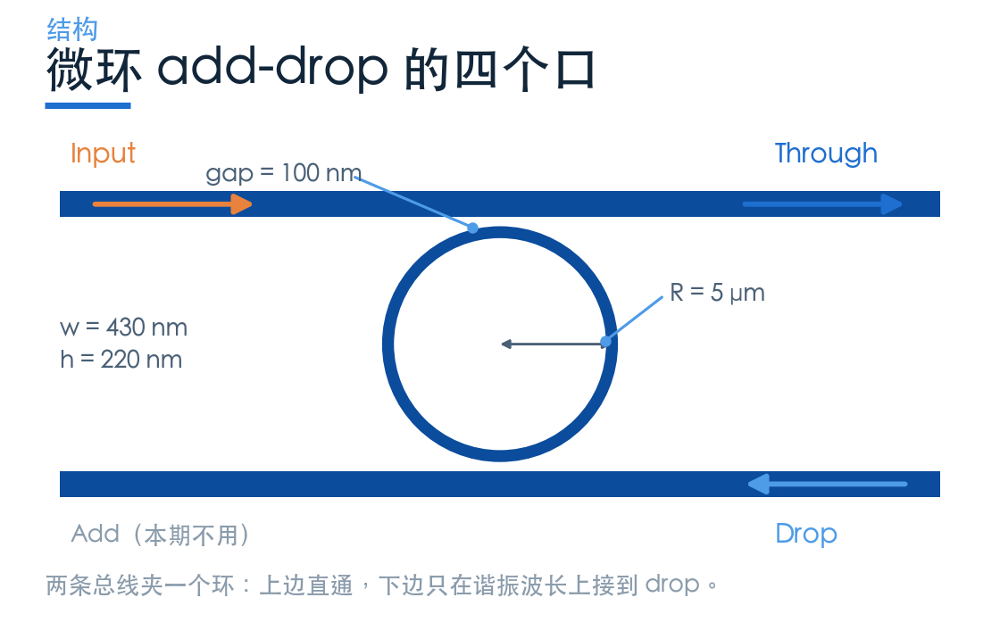
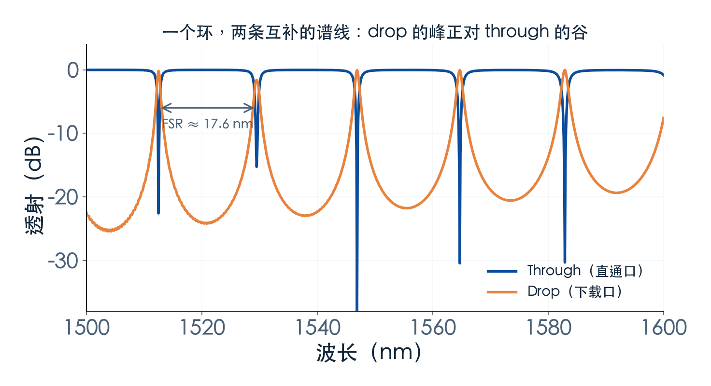
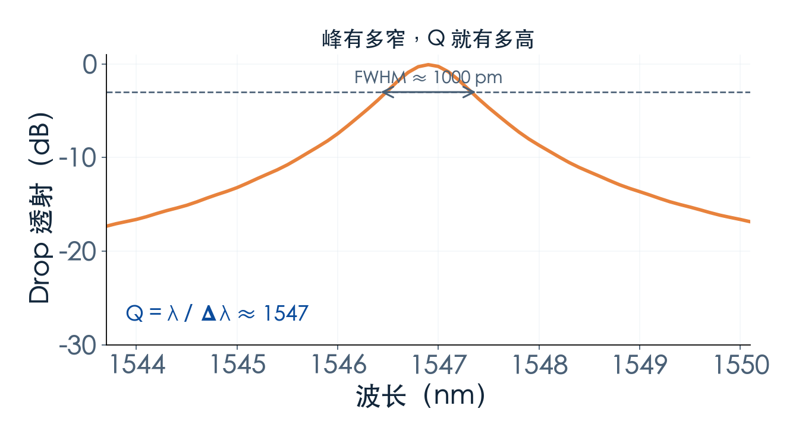
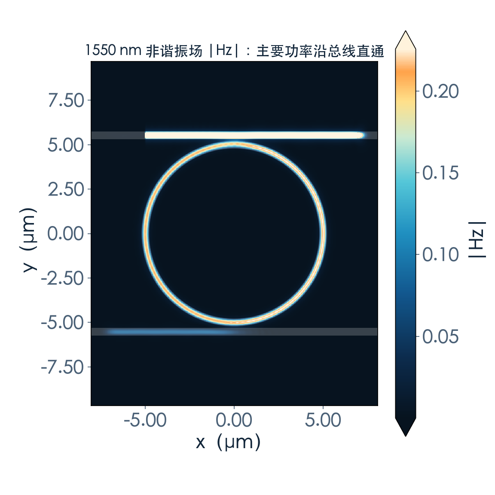
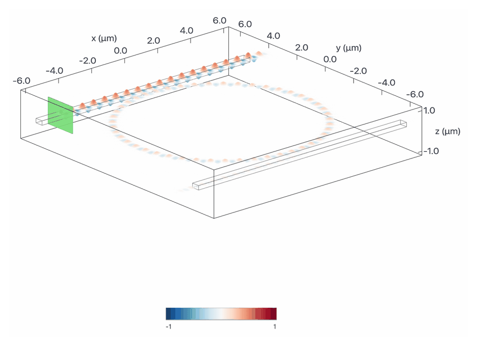
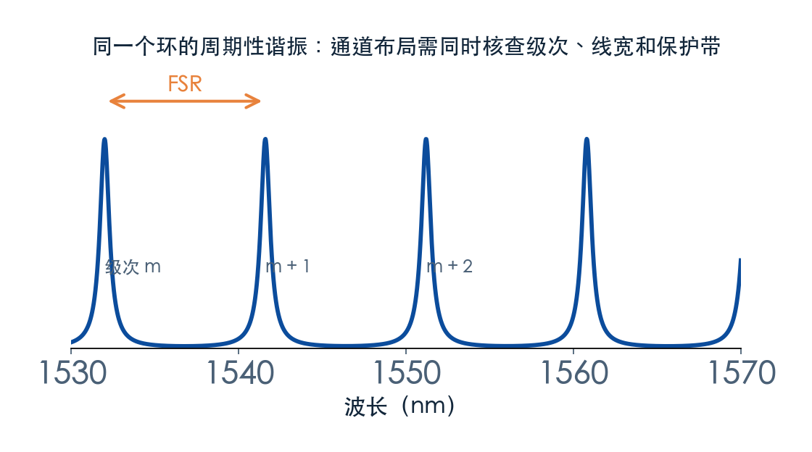

# 一个环，怎么把某个波长接下来？

> **待审稿**：本文处于独立 PR 审核阶段，尚未收录为正式内容。定量结论、素材来源与授权仍需指定业内审核者核查。

微环是选波器件里最「反直觉」的一个：它没有镜子，没有光栅，只是一圈闭合的波导。但恰恰是这一圈，能让某个波长绕在里面出不来，而旁边所有波长照常通过。

本篇用官方 `RingResonator` 案例，按本次求解结果讲三件事：谐振条件怎么定波长，Q 与 FSR 怎么从谱线上读出来，以及一个 5 μm 半径的环到底能排多密的通道。

## 01　四个口，两种命运

结构很朴素：一条上总线、一条下总线，中间夹一个环。光从上总线左边进入，走到与环最接近的那一段时，一部分能量耦合进环。

进入环的光沿圆周绕行。绕一圈回到起点时，如果相位正好回到自身，它就会与后续耦合进来的光同相叠加，环里的场越积越强；这时候下总线的那一段也会把能量耦合出去，从 drop 口输出。

相位对不上的波长，环里建立不起场，耦合进去的那点能量会原路返回上总线，继续往 through 口走。

于是同一个器件给出两条互补的谱线：**drop 口是一串峰，through 口是一串谷**，峰和谷在波长上严格对齐。这不是巧合，是能量守恒的直接结果——从 drop 出去的，正是从 through 少掉的那部分。

## 02　谐振条件：一圈的相位必须是 2π 的整数倍

写成公式只有一行：

m·λ = n_eff · L

L 是环的周长，n_eff 是波导的有效折射率，m 是整数（谐振级次）。物理含义是：光绕一圈累积的相位 `2π·n_eff·L/λ` 必须等于 `2π·m`。

这个式子解释了微环的两个性格。

第一，**波长由几何决定**。半径变一点、宽度变一点，n_eff 就变，谐振波长跟着漂。硅的热光系数约 1.8×10⁻⁴/K，对应约 0.08–0.1 nm/K 的漂移——温度变 1 ℃，峰就挪了大约十分之一个纳米。对 20 nm 间隔的 CWDM 还能忍，对 0.8 nm 间隔的 DWDM 就是灾难。

第二，**谱线是周期性的**。满足条件的波长不止一个，每隔 FSR 出现一次。FSR 由周长和群折射率决定：`FSR = λ²/(n_g·L)`。半径越小，FSR 越大。

本次求解的环：半径 5 μm、波导 430×220 nm、耦合间隙 100 nm，在 1500–1600 nm 内出现 5 个谐振峰，**FSR 约 17.6 nm**，drop 峰值约 **99.1%**，through 谷底 **−37.9 dB**。

## 03　Q：峰有多窄，通道就能排多密

Q 的定义是 `Q = λ / Δλ`，Δλ 是峰的半高全宽（FWHM）。它不是抽象的品质因数，而是「这个环能分辨多细的波长差」。

本次读数：FWHM 约 **1.0 nm**，对应 Q 约 **1500**。

这个数字比很多人对微环的印象低。原因在间隙：本次只有 100 nm，环与总线处于强耦合，能量进出太快，环里存不住，峰就被主动展宽了。代价是 Q 低；好处是 drop 效率高（峰值 99.1%）、消光比深（38 dB）。

这里需要区分内禀 Q、两条总线的外耦合 Q 和加载 Q：`1/Q_loaded = 1/Q_i + 1/Q_e1 + 1/Q_e2`。谱线半高宽给出加载 Q。减弱外耦合可以变窄线宽，但峰高还取决于内损耗及两侧耦合是否匹配，不能说提高 Q 必然降低 drop 峰值。

作为对照：Q = 5000 时，1550 nm 处的 FWHM 约 0.31 nm；Q = 10000 时约 0.16 nm。要排 0.8 nm 间隔的 DWDM 通道，Q 至少要几千，才有余量留给隔离带。

用 γi 表示内禀振幅衰减率、γ1/γ2 表示两总线的外耦合衰减率，理想单模 add-drop 模型在谐振处有 `T_drop = 4γ1γ2/(γi+γ1+γ2)²`，through 为零的条件为 `γ1 = γi + γ2`。这不同于单总线的临界条件。若 γi=0 且 γ1=γ2，同时把两侧耦合减小十倍，峰值仍可为 1，线宽则缩小十倍。实际取舍需要结合损耗和模型拟合。

## 04　场图：能量确实在环里

谱线只能说明「有多少光去了哪」，场图才能说明「光在哪」。

场监视器只存了 1550 nm。该频点端口读数为 drop 约 **2.19%**、through 约 **97.75%**，主要功率直通。要展示 1546.9 nm 的谐振场，需要新增对应频点的场数据；本文保留现有图并按实际频点说明。

场图不能用来定量。颜色深浅受色标范围影响，不同器件之间不能比亮度。要报数字，只能回到端口监视器。

## 05　半径 5 μm，能放几个通道

以本次的环为例，FSR 约 17.6 nm，一个 FSR 内放不下两个相隔 20 nm 的中心。按 0.8 nm 间隔可以在几何上排下十几个中心，但本例 FWHM 约 1 nm，不能据此宣称满足邻道隔离；还需设计更窄通带，核查保护带、其他级次和总输入光谱。

这就是微环的真实处境：**它天生适合「一个环管一个通道」的并行结构**，而不是「一个环管所有通道」。实际系统里通常是多个环挂同一条总线，每个环的半径略有差异，各自对准一个波长。代价是每个环都要一套调谐电极和监测。

## 06　它不适合什么

微环的短板和优点一样鲜明。

**温度**：0.08–0.1 nm/K 的漂移意味着没有温控就没有稳定的通道。片上加热器可以补，但每个通道都要补，功耗和布线都上去了。

**工艺**：波导宽度偏 5 nm，谐振峰就能挪零点几纳米。批量做多通道时，一致性比单个器件的性能更难。

**通带形状**：单环的峰是洛伦兹型，窄而尖，顶部不平。要做平顶通带，得级联多个环或者用游标结构，面积和复杂度立刻上升。

所以微环最合适的位置是：通道数不多、面积紧张、能接受调谐开销的场景。要几十个通道一次分开，就该换 AWG 了——那是下一期的事。

---

*下一篇：间隙 50 nm 的局部耦合模型——区分源端反射、环段逆向功率与边界误差。*
