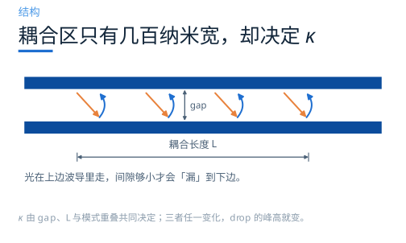
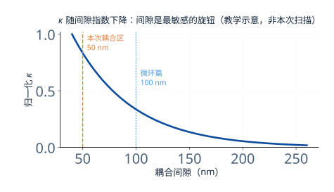
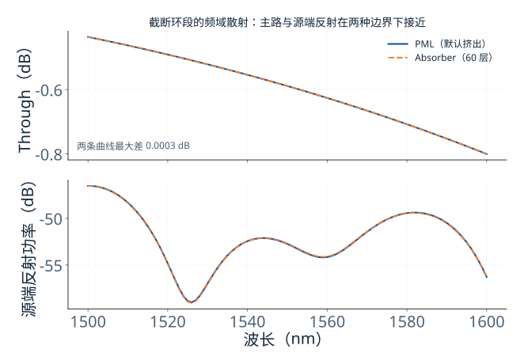
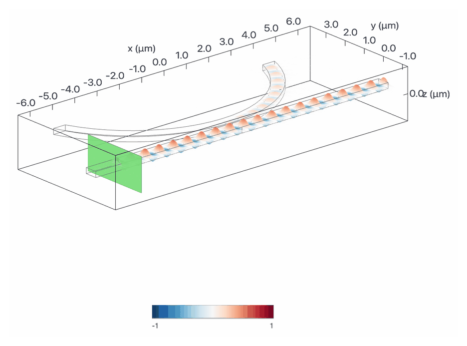
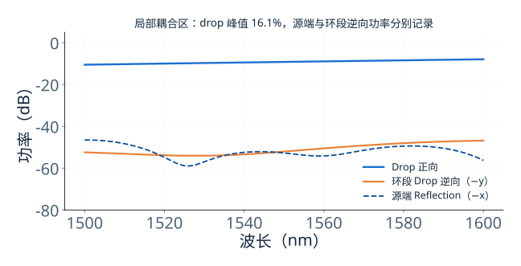

# 间隙 50 nm 的环耦合区：怎样区分耦合与反射

> **待审稿**：本文处于独立 PR 审核阶段，尚未收录为正式内容。定量结论、素材来源与授权仍需指定业内审核者核查。

微环的外耦合取决于环与总线最接近的那一段。间隙影响模式重叠，但峰高还取决于两侧耦合及环内损耗，不能由间隙变化直接给出固定的峰高比例。

本篇用官方 `WaveguideToRingCoupling` 案例（间隙 50 nm、环半径 5 μm），只计算局部耦合区。环在吸收边界处被截断，不能绕行一周；结果是局部结构的频域散射，不是完整微环的谐振谱。

## 01　耦合不是「光漏过去」，是场在重叠

波导里的导模并不是全部关在硅里。总有一部分场延伸到包层，按指数衰减。两根波导靠得足够近时，各自的延伸场开始重叠，原本独立的两个模式变成一对超模（偶模与奇模）。

两个超模的传播常数略有差异，沿传播方向累积出相位差。相位差到 π 时，能量从上波导完全转移到下波导——这就是耦合长度的由来。

所以 κ 不是一个独立参数，它是**间隙、波导尺寸、波长**共同决定的函数。间隙每增加几十纳米，场重叠按指数下降，κ 也跟着掉。

这也解释了为什么耦合区对工艺这么敏感：100 nm 的间隙，刻蚀偏差 10 nm 就是 10% 的变化。

## 02　为什么单独算这一段

完整的微环仿真要跑 30 ps、三千多万网格，成本 6.92 FC。耦合区单独拿出来只有 13×5 μm、2 ps，一个任务 0.62–0.67 FC，便宜一个数量级。

更重要的是：单独算耦合区，可以把「环内的谐振」和「总线的耦合」分开看。谐振由周长决定，耦合由间隙决定，两者在一张谱线上纠缠在一起时，很难判断性能变化到底来自哪一项。

工程上的常规做法是：耦合区用 FDTD 精确算出 κ，再把 κ 代进解析模型或电路仿真，快速扫环长、扫通道数。这样既保住了精度，又把成本压到可以接受。

## 03　同一几何，只换边界条件

本次跑了两个模型，几何、材料、源、监视器相同，只改变 y 正侧边界：默认 PML 或 60 层 Absorber。域的 y 上界为 3.825 μm，而环心在 y=5.55 μm、半径为 5 μm，因此上边界截断了环。

结果：两条 through 曲线几乎重合，最大差异小于 **0.001 dB**。这说明在这个设计点上，边界条件的选择不影响主路读数。

源端 `reflection` 的 −x 基模峰值为 PML **−46.523 dB**、Absorber **−46.529 dB**，相当接近。另一监视器 `drop` 的 −y 逆向分量为 **−46.831 dB** 与 **−49.120 dB**；约 2.3 dB 的差异属于环段逆向模，不能移用到源端反射。

需要强调的是：**「差异小」是本次结构的结果，不是通用结论。** Notebook 原文之所以专门讨论边界，是因为某些几何下 PML 的默认「结构挤出」会把波导延伸进吸收层，产生非物理反射。这次没撞上，不代表下次不会。

## 04　源端反射与环段逆向模，分别统计

要判断回到输入光源的反射，应读取源后方的 `reflection` 监视器。环段 `drop` 沿 y 法向，其正反向模式是另一组端口量。

1. **源端反射**：`reflection` 的 direction="-"，沿 −x 返回。
2. **环段逆向模**：`drop` 的 direction="-"，沿 −y 传播，不等于源端回波。本模型使用理想侧壁，没有粗糙度散射的统计。

本次窗口内 drop 正向峰值约 **16.1%**；源端反射峰值约 **−46.5 dB**，环段逆向峰值约 **−46.8 dB**。不同峰值不一定出现在同一波长。

最大运行时长设为 2 ps，但日志显示 PML 与 Absorber 分别约在 **0.394 ps**、**0.381 ps** 达到 1e−5 衰减阈值并提前结束。没有周期性谐振的原因是环被截断，不是运行太短。16.1% 是局部端口频域耦合读数；完整环的下载效率要用完整闭环模型计算。

## 05　一个建模陷阱：PML 的「结构挤出」

Tidy3D 的 PML 默认会把穿过边界的结构延伸进吸收层（`extrude_structures=True`）。这在多数情况下是好事——避免结构在边界处突然截断引起反射。

但如果波导是斜着穿过边界的（比如环的切向），挤出会在 PML 内部生成一段非物理的几何，反而引入反射。原文为此对比了三种设置：不挤出、挤出、改用 Absorber。

本次只跑了后两种，因为不挤出属于实现细节，不影响正文论点。这个取舍写在 ADR 里，读者不必重复。

## 06　怎么从谱线反推 κ

局部耦合模型可用于提取端口散射系数，再接入完整环的电路模型。需要先明确 κ 指场耦合系数还是每单位长度耦合率，不能混用。

1. 从局部模型提取各端口复振幅，确认模式、方向、归一化和参考平面。
2. 由完整环谱线得到加载 Q，并结合两总线外耦合和内损耗的模型拟合。
3. 扫描间隙时同时检查通过、下载、反射及损耗；仅凭两个峰高不足以唯一确定所有参数。

两总线 add-drop 的 through 为零条件为 `γ1=γi+γ2`，不能套用单总线「外耦合等于内损耗」。本次没有扫间隙或做上述拟合，因此不反推 κ 的唯一数值。

## 07　这一段决定了什么

把耦合区单独讲清楚，价值在于它把「微环性能」拆成了两个可独立优化的部分：

- 环长与群折射率主要决定 FSR，内损耗与外耦合共同决定加载 Q；
- 局部耦合的幅度、相位与反射进入完整环模型，共同决定下载谱形。

两者都调好，才有一条又深又窄的 drop 峰。只调其中一个，通常会在另一项上付出代价。

局限也要说清：本次只跑了一组几何、两种边界，没有扫间隙，也没有做 3D 与 2D 等效模型的对照。所以这里的数字只描述这一个设计点。

---

*下一篇：周期结构怎么只反射一个波长？——从 `λ = 2n·Λ` 讲到齿的相位如何把「镜子」变回透明波导。*
