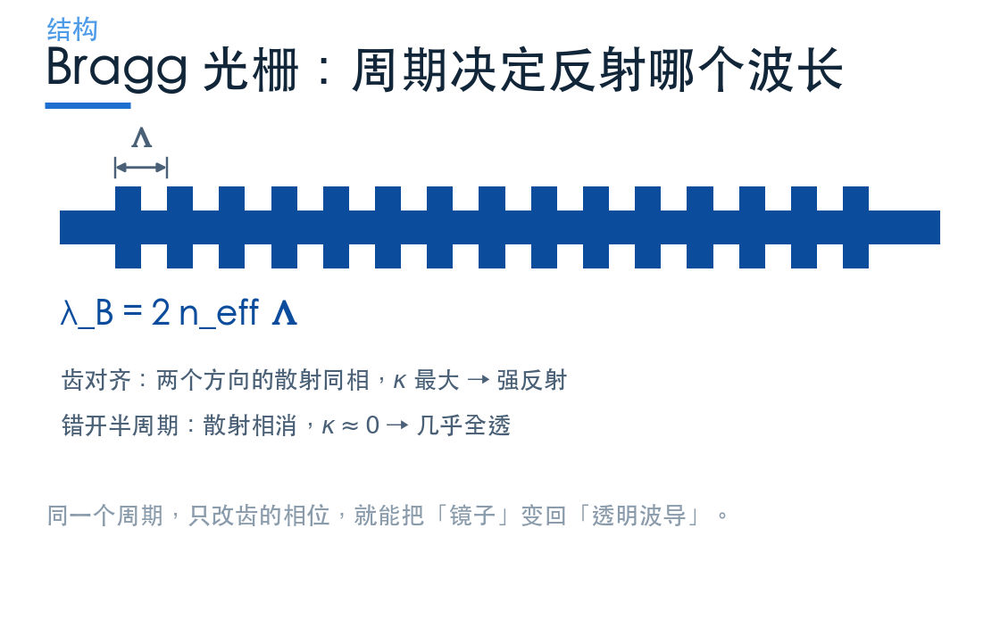
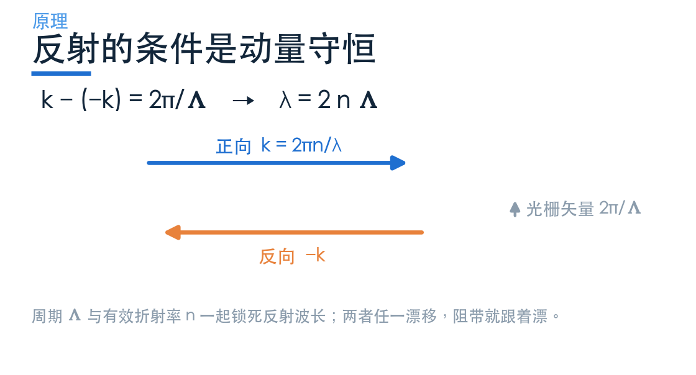
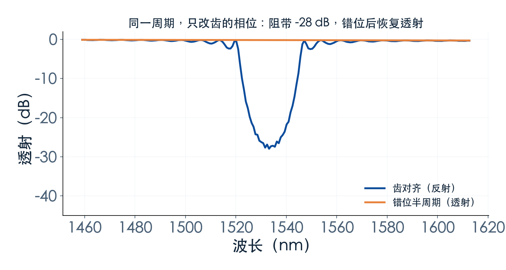
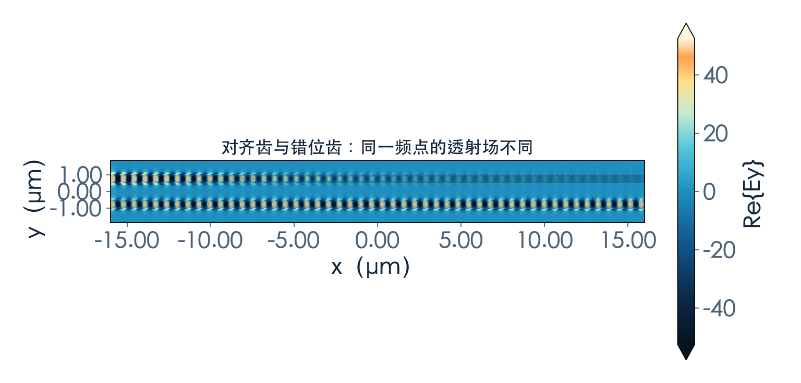
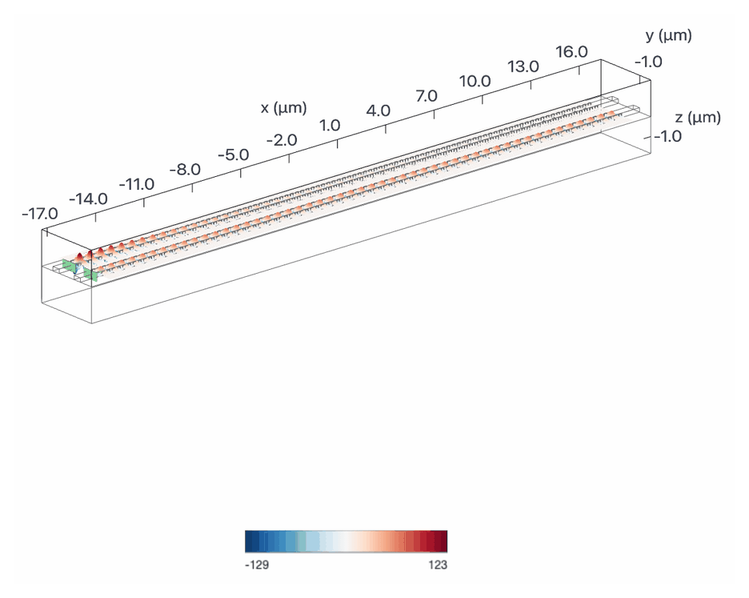
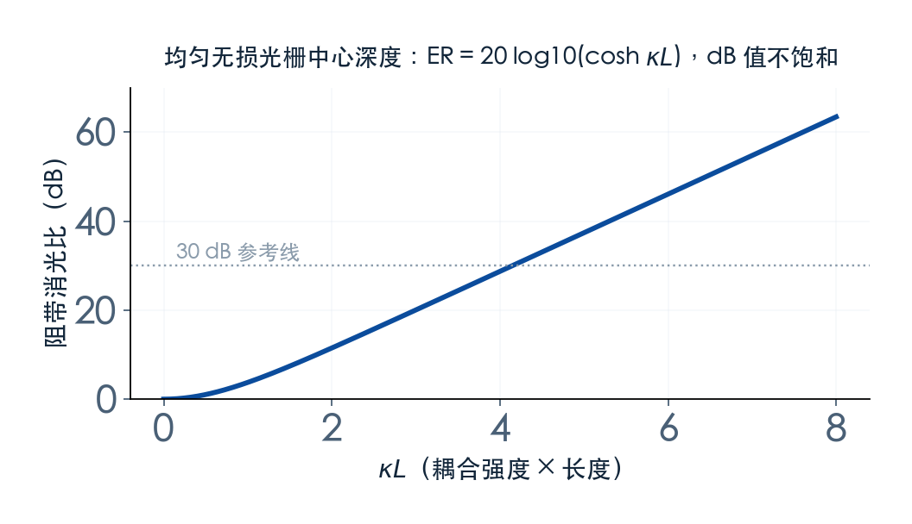

# 周期结构怎么只反射一个波长？

> **待审稿**：本文处于独立 PR 审核阶段，尚未收录为正式内容。定量结论、素材来源与授权仍需指定业内审核者核查。

如果说微环是靠「留」来选波，Bragg 光栅就是靠「退」：在波导侧壁刻一串周期性的齿，某个波长走到这里会被原路反射回去，其他波长照常通过。

它比微环简单得多——没有环，没有谐振腔，只有一段周期性扰动。但正因为简单，它把选波的另一条物理路线暴露得非常清楚。

## 01　反射的条件是动量守恒

正向传播的模，波矢是 k；要想被反射，必须有一个反向传播的模，波矢是 −k。光栅提供的就是这个「动量缺口」。

光栅的波矢是 `2π/Λ`，Λ 是周期。相位匹配要求：

k − (−k) = 2π/Λ

把 `k = 2π·n_eff/λ` 代进去，就得到 Bragg 条件：

λ_B = 2·n_eff·Λ

这个式子只有两个变量：周期与有效折射率。想改反射波长，要么改周期，要么改折射率——后者正是相变材料那篇的入口。

## 02　同一个周期，两种命运

本次用的官方 `BraggGratings` 案例有个很巧妙的设计：**把两段光栅并排放在同一个仿真里**，一段齿对齐，一段齿错开半个周期。

为什么错开半周期就能从「镜子」变成「透明」？因为两侧的齿对同一个正向模产生两次散射，两次散射的相位差正好是 π，相干相消。耦合系数 κ 被压到接近零，光就顺利通过了。

本次读数：对齐段在 **1533 nm** 处透射降到 **−27.9 dB**，−10 dB 阻带宽度约 **21.6 nm**；错位段的透射最低只到 **−0.3 dB**，平均透射约 **96%**。

这组对比说明一件事：**Bragg 光栅的强度不是一个固定的材料属性，而是几何相位的函数。** 同一个版图，只改齿的排布，就能在「强反射」和「几乎透明」之间切换。工程上常用这一点做 κ 的精确控制——不是靠改刻蚀深度，而是靠改相位。

## 03　场图：被挡住的那一段

场图把「反射」这件事变得可见：对齐段里能看到明显的驻波图案——正向与反向行波叠加的结果；错位段则是一条干净的行波。

注意场图只能定性。驻波的条纹间距与波长有关，但不能从条纹数直接读出反射率；要数字，回到通量监视器。

## 04　κL 定中心深度，带宽还要分别看 κ 与 L

理想均匀无损光栅在中心频点有 `R=tanh²(κL)`、`T=sech²(κL)`，因此相对单位输入功率的透射抑制度为 `ER=20log10(cosh(κL))`。

- κL 增大时，中心反射率趋近 1，但 dB 抑制度继续增长。
- κL=2、4、8 时，理想中心抑制度约为 11.51、28.73、63.47 dB。
- 相同 κL、不同 κ 和 L 可以得到相同中心深度，却具有不同带宽；群速度和失谐也参与决定频谱。

设计需要联合确定 κ、L、带宽、边沿及旁瓣，不能先由一个 κL 决定带宽，再任意分配 κ 与 L。

本次只跑了一个长度（100 个周期），所以只能给出这一点的读数，不能画 κL 曲线。这是本期的边界，正文不越界外推。

## 05　反射式的代价

Bragg 光栅最大的工程麻烦，来自它是**反射式**器件。

光被原路退回，会和入射光走在同一根波导里。要把它从系统里取出来，必须加环行器或隔离器；而在片上集成里，这两样都不好做。这就是为什么 Bragg 更多见于「反射镜」「窄带滤波」这类角色，而不是直接做 add-drop。

一种路线是**反向耦合器**（contradirectional coupler）：在两根波导之间做周期扰动，让目标谱段耦合到另一波导的反向端口，便于单独提取。寄生反射仍需验证，不能保证回波为零；本期没有跑这一结构。

另一个代价是**温度与工艺**。λ_B 随有效折射率和周期变化；热光效应、热膨胀与加工偏差都可能移动阻带。是否需要温控或反馈，取决于允许漂移、阻带宽度与工作温度范围，不能由「没有环」推出免调谐。

## 06　它适合什么

把特点归拢一下：

- **适合评估**：单通道滤波、反射镜、与相变材料结合做可重构器件；需要另行核查温度与回波预算。
- **不适合**：多通道一次分波（需要级联，面积迅速上升）、对回波敏感的系统（需要环行器）。

本案例未加入调谐结构；Bragg 也能采用热光等调谐方式，是否需要由系统规格决定。

---

*下一篇：同一块材料，两个折射率——相变 Bragg 怎么让阻带搬家，周期数又怎么决定它能挡多深。*

## 07　一个容易被忽略的细节：阻带不是矩形

看本次的谱线会发现，阻带的底部不是平的，两侧也不是垂直落下的。这是 Bragg 光栅的固有形状：耦合越强，阻带越宽，但边沿的滚降始终是有限的。

对系统设计来说，这意味着两件事。第一，**「阻带宽度」必须说清是在哪个深度上量的**：−3 dB、−10 dB 还是 −20 dB，同一个器件能差出一倍。本期统一用 −10 dB，正文与图注都标了这个口径。第二，**相邻通道不能贴着阻带边沿排**，因为边沿的滚降会把邻居的功率漏进来一部分。

要更陡的边沿，常见做法是级联两段周期略有差异的光栅，或者改用反向耦合器加 apodization（耦合强度沿长度渐变）。这两种做法都会增加长度与工艺步骤，属于「用面积换边沿」。
