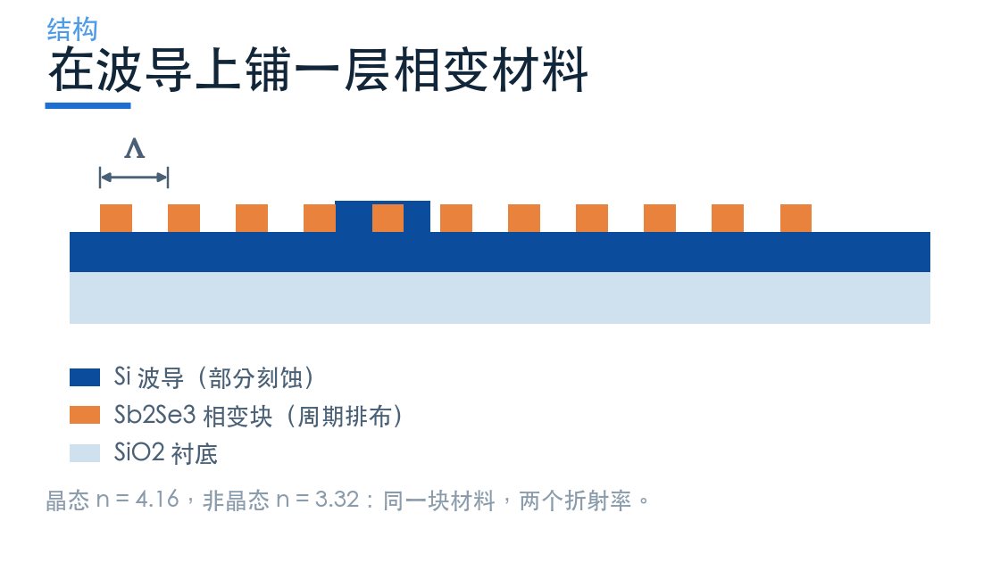
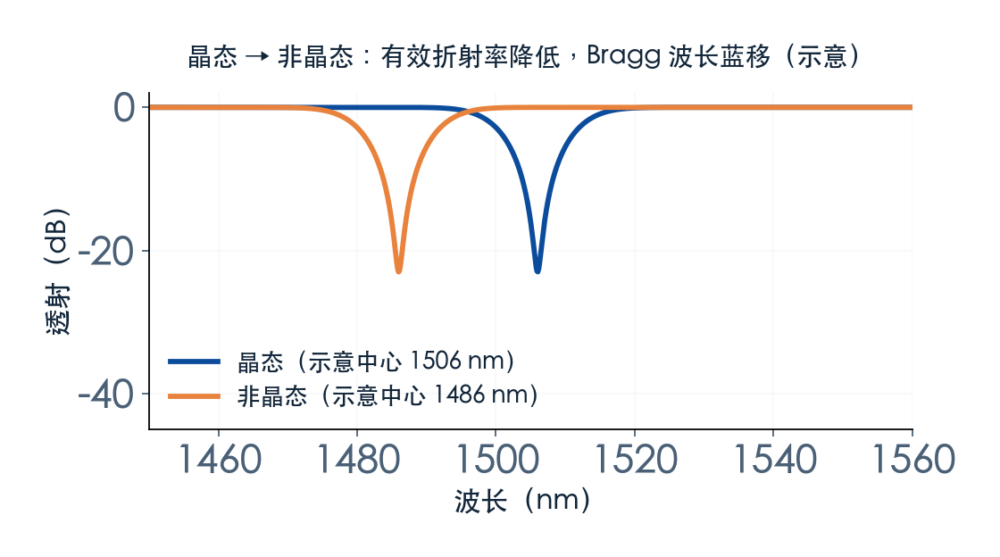
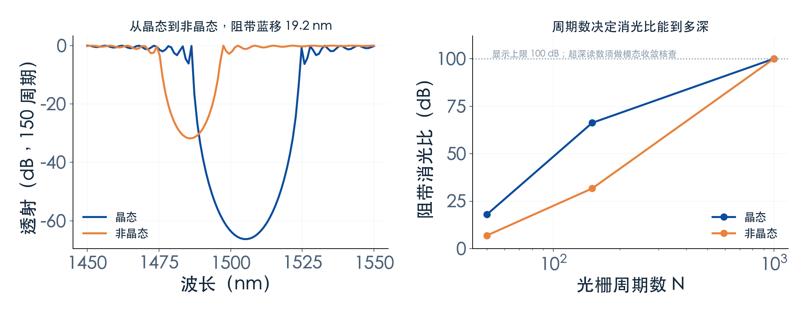

# 同一块材料，怎么让阻带搬家？

> **待审稿**：本文处于独立 PR 审核阶段，尚未收录为正式内容。定量结论、素材来源与授权仍需指定业内审核者核查。

前面三篇讲的都是「设计定死」的器件：微环的半径、耦合区的间隙、光栅的周期一旦流片就固定了。要改波长，只能加热或者重做。

相变材料给的是另一条路：**同一块材料，两种状态，两个折射率。** 状态可以切换，波长就跟着切换，而器件结构一点没动。

本篇用官方 `PCMBraggGratingFilter` 案例，讲清三件事：相变怎么移动阻带，周期数怎么决定消光比，以及为什么这一次我们选择 EME 而不是 FDTD。

## 01　把相变材料放进 Bragg 光栅

结构很直接：一条硅脊波导，上面按周期铺一层 Sb₂Se₃ 块。Bragg 条件还是那一条：

λ_B = 2·n_eff·Λ

只不过这里的 n_eff 是整个波导模的有效折射率，它由硅、包层和上方的相变材料共同决定。相变材料的状态一变，n_eff 就变，λ_B 跟着变，周期 Λ 完全不用动。

Sb₂Se₃ 的两个折射率差得很多：晶态 4.16，非晶态 3.32。这么大的差值意味着波长移动会很明显——代价是两态的插入损耗、稳定性、切换速度都要单独评估。

## 02　本次求解：两相各一条谱线

本次用 EME 求解器，两相各跑一次，每次同时给出 50 / 150 / 1000 三个周期数的结果。

读数：

- 晶态阻带中心 **1506 nm**，非晶态 **1486 nm**；从晶态切到非晶态，阻带蓝移 **19.2 nm**。指标 `phase_shift_nm` 定义为「非晶态减晶态」，因此带符号值为 **−19.2 nm**。
- 150 周期时，消光比分别为 **66.3 dB** 与 **31.8 dB**。
- 1000 周期时，理想 EME 读数两态均 **>100 dB**；图中显示截到 100 dB，未完成模态数、网格或实际工艺收敛，不能作为成品隔离保证。

两点值得注意。

第一，**移动量由两相的有效折射率差决定**。它不是材料折射率差本身，还取决于模场重叠和分布；改变层厚对移频与损耗的影响需要重新求解，不能直接断言损耗必然增加。

第二，**中心反射率趋近 1，不代表 dB 抑制度饱和**。均匀无损模型给出 `ER=20log10(cosh κL)`，大 κL 时近似随长度线性增加。实际可用深度受数值精度、模式截断及制造误差限制；长度应按所需抑制、带宽与损耗联合确定。

## 03　为什么这次用 EME，不用 FDTD

相变 Bragg 的官方 Notebook 里有两条路径：3D FDTD（晶态与非晶态各一个，估价 12.7 FC）和 EME（周期单元 + 周期数扫描，估价 0.23 FC）。

本次只跑了 EME，理由写在 ADR 里，简单说三条：

1. **成本差 55 倍**。本期总预算 9.59 FC，其中微环一项就占 6.92 FC，再叠 12.7 FC 的 FDTD，单期会翻倍。
2. **EME 一次给出三个长度**。FDTD 只能给一个长度，要画「消光比 vs 周期数」就得跑三次。
3. **本期要讲的是趋势，不是绝对设计值**。相态移动与长度依赖这两件事，EME 已经说清楚。

代价也要讲明：**EME 没有时域场演化**，所以本篇没有 GIF，机制图只能是示意。另外 EME 的端口定义比 FDTD 理想，两者的绝对透射会有差异，正文不把两组数字并列。

原文用 FDTD 与 EME 互相验证过，两者吻合。这是原文的结论，本期没有复现那次验证。

## 04　可重构的边界在哪

相变器件常被描述成「可编程光子学」的基础，但工程上要过四道关。

**非易失性**：晶态与非晶态在室温下是否稳定？如果几小时就自发结晶或弛豫，器件就没法用。这一项取决于材料与包层工程，本期数据不涉及。

**切换速度**：光脉冲或电脉冲加热—淬火的循环，通常在纳秒到微秒量级，比热光调谐快，但比电光调制慢得多。

**循环寿命**：反复相变会在材料里积累缺陷，插损逐渐上升。公开报道的循环次数从千次到百万次不等，差别很大。

**两态的插损不对称**：晶态与非晶态的吸收系数不同，同一器件在两个状态下的插入损耗往往不一样。做系统预算时必须按最差的那个状态算。

本期只测了「两种状态下的谱线」，其余三项都是定性讨论，没有数据支撑。这一点必须在正文写清，不能让人误以为器件已经可用了。

## 05　它适合什么

相变 Bragg 的位置很明确：**需要「设定后保持」、且切换不频繁的场合**。

- 适合：可重构的窄带滤波、波长锁定后的备份通道、需要非易失配置的链路。
- 不适合：高速切换（用调制器）、需要连续调谐（用热光或电光）、对插损极敏感的系统。

它和微环的关系也不是替代，而是互补：微环给你连续调谐和窄带，相变给你非易失的两个离散状态。选哪个，取决于你要「调」还是「切」。

---

*下一篇：四个案例放一起，Q、带宽、面积、可调性怎么权衡？——给一套能照着走的选型顺序。*

## 06　两态的插损不一定对称

两态的材料吸收需要材料测量支持。本案例以指定的两种折射率计算频谱，不能仅从 n=4.16 与 3.32 推出吸收差异或哪个状态损耗更大。

本次只统计透射谱，没有单独分离吸收、散射及端口失配，也未对通带插损差做统一窗口取数。两态谱线的差异不能被直接归因于吸收。

这一点在系统预算里很重要：**做链路预算要按最差的那个状态算**，不能取平均，也不能只测一个状态。很多相变器件的论文只报「最好状态」的性能，实际部署时会发现另一个状态差一截。

另一个容易被忽略的是**过渡态**。实际切换过程中，材料不是瞬间从晶态变成非晶态，中间会经历部分结晶的混合态。这个状态的折射率介于两者之间，光学性能也不稳定。本次只跑了两个端点，没有模拟过渡过程——这需要热-光耦合仿真，超出本期的范围。
