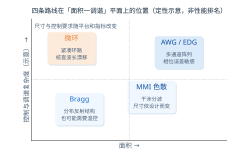
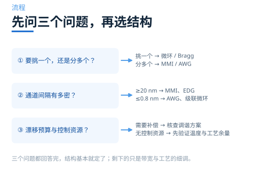

# 选波该选什么？把 Q、带宽、面积和可调性一起算

> **待审稿**：本文处于独立 PR 审核阶段，尚未收录为正式内容。定量结论、素材来源与授权仍需指定业内审核者核查。

四个案例讲完，最后要把它们放到同一张桌上。但先说清楚一件事：**这四个案例不构成同条件排名。** 它们的波段、材料、维度、指标口径都不一样，能比较的是机制与代价，不是谁的数字更漂亮。

本篇做三件事：把四个案例的条件摊开，把六个指标横向对照，再给一套能照着走的选型顺序。

## 01　先看条件，再看数字

| 案例 | 结构 | 维度 | 波段 | 本次读数 | 估价 |
| --- | --- | --- | --- | --- | ---: |
| 微环 add-drop | 环 + 两条总线，R=5 μm | 3D FDTD | 1500–1600 nm | FSR 17.6 nm，Q ≈ 1547，drop 峰 99.1% | 6.92 FC |
| 环耦合区 | 直波导 + 截断环段，gap=50 nm | 3D FDTD | 1500–1600 nm | drop 峰 16.1%，源端反射峰约 −46.5 dB | 1.30 FC |
| Bragg 光栅 | 侧壁周期齿，Λ=324 nm | 3D FDTD | 1532 nm 附近 | 阻带 −27.9 dB，−10 dB 带宽 21.6 nm | 0.91 FC |
| 相变 Bragg | Si + Sb2Se3 周期块 | EME | 1450–1550 nm | 阻带移动 19.2 nm（蓝移），1000 周期消光比 >100 dB | 0.47 FC |

最后一列是估价上限；六个任务实付合计 **6.01 FC**，比估价低 37%。

看这张表时要注意三处不可比：

- **完整环与耦合区分别展示整体和局部建模**，且间隙为 100 nm 与 50 nm，不能当作同一器件的直接拆分或互证。
- **Bragg 与相变 Bragg 是两种光栅**，一个靠侧壁齿、一个靠上覆材料块，周期与折射率都不同。
- **相变 Bragg 用 EME，其余用 FDTD**，端口定义与边界处理不同，绝对透射不可直接并列。

## 02　六个指标横向看

| 指标 | 微环 | Bragg | 相变 Bragg | 说明 |
| --- | --- | --- | --- | --- |
| 消光比 | 高（37.9 dB） | 高（−27.9 dB） | 随长度增长（>100 dB） | 三者都能做深，代价不同 |
| 带宽口径 | drop 峰 FWHM 约 1.00 nm | 透射低于 −10 dB 的阻带宽 21.6 nm | 随相态、κ、L 与阈值变化 | 通带半高宽与阻带宽度不能直接排名 |
| FSR | 17.6 nm | 无环路型 FSR | 无环路型 FSR | Bragg 仍需核查其他反射带与旁瓣 |
| 尺寸 | 环直径约 10 μm | 有效光栅长 32.4 μm | 随周期数增长 | 这里报告长度；总面积还需宽度与布线 |
| 调谐 | 本例未加加热器，可另设计 | 本例未加入调谐结构 | 两态光学端点，切换驱动未模拟 | 三者均需核查漂移与控制资源 |
| 工艺敏感点 | 波导宽度、间隙 | 周期、刻蚀深度 | 相变层厚度与结晶度 | 都怕宽度偏差，怕法不同 |

这张表说明规格与机制必须一起看。窄线宽、反射光路和可重构状态分别带来不同的系统约束；本组并未证明某一结构在面积或稳定性上普遍占优。

## 03　三条判断线

把选型压缩成三个问题，顺序不能颠倒。

**第一问：要挑一个，还是分多个？**

挑一个 → 微环、Bragg、相变 Bragg。分多个 → 直接跳到下一期的 MMI / AWG，本期的四个结构都不合适（级联微环可以，但面积与调谐成本会迅速失控）。

**第二问：通道间隔有多密？**

- ≥20 nm（CWDM）：对 Q 要求不高，微环、Bragg 都够用。
- ≤0.8 nm（DWDM）：微环需要高 Q 且逐通道锁温；Bragg 的阻带要足够窄，级联是常态。

**第三问：能不能接受调谐？**

- 能 → 微环最省面积，代价是功耗与控制电路。
- 不能 → 先验证工作温度与工艺偏差下的通带/阻带余量；Bragg 也可能需要温控，不能由结构名称保证波长。
- 要「设定后保持」→ 相变 Bragg，但先确认循环寿命与两态插损。

这些问题用于筛选候选。带宽、插损、回波与工艺容差仍可能改变最终选择。

## 04　什么时候不该用这四个

本期四个结构都有明确的适用边界，越过就该换工具。

**要几十个通道一次分开**：用 AWG 或 EDG。本期没跑，因为官方目录没有对应 Notebook；机制在下一期讲。

**要平顶通带**：单环是洛伦兹型，顶部不平；要么级联多环，要么用 Bragg 反向耦合器设计平顶。

**要极低回波**：Bragg 是反射式，回波是结构性的；改用反向耦合器或加环行器。

**要高速切换**：相变是纳秒到微秒量级，比电光慢几个数量级；这类需求归调制器。

## 05　本期的方法边界

最后把边界写清楚，免得读者把结论用过头。

1. **四个案例的波段不统一**（1550 / 1532 / 1500 nm），材料平台也不完全一致，只能讲机制。
2. **微环只跑了一个半径、一个间隙**，没有扫参数，所以「Q 与 FSR 的关系」是从公式推的，不是从多组仿真拟合的。
3. **耦合区只跑了两种边界、一组几何**，没有扫间隙，κ 的数值没有给出。
4. **Bragg 只跑了一个长度**，κL 曲线是定性讨论。
5. **相变 Bragg 用 EME**，没有时域场演化，也没有 FDTD 对照；两态插损的绝对值不可直接用于系统预算。

这些边界不是缺陷，是「一期讲一件事」的必然结果。把边界写出来，读者才知道哪些结论可以搬到自己身上，哪些只能当参考。

---

*下一期：多个波长怎么一次分开？——从 MMI 的色散自成像讲到逆向设计 WDM，以及为什么工业界的 DWDM 主力是 AWG。*

## 06　给一个能落地的检查顺序

真正开工时，指标之外还有四件事要先确认，顺序不能反。

**第一，先确认波段与材料平台。** 硅、氮化硅、铌酸锂的热光系数与工艺容差差别很大，同一个结构换个平台，Q 与漂移都会变。本期四个案例虽然都在硅基上，但波段横跨 1450–1600 nm，不能直接套用。

**第二，确认工艺能做出的最小间隙。** 微环与耦合区的性能对 gap 极敏感，100 nm 与 50 nm 是两个不同的工艺档位。先问代工厂能做到多少，再定设计点，比先设计再找工艺靠谱。

**第三，确认有没有调谐资源。** 若漂移预算要求主动补偿，加热器、监测和控制环路都要计入功耗、布线与封装。没有资源时，应先验证被动温度和工艺余量；Bragg 也不能跳过这一步。

**第四，确认测试方案。** 微环的 Q 与 FSR 可以从一条谱线读出来，Bragg 的阻带深度需要足够宽的扫描范围，相变器件还需要在两种状态之间切换的驱动。测试方案定不下来，前面的设计都白做。

这四件事确认完，再回到本期的三个判断问题，选型基本不会走偏。
