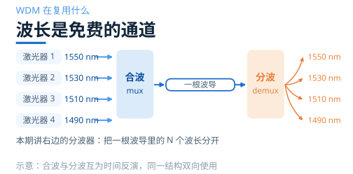
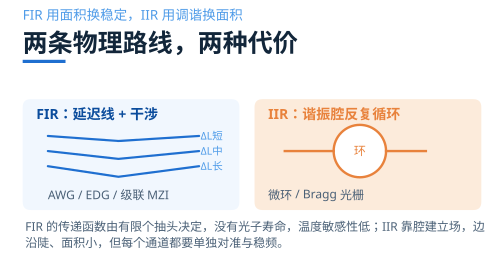
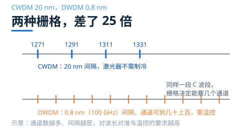
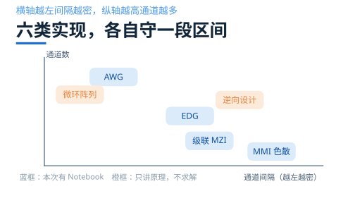

# 多个波长怎么一次分开？

> **待审稿**：本文处于独立 PR 审核阶段，尚未收录为正式内容。定量结论、素材来源与授权仍需指定业内审核者核查。

上一组讲的是「挑一个」：微环和 Bragg 光栅从一片光谱里选出一个波长，其余丢掉或直通。这一组要难一档——一根波导里同时跑着好几个波长，要把它们各自送到对应的出口，一个都不能丢。

这就是波分复用（WDM）里的分波器，也就是解复用器（demux）。它是光通信能把一根光纤的容量翻几十倍的根本原因：不是把光传得更快，而是同时传好几路。

本期两个核心案例都按本次求解结果重绘：MMI 色散自成像，和逆向设计 WDM。AWG 与 EDG 是工业界的主力，但官方没有对应 Notebook，只能讲原理——这一点会在第 3 篇里明确标注。

## 01　滤波与分波，差的不是难度而是端口数

上一组的器件是 1 进 1 出（微环 add-drop 算四口，但一次只处理一个波长）。分波器是 1 进 N 出，这一条就把问题变了性质。

选波只关心「这个波长能不能挑出来」，指标是 Q、消光比、滚降。分波要关心「N 个波长能不能各就各位」，指标变成通道数、通道间隔、串扰、插损、FSR 和面积。同一类结构两种都能做，但设计问题和验收标准不同，所以分两组讲。

最容易混淆的是串扰。它是「别的通道漏进本口的功率」与本通道功率之比，听起来简单，实际上至少有三种算法：只看相邻通道、看所有非相邻通道、或者全部求和。写文章、看数据手册时必须问清是哪一种，否则差 10 dB 很正常。

## 02　两条路线：用面积换稳定，或用调谐换面积

文献把片上 WDM 滤波器分成两类，这个分法比按结构罗列更能解释「为什么它又小又难用」。

**FIR（有限冲激响应）**：把光分到多条路径，路径长度差给出与波长成正比的相位差，再在输出端干涉重组。AWG、EDG、级联 MZI 都属于这一类。它的传递函数由有限个抽头决定，没有谐振腔、不积累光子寿命，原则上对温度不敏感。

**IIR（无限冲激响应）**：靠谐振腔反复循环，只在谐振波长上建立场。微环、Bragg 光栅属于这一类。单个腔就能给出极陡的边沿，面积极小，但每个通道的中心波长都要单独对准、单独稳频。

一句话概括：**FIR 用面积换稳定，IIR 用调谐换面积**。这句话可以直接当选型的起点——如果你的系统没有温控预算，FIR 结构更省心；如果面积是硬约束，就得接受每个通道都要锁波长。

硅的热光系数约 1.8×10⁻⁴/K，对应 0.08–0.1 nm/K 的漂移。这意味着温度变 1 ℃，波长就挪了大约十分之一个纳米。对 20 nm 间隔的 CWDM 还能忍，对 0.8 nm 间隔的 DWDM 就是灾难。

## 03　两种栅格，差了 25 倍

通道间隔不是一个可以随便取的数字，它由标准规定，也决定了能用什么结构。

**CWDM** 用 20 nm 间隔，O 波段常见的四波是 1271 / 1291 / 1311 / 1331 nm。间隔宽，激光器不需要制冷，成本低，是数据中心短距的主力。

**DWDM** 用 ITU-T G.694.1 栅格，C 波段 100 GHz（约 0.8 nm）或 50 GHz（约 0.4 nm）。间隔密，通道数可以做到几十上百，但需要温控与精确对准。

这个差别直接决定结构选型：20 nm 间隔用 MMI、EDG 或级联 MZI 就够；0.8 nm 间隔基本只有 AWG 和级联微环能打。本期两个案例恰好落在这条线的两端——MMI 是 1.55 / 2.0 μm 的双波长（间隔 450 nm），逆向设计是 20 nm 间隔的四通道。

## 04　六类实现，本期只做两个

把常见的六类实现按「通道间隔」和「通道数」两个轴摆开，各自的舒适区很清楚。

本期只求解两个：

- **MMI 色散自成像**：1.55 / 2.0 μm 双波长，MMI 宽 6 μm、长 287 μm。只跑 EME（本征模展开），不跑原 Notebook 的 3D FDTD 段——那一段估价 67.7 FC，是前几期任何单期总花费的两倍以上。
- **逆向设计 WDM**：4 通道、1270 / 1290 / 1310 / 1330 nm，设计区 4.5×4.5 μm，2D，完整跑 50 步伴随优化。

原计划的第三个案例是「工艺感知逆向设计」，需要 PreFab 账号做虚拟制造。本次开工前确认本机没有可用授权，按预案取消，本期由 6 篇压到 5 篇，该案例只在综述里点名。

## 05　本期的证据边界

三件事先说清楚，后面的文章不再重复。

第一，**AWG 与 EDG 没有本次仿真**。官方目录里没有对应 Notebook，所以第 3 篇只能给机制、公式和量级，不能出图、不能给读数。文中会逐段标注「机制说明，非本次仿真」。

第二，**两个核心案例不可互相排名**。MMI 是 3D 肋波导、双波长、间隔 450 nm；逆向设计是 2D、四通道、间隔 20 nm。波段、维度、指标口径都不同，只能各自讲机制与适用条件。

第三，**MMI 的端口命名与 Notebook 正文相反**。本次 EME 复算给出 1.55 μm 从与输入同侧的口输出、2.0 μm 从对侧口输出；官方 Notebook 的文字把 2 μm 的出口写作 top。两者的对比度与插损量级一致（约 20 dB、小于 2 dB），第 2 篇会把这个差异写清楚，并以本次复算的端口为准。

下一篇从 MMI 开始：一块没有任何周期结构的方块，凭什么能把两个波长分开。
