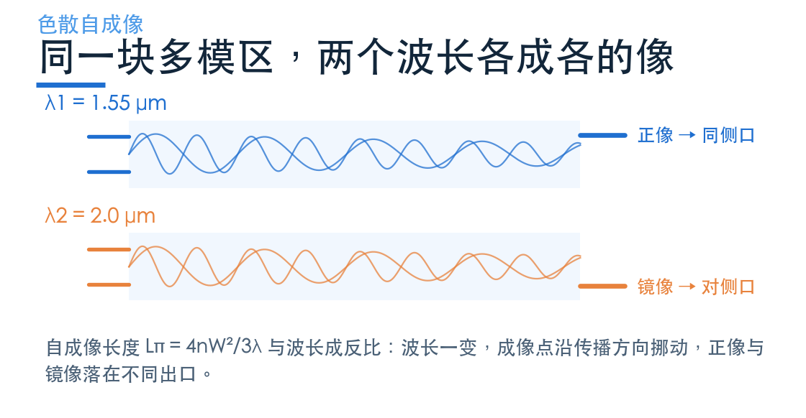
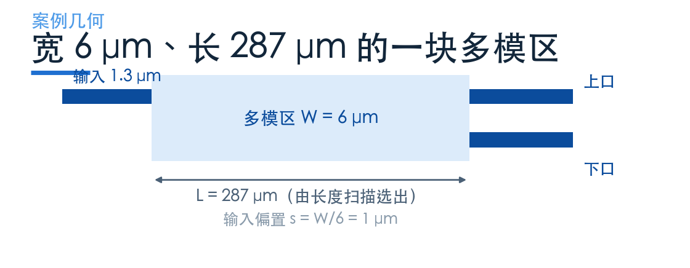
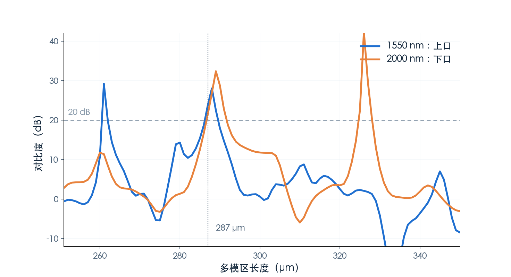
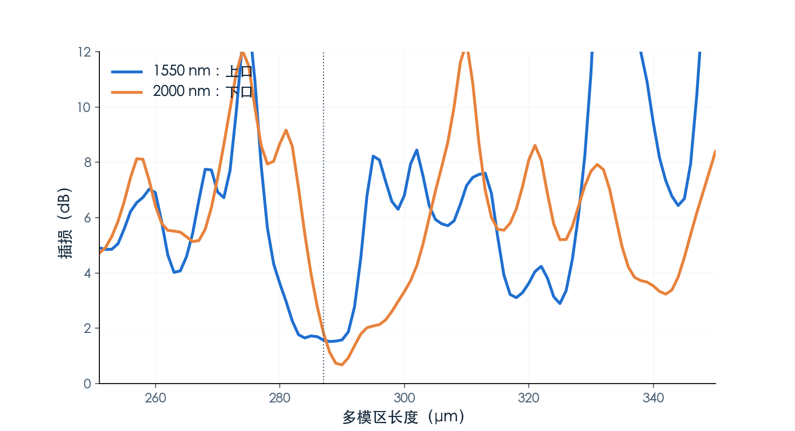

# 一块方块，怎么把两个波长分开？

> **待审稿**：本文处于独立 PR 审核阶段，尚未收录为正式内容。定量结论、素材来源与授权仍需指定业内审核者核查。

MMI 分波器看起来不像分波器。它没有光栅、没有环、没有周期结构，只是一块宽 6 μm、长 287 μm 的矩形多模区，左边一个输入波导，右边两个输出波导。

它的分波能力来自一个纯几何的效应：**自成像长度与波长成反比**。同一块方块，对两个波长来说「成像点」的位置不一样，把输出波导放在各自成像点上，就分开了。

本篇用官方 `MultiplexingMMI` 案例，按本次 EME 求解结果讲三件事：自成像怎么定长度，长度扫描怎么选设计点，以及为什么这个案例只跑 EME 不跑 FDTD。

## 01　自成像：光在方块里自己「照」出自己

光从窄波导进入宽多模区，会激励出许多个模式。这些模式的传播常数不同，走同样的距离积累的相位就不同，于是沿传播方向出现周期性的场分布。

在一个特定长度上，这些模式重新同相，场的横向分布回到入射时的形状——这就是「自成像」。这个长度写作

Lπ = 4·n·W² / (3·λ)

W 是多模区宽度，n 是区内的折射率，λ 是波长。式子里的 λ 在分母上，所以**波长越长，成像长度越短**。

分波就利用这一点：把输出波导放在某个长度上，让一个波长在这里成「正像」（回到输入同侧），另一个波长成「镜像」（翻到对侧）。两个波长各走各的口。

## 02　几何：偏置 1 μm 是关键

案例的几何很简洁：输入与输出波导都是 1.3 μm 宽，多模区宽 6 μm，输入横向偏置 s = W/6 = 1 μm，输出分别在 ±s。

为什么要偏置？如果输入放在正中间，激发的模式是对称的，成像点会落在中间，两个输出口都接不到。偏到 W/6 处，激发的模式组合才在两侧形成可用的像。

287 μm 这个长度不是算出来的，是扫出来的。原 Notebook 在 251–350 μm 之间扫了 100 个长度，看哪个长度上两个波长的对比度同时够高、插损同时够低。本次求解把这 100 个点一次性算完。

## 03　长度扫描：287 μm 上两条曲线同时过线

EME（本征模展开）求解给的是 S 参数。把输出监视器的模式作为基，取 |S21|² 就是透射率。

对比度定义为「目标口透射 / 另一口透射」，用 dB 表示。下图是 100 个长度上两个波长的对比度。

曲线的形状值得注意：对比度不是平顶，而是一串尖峰。峰与峰之间的间隔对应自成像长度的变化周期——长度差半个成像周期，正像与镜像就互换，对比度翻负。

这也解释了 MMI 分波的一个现实问题：**它对长度非常敏感**。287 μm 附近 ±5 μm 就能让对比度掉 10 dB 以上，制造误差必须控制在微米级。这是色散型器件的通病，也是工业界更愿意用 AWG 的原因之一。

## 04　插损：两个波长都在 2 dB 以内

同一组扫描的插损（−10log10 目标口透射）如下。

设计点（287 μm）的完整读数：

| 波长 | 上口（y = +1 μm） | 下口（y = −1 μm） | 对比度 |
| --- | --- | --- | --- |
| 1.55 μm | 69.6%（1.57 dB） | 0.29%（25.4 dB） | 23.9 dB |
| 2.0 μm | 0.45%（23.4 dB） | 65.5%（1.84 dB） | 21.6 dB |

两个波长的插损都压在 2 dB 以内，对比度都超过 21 dB，与 Notebook 正文声称的「约 20 dB 对比度、小于 2 dB 插损」吻合。

**一处必须写明的差异**：官方 Notebook 的文字说 2 μm 主要从上口输出，本次 EME 复算的结果是 2 μm 从下口输出、1.55 μm 从上口输出。端口命名相反，但对比度与插损量级一致，说明物理没算错，只是文字与监视器命名的对应关系可能有误。本文以本次复算的端口为准。

## 05　为什么只跑 EME

原 Notebook 分两段：先用 EME 扫 100 个长度找最优点，再用 3D FDTD 验证。第二段的估价是 **67.7 FC**，而本期全部预算不到 6 FC。

不跑 FDTD 的理由不是省钱，而是它在这篇文章里没有增量信息：FDTD 段的作用是验证 EME 扫出的长度，属于方法自检；而本文要讲的机制（自成像、长度敏感、双波长分离）EME 的 S 参数已经足够。

代价是拿不到时域场演化，也没有场分布图。本期尝试过自建 2D 等效折射率模型补场图，但模型用固定折射率时两个波长看到完全相同的结构，物理上不可能分波，最终没有采用——与其放一张会误导的场图，不如不放。这一条记在 ADR 0003 里。

## 06　这个案例教会我们什么

三句话。

**第一，分波不一定需要周期结构。** 色散本身就是一种「按波长排队」的机制，MMI 只是把它做在了一块矩形里。

**第二，色散型器件的带宽与长度是一对矛盾。** 想分开间隔很近的两个波长，就得让成像长度差足够大，也就是器件要够长；器件越长，长度误差的绝对容差越难保证。

**第三，双通道是 MMI 的舒适区。** 通道数再多就要级联，面积和损耗都会上去。所以工业界的 CWDM 用 MMI 或 EDG，DWDM 用 AWG——不是 MMI 不好，是它守的那段区间就那么大。

下一篇换一条完全不同的路：不写几何，只写目标函数，让算法自己找出结构。

案例页：[MMI NIR/MIR demultiplexer](https://www.lingcompute.com/photon/learning-center/examples/notebooks/MultiplexingMMI)。想自己跑一遍，可以从[国内产品入口](https://tidy3d.fangzhen.cloud/)注册后进入案例库。
