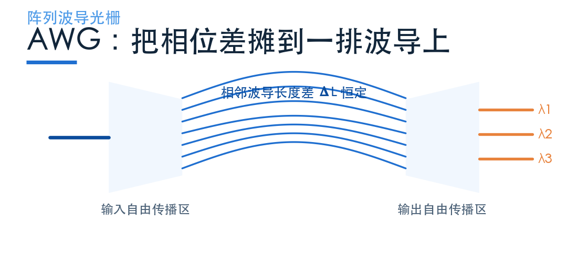
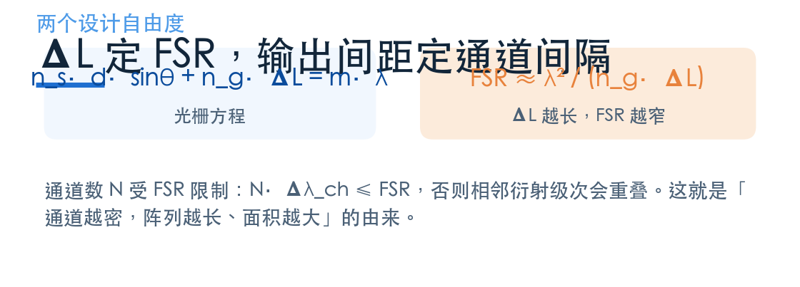
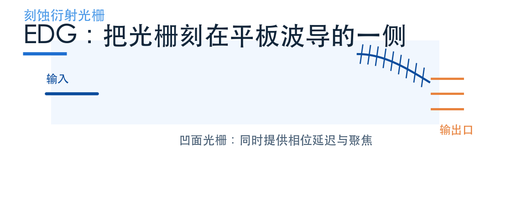
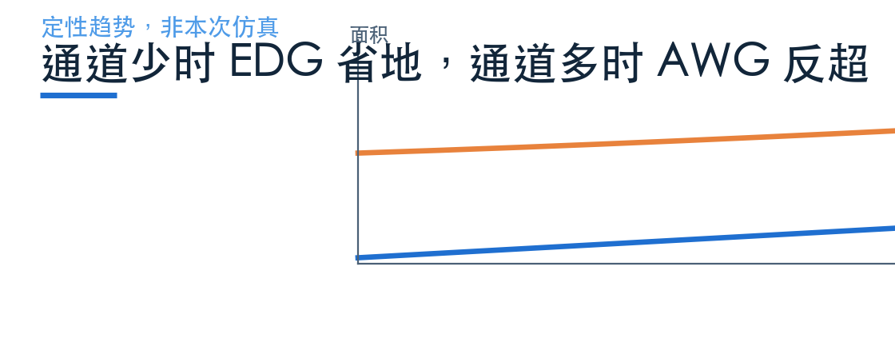

# 工业界为什么用阵列波导光栅？

> **待审稿**：本文处于独立 PR 审核阶段，尚未收录为正式内容。定量结论、素材来源与授权仍需指定业内审核者核查。

前一篇的 MMI 只分两个波长，间隔 450 nm，器件 287 μm 长。真实的 DWDM 系统要分 40 个通道、间隔 0.8 nm——这时 MMI 就不够用了。

工业界的主力是 **AWG（阵列波导光栅）** 和 **EDG（刻蚀衍射光栅）**。这一篇讲它们的机制、公式和设计取舍。

**先说明证据边界：官方案例库里没有 AWG 与 EDG 的 Notebook，本篇全部是机制说明，不是本次仿真。** 文中出现的所有数字都是文献量级，不能当作本项目的求解结果，也不与前面 MMI 的读数比较。

## 01　AWG：把相位差摊到一排波导上

AWG 的结构可以拆成五段：输入波导 → 输入自由传播区（星形耦合器）→ 一排长度递增的阵列波导 → 输出自由传播区 → N 条输出波导。

关键是那排阵列波导。相邻两条的长度差 ΔL 是恒定的，于是同一个波长经过相邻波导时，相位差是 `2π·n_g·ΔL/λ`——只与波长有关。

不同波长积累的相位不同，在输出自由传播区里汇聚的位置就不同：聚焦点沿一条弧线平移，输出波导阵列正好各接住一个波长。

## 02　两个设计自由度：ΔL 定 FSR，输出间距定间隔

AWG 的设计可以归结为一个光栅方程：

`n_s·d·sinθ + n_g·ΔL = m·λ`

其中 d 是阵列波导间距，θ 是衍射角，m 是衍射级次。这个式子说明两件事。

**第一，ΔL 决定自由光谱范围（FSR）**：`FSR ≈ λ²/(n_g·ΔL)`。ΔL 越长，FSR 越窄。而通道数 N 受 FSR 限制——`N·Δλ_ch ≤ FSR`，否则相邻衍射级次会重叠，通道之间互相串。

**第二，输出波导的间距（配合自由传播区的色散）决定通道间隔**。设计上通常取 `Δλ_ch = FSR/N`，让 N 个通道正好铺满一个 FSR。

这两条一联立，就能看出 AWG 的代价结构：通道越密（Δλ 越小），要么 N 变小，要么 FSR 变大，而 FSR 变大就要 ΔL 变短——ΔL 变短又会让阵列波导的相位误差更难控制。所以密间隔的 AWG 天然是「又长又难做」的器件。

## 03　EDG：把光栅刻在平板波导的一侧

EDG 走的是另一条路。它不用一排波导，而是在一块平板波导的一侧刻出凹面光栅：光栅面同时提供相位延迟和聚焦。

光进入平板后发散，打到凹面光栅上被反射并聚焦。不同波长的衍射角不同，于是落在输出端的不同的位置。

与 AWG 相比，EDG 的差别在色散机制：平板波导的色散与群折射率比阵列波导低，所以同样 FSR 需要更大的延迟长度。但通道少的时候，它省掉了整排阵列波导，面积反而更小。

代价是工艺：凹面光栅需要高质量深刻蚀，对平板厚度变化很敏感。

还有一个常被忽略的差别：AWG 的相位误差来自阵列波导的长度与宽度，EDG 的相位误差来自光栅齿的位置与平板厚度。前者可以用后修调（比如紫外调谐）逐个波导修正，后者只能整片控制。这也是 AWG 在通道数上走得更远的原因之一。

## 04　谁更省地，取决于通道数

把两者的面积随通道数的走向画在一起，会出现一个交叉点。

这解释了工业界的实际选择：**CWDM（通道少、间隔大）用 EDG 或 MMI，DWDM（通道多、间隔密）用 AWG**。不是哪个技术更先进，是各自守的区间不同。

## 05　没有 Notebook，读者怎么自己验证

官方案例库没有 AWG/EDG 的 Notebook，这是本期的一个硬约束。想自己动手，有三条路。

**第一条，用 MMI 级联。** 把两个 MMI 分波器串起来，可以做四通道。这不是 AWG，但能让你亲手体会「通道数上去以后，面积和损耗怎么变」。

**第二条，用逆向设计替代。** 下一篇要讲的案例就是四通道 WDM，虽然结构不是 AWG，但目标函数、通道间隔、串扰这些概念完全一样。理解了目标函数怎么约束串扰，再回头看 AWG 的 ΔL 设计会更容易。

**第三条，按光栅方程手算。** 给定 λ、n_g、ΔL，能算出 FSR；给定 N，能算出需要的 ΔL 上限。这是设计 AWG 的第一步，纸笔就能做。

## 06　这一篇的结论

**AWG 与 EDG 的价值在于通道数。** 它们的机制决定了可以做到几十个通道，而 MMI 的双通道、级联 MZI 的四通道都到不了这个量级。

**它们的代价在于相位精度。** 通道越密，对 ΔL 的制造误差、对温度漂移越敏感。这也是为什么 DWDM 系统几乎都要温控。

**没有仿真不等于不能讲。** 机制、公式、量级是文献共识，可以讲；具体读数必须来自自己的求解，不能借。这条界线在本系列里一直没变。

下一篇换方法维度：不预设结构，把「第 i 个波长去第 i 个口」直接写成目标函数，让伴随法去搜。

延伸阅读：[灵算光子学习中心案例库](https://www.lingcompute.com/photon/learning-center/example-library) 里有 MMI 分波的完整案例，可以对照本篇的机制说明自己跑一遍。注册入口在[这里](https://tidy3d.fangzhen.cloud/)。
