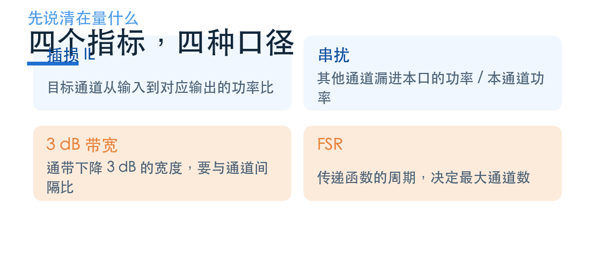
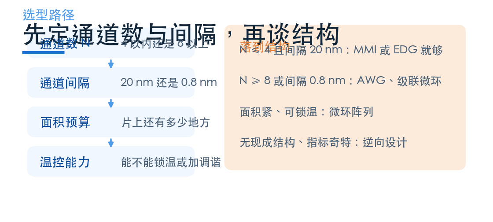

# 分波器怎么选：五条约束的联立

> **待审稿**：本文处于独立 PR 审核阶段，尚未收录为正式内容。定量结论、素材来源与授权仍需指定业内审核者核查。

到这一篇，分波的三条路都走完了：MMI 靠色散自成像，AWG/EDG 靠阵列相位差，逆向设计靠目标函数。它们不是替代关系，而是各自守一段区间。

选型难的地方在于，五个指标互相牵制：通道数上去，间隔就得放宽；间隔收紧，面积和温控成本就上来；想省面积，可制造性又会变差。没有单指标最优的器件。

## 01　五个指标，五种口径

先把要量的东西说清楚。分波器的指标比选波器多，而且每个都有坑。

**插损（IL）**：目标通道从输入到对应输出的功率比。坑在于是否含输入输出弯曲引线、是否归一化到源功率。

**串扰**：其他通道漏进本口的功率与本通道功率之比。坑最大——相邻、非相邻、全部求和是三个不同的数，单侧还是全空间也要写明。

**3 dB 带宽**：通带内透射下降 3 dB 的宽度。它必须与通道间隔一起看：带宽/间隔的比值决定滚降，只报绝对值没有意义。

**FSR**：传递函数的周期，决定可用的最大通道数。FSR 小于通道数×间隔时会发生级次重叠。

另有两个工程指标：偏振相关损耗（PDL）与温度漂移（nm/K）。硅的温漂约 0.08–0.1 nm/K，对 20 nm 间隔的 CWDM 还能忍，对 0.8 nm 间隔的 DWDM 必须锁温。

## 02　三条路线的定位

把本期涉及的三条路线放在同一张表里，只看各自的能力边界，不做优劣排名。

| | MMI 色散 | AWG / EDG | 逆向设计 |
| --- | --- | --- | --- |
| 通道数 | 2（更多要级联） | 8–64 | 案例为 4，可扩 |
| 通道间隔 | 本例 450 nm | 0.8–20 nm | 本例 20 nm |
| 长度尺度 | 287 μm | 数百 μm 至 mm | 4.5 μm 设计区 |
| 温控需求 | 中（长度敏感） | 高（相位敏感） | 取决于结构 |
| 可制造性 | 结构简单、容差紧 | 工艺成熟 | 需最小尺寸约束 |
| 本次证据 | EME 100 点扫描 | 无 Notebook，只讲原理 | 完整 50 步优化 |

这张表最该注意的不是数字，是最后一行的差别：**三条路线的证据强度不一样**。MMI 有 100 个长度的扫描数据，逆向设计有一次完整的优化运行，AWG/EDG 只有文献量级。所以本文不给三者排名，只给适用条件。

## 03　为什么不能排名

跨案例排名的诱惑很大，但这里有三道硬障碍。

**波段不同。** MMI 是 1.55 与 2.0 μm，逆向设计是 1270–1330 nm。材料色散、波导尺寸、工艺窗口都不一样。

**维度不同。** MMI 是 3D 肋波导的 EME 计算，逆向设计是 2D 模型。2D 忽略了垂直方向的模场，绝对值天然偏乐观。

**口径不同。** MMI 的插损是「单个输出波导基模」下的 −10log10|S21|²；逆向设计的插损是通道带宽内 5 点平均的功率比。两者的参考面、模式分解方式都不同。

这三条任何一条成立，排名就没有意义；三条同时成立，排名只是数字游戏。

## 04　选型顺序：先定约束，再定结构

实际工程里，选型不是「哪个性能好选哪个」，而是「哪个约束最先卡住」。

**第一步，通道数。** 4 个以内，MMI 级联或 EDG 就够；8 个以上，基本只有 AWG 与级联微环能打。

**第二步，通道间隔。** 20 nm 的 CWDM 可以选色散型器件；0.8 nm 的 DWDM 必须选相位型（AWG）或高 Q 谐振型（微环阵列）。

**第三步，面积预算。** 片上还有多少地方，决定了能不能放 AWG 的阵列波导。通道数越多，AWG 越长。

**第四步，温控能力。** 能不能锁温、能不能加调谐，决定了能不能用对温度敏感的器件。

**第五步，才轮到结构。** 前四步定完，可选的其实只剩一两个。

## 05　本期的三条结论

**第一，色散型器件的舒适区是「少通道、宽间隔」。** MMI 用一块矩形就能分两个波长，插损 1.6–1.8 dB、对比度 21–24 dB，代价是长度容差只有几微米。

**第二，通道数上去以后，代价从「精度」转到「面积与温控」。** AWG 能分几十个通道，但阵列波导的长度误差、芯片的温度梯度都会直接变成串扰。这也是为什么 DWDM 系统几乎都要温控。换句话说，密分波不是设计问题，是热管理问题——通道间隔越密，对温控精度的要求越高。

**第三，逆向设计改变的是「怎么找结构」，不是「物理极限」。** 它能在一个 4.5 μm 见方的设计区里找出一个满足四通道分离的结构，平均插损 0.37 dB、最差串扰 −18.26 dB。但 2D 模型、单次优化、演示尺度的设计区，这三条限制决定了它现在还是「方法演示」，不是「可量产的器件」。

## 06　下一组：换一个维度

波长是用频率给光贴标签。下一组换两个维度：模式（同一根波导里跑几个正交模式）和偏振（TE 与 TM）。

物理机制完全不同——模式靠正交性与相位匹配，偏振靠双折射或绝热演化——但器件要回答的问题是同一个：**怎么给光贴标签，再按标签送到不同口**。

下一期先讲模式复用。

案例索引：[灵算光子学习中心案例库](https://www.lingcompute.com/photon/learning-center/example-library)。想跑通一个入门案例，可以从[国内产品入口](https://tidy3d.fangzhen.cloud/)注册后进入。
